# WORKFLOW — SAKIP LLDIKTI Wilayah XVI

> **Klarifikasi final LLDIKTI Wilayah XVI — 24 September 2026**  
> Bagian ini adalah kontrak terbaru dan **menggantikan keputusan Q31 atau teks lama yang bertentangan**. Role bawaan SAKIP berjumlah **lima**: `superadmin`, `admin`, `perencanaan`, `pimpinan`, `pegawai`. **PIC bukan role sistem**; PIC adalah konteks operasional yang dibentuk oleh penugasan dan grant unit. Detail keputusan dicatat sebagai **Q32** pada dokumen Keputusan Penyelarasan.


---


> **Q32 aktif:** role final hanya lima. Setiap label PIC pada diagram berarti PIC operasional (assignment/grant/business guard), bukan role database.

## 1. Alur Penggunaan Utama End-to-End (Fase Awal)

> **Q39–Q51 (13 Oktober 2026):** alur di bawah diselaraskan dengan Q39–Q51: target Renstra diisi di Sasaran & Indikator sebagai pembanding, sedangkan baseline dan target PK diisi di halaman PK (Q39); PK dapat direvisi sebagai versi baru (Q40, tahap 3); Rencana Aksi disusun sejak jadwal aktif sampai penutupan tanpa jendela penyusunan, dengan kunci per triwulan bagi PIC (Q41); kegiatan beranggaran ditambahkan dari halaman Rencana Aksi dan RAB wajib untuk anggaran lebih dari 0 (Q42); kewajiban alasan dipersempit (Q43); saklar unggahan dan penanda `tidak_dapat_dipenuhi` akibat unggahan dimatikan tidak berlaku lagi (Q44); narasi pengukuran wajib dan Rekomendasi Pimpinan diisi Pimpinan (Q45); TW III 2026 menjadi periode lampau (Q46); indikator dinilai tahunan boleh tanpa target periode dan realisasi dapat berstatus "belum dapat diukur" (Q47, §24); Rencana Aksi tahunan dan Laporan Kinerja Triwulan dibuat dari SAKIP lalu PDF bertanda tangannya diunggah kembali (Q48, §25); nama kegiatan hingga 500 karakter, tujuan opsional, dan kegiatan dapat disalin ke periode lain (Q49); nomor PK opsional, target PK bernilai penuh, dan kode indikator mengikuti PK (Q50); Rekomendasi Pimpinan disusun sebagai draf oleh Perencanaan dan berlaku setelah disetujui Pimpinan (Q51, §17). Langkah yang berubah diberi rujukan Q-nya. Status implementasi Q39–Q51: belum.

Diagram berikut menggambarkan urutan penuh dari login hingga dashboard terupdate, termasuk pengelolaan dokumen dasar (`regulasi` beserta lampirannya, lampiran Renstra dan Perjanjian Kinerja), tahap penyusunan rencana aksi, kegiatan, klaim kegiatan, bukti dukung tiga mode (file/tautan/teks) pada tiap induk lampiran, dan pengukuran berbasis komponen yang disisip di antara penugasan Penanggung Jawab dan pengisian pengukuran.

```
👤 Pengguna
  1. Buka aplikasi SAKIP → diarahkan ke Keycloak (OIDC Authorization Code Flow)
  2. Login dengan kredensial masing-masing
     → Gagal: kembali ke halaman login
     → Berhasil: sistem callback, mapping keycloak_id ke user lokal, sesi Laravel terbentuk

📋 Perencanaan / ⚙️ Superadmin
  3. Mencatat dokumen dasar (regulasi): jenis (kepmen/permen/perpres/keputusan_lainnya), nomor,
     tahun, tentang, tanggal, tautan_sumber — dapat melampirkan dokumen regulasi (mode file/
     tautan/teks) sebagai bukti fisik dasar aturan — lihat §3

📋 Perencanaan
  4. Menyusun Renstra baru: nama, dasar_hukum (ringkasan), rentang tahun, merujuk regulasi_id
     (opsional) sebagai dasar aturan terstruktur
  5. Melampirkan dokumen Renstra (mode file/tautan/teks) — lihat §3
  6. Menyusun Sasaran dan Indikator di bawah Renstra tersebut — tiap indikator diberi unit pemilik,
     arah penilaian (naik_baik/turun_baik), tipe_perhitungan (rasio_persen/penjumlahan/manual),
     dan regulasi_id (opsional) sebagai dasar aturan per indikator
     → Kode sasaran dan indikator mengikuti PK, Rencana Aksi, dan laporan triwulan (S1–S4,
       IKU 1.1–4.1); nomor IKU Renstra (IKU 1–8) dicatat pada definisi operasional (Q50 §50.4)
     → Indikator yang nilainya baru tersedia pada periode nilai akhir ditandai "Dinilai
       tahunan" (indikator.dinilai_tahunan, Q47 §47.1) — lihat §24
  7. Untuk indikator bertipe rasio_persen/penjumlahan, mendefinisikan indikator_komponen
     (kode, label, peran, bobot) — lihat §6
  8. Mengisi target Renstra per tahun (setiap tahun dalam rentang Renstra) untuk tiap indikator
     di halaman Sasaran & Indikator — pembanding target PK, tidak dipakai menghitung capaian
     (Q39)
  9. Mencatat Perjanjian Kinerja (renstra_pk) untuk tahun berjalan: nomor_pk (opsional, Q50),
     tanggal_pk, serta baseline dan target PK tiap indikator aktif di halaman PK, disimpan pada
     target_tahunan (Q39; lihat §3.3) — target PK bernilai penuh dan baseline tampil sebagai
     data pendukung, bukan isi dokumen PK (Q50 §50.2–§50.3)
     → Target PK di bawah target Renstra tahun yang sama (naik_baik; di atasnya untuk
       turun_baik): sistem menampilkan PERINGATAN dan MEWAJIBKAN alasan — tidak memblokir
  10. Melampirkan dokumen Perjanjian Kinerja (mode file/tautan/teks) pada renstra_pk tahun
      berjalan — lihat §3
  11. Mengaktifkan Renstra
     → Validasi gagal (dasar_hukum kosong atau beririsan dengan Renstra aktif lain): kembali ke
       langkah 4
     → Validasi lolos: Renstra berstatus AKTIF
  12. Membuat Jadwal Tahunan yang merujuk Renstra X, Tahun Y → status: draft
  13. Menyusun daftar Periode yang diharapkan tahun ini (jadwal_periode) beserta jendela
      pengisian dan reviu masing-masing periode (mis. Triwulan I–IV)
  14. [Digantikan Q41] Jendela penyusunan rencana aksi tingkat tahun (rencana_aksi_mulai,
      rencana_aksi_selesai) tidak lagi diisi — Rencana Aksi dapat disusun sejak jadwal aktif
      sampai penutupan (§4)
  15. Mengaktifkan Jadwal Tahunan
     → Gerbang 1 gagal (renstra_pk tahun Y belum tercatat): kembali ke langkah 9
     → Gerbang 2 gagal (ada indikator aktif tanpa target PK tahun Y, Q39): kembali ke langkah 9
     → Gerbang 3 gagal (tahun Y di luar rentang tahun Renstra): kembali ke langkah 12
     → Gerbang 4 gagal (renstra_pk tahun Y belum memiliki minimal satu lampiran dokumen):
       kembali ke langkah 10 — mode lampiran bebas (file/tautan/teks) dan unggahan file selalu
       aktif (Q44), sehingga gerbang ini tidak memacetkan alur; penanda tidak_dapat_dipenuhi
       akibat unggahan dimatikan tidak lagi terjadi (lihat §10.5)
     → Seluruh gerbang lolos: Jadwal AKTIF, sistem membuat jadwal_snapshot (termasuk
       jadwal_snapshot_komponen untuk indikator berkomponen) untuk setiap pasangan
       (jadwal, indikator) yang belum punya baris

📋 Perencanaan / ⚙️ Superadmin
  16. Menugaskan Penanggung Jawab per indikator (form tanpa isian alasan, Q43 §43.3 butir 4)
  16a. Menetapkan persyaratan bukti dukung (jenis_berkas) di menu Persyaratan Berkas (grup
       Perencanaan Kinerja, Q44) untuk tiap tahap yang relevan (rencana_aksi/pengukuran/
       kegiatan_perencanaan/kegiatan — tahap kegiatan_perencanaan baru, Q42): nama, tahap, mode
       yang diizinkan (file/tautan/teks), wajib/opsional, semua_mode_wajib, format/ukuran per
       persyaratan (Q44), penanda hanya_kegiatan_beranggaran untuk RAB, dan contoh berkas bila
       perlu (mis. contoh RAB) (Q42) — lihat §10

🎯 Penanggung Jawab / PIC operasional
   [Q32] PIC bukan role. User aktif yang ditetapkan sebagai PJ tetap membutuhkan Grant Unit yang cocok untuk melakukan pekerjaan scoped.
  17. Menyusun Rencana Aksi untuk indikator × tahun miliknya, sejak jadwal tahun tsb aktif
      sampai penutupan (Q41): mengisi target per periode per komponen (kumulatif) dan daftar
      kegiatan per periode — "Tambah kegiatan" membuat kegiatan beranggaran (rupiah, ≥ 0, wajib
      diisi) sekaligus klaimnya ke RA dengan sumber_klaim = rencana_aksi (Q42); sistem
      menampilkan perkiraan skor hasil hitungan komponen
     → Periode yang pengisian_selesai-nya sudah lewat TERKUNCI bagi PIC: target dan daftar
       kegiatan periode itu tidak dapat diubah (ditolak 422, diaudit); Perencanaan dikecualikan
       sampai penutupan; kunci mengikuti pengisian_selesai yang berlaku, termasuk perpanjangan
       resmi jendela pengisian (Q41 §41.2, Q18)
     → Indikator dinilai tahunan (menurut snapshot): target periode sebelum periode nilai akhir
       boleh kosong = tidak ditargetkan, berbeda dari target 0 (Q47 §47.2, §24)
     → Kegiatan yang ditambahkan dapat disalin ke periode lain yang belum terkunci pada RA yang
       sama; nama kegiatan hingga 500 karakter dan tujuan opsional (Q49)
     → Nilai suatu periode lebih kecil dari periode sebelumnya: sistem menampilkan PERINGATAN
       (tidak memblokir)
     → Total target komponen periode terakhir tidak setara target PK tahunan: sistem
       menampilkan PERINGATAN dan MEWAJIBKAN alasan saat pengajuan
  18. Melengkapi bukti dukung wajib bertahap rencana_aksi (jenis_berkas.tahap = rencana_aksi),
      memilih salah satu atau kombinasi mode yang diizinkan (unggah file, isi tautan, tulis
      keterangan teks) sebelum mengajukan, serta persyaratan tahap kegiatan_perencanaan untuk
      setiap kegiatan yang diklaim pada tahap RA — RAB (Excel/PDF) wajib untuk kegiatan
      beranggaran lebih dari 0 (Q42)
  19. Mengajukan Rencana Aksi → Status: diajukan
     → Ada komponen aktif tanpa target pada salah satu periode yang diharapkan: pengajuan
       DITOLAK, kembali lengkapi target — kecuali periode sebelum periode nilai akhir pada
       indikator dinilai tahunan (Q47 §47.2)
     → Bukti dukung wajib tahap rencana_aksi belum lengkap (sesuai mode yang dipilih dan aturan
       semua_mode_wajib): pengajuan DITOLAK
     → Belum ada minimal satu kegiatan yang diklaim pada tahap RA: pengajuan DITOLAK (Q42)
     → Persyaratan wajib tahap kegiatan_perencanaan (mis. RAB) belum lengkap untuk salah satu
       kegiatan yang diklaim pada tahap RA: pengajuan DITOLAK (Q42)
     → Gerbang kegiatan minimal dan RAB DIKECUALIKAN untuk RA 2026 data awal; gerbang baru
       Q42–Q45 dikecualikan untuk periode lampau, sedangkan kunci per triwulan bukan bagian
       pengecualian itu — periode lampau terkunci bagi PIC sejak aktivasi (Q46 §46.1 butir 1,
       §15)

📋 Perencanaan
  20. Memverifikasi Rencana Aksi yang diajukan
     → Ditolak, perlu revisi: Status: dikembalikan + alasan wajib, kembali ke Penanggung Jawab
       (langkah 17)
     → Disetujui teknis: Status: diverifikasi
  21. Mengesahkan Rencana Aksi → Status: disahkan

🎯 Penanggung Jawab (PIC) / 📋 Perencanaan
  22. Kegiatan per periode (unit pemilik, rencana pelaksanaan, anggaran) sudah disusun di
      halaman Rencana Aksi (langkah 17, Q42); kegiatan tambahan — termasuk kegiatan lanjutan
      dari kegiatan yang ditunda — diklaim pada tahap pengukuran (langkah 25)
  23. Klaim kegiatan terhadap Rencana Aksi menyatakan kegiatan mana yang mendukung rencana
      aksi/indikator dan komponen mana yang terdampak (menambah/mengurangi) — klaim dibuat saat
      penyusunan RA lewat "Tambah kegiatan" (sumber_klaim = rencana_aksi, Q42) maupun saat
      pengisian pengukuran (sumber_klaim = pengukuran, langkah 25)
  23a. Melaksanakan kegiatan sesuai rencana, lalu memperbarui status — status dapat diperbarui
       sepanjang periode berjalan, mis. setiap bulan (Q45):
     a. Terlaksana sesuai rencana: melengkapi bukti dukung wajib bertahap kegiatan
        (jenis_berkas.tahap = kegiatan — mis. daftar hadir, laporan, dokumentasi, dalam mode
        file/tautan/teks sesuai yang diizinkan), lalu mengubah Status → terlaksana
        → GERBANG: ada bukti dukung wajib bertahap kegiatan yang belum terpenuhi → transisi
          ke terlaksana DITOLAK
     b. Tidak terlaksana / ditunda / dibatalkan: Status → tidak_terlaksana / ditunda / batal,
        WAJIB mengisi justifikasi (ditunda: beserta periode tujuan, Q41) — TIDAK memerlukan
        bukti dukung pelaksanaan, kegiatan TIDAK DIHAPUS
  23b. Kegiatan yang ditunda: sistem membuat kegiatan lanjutan pada periode tujuan dengan
       kegiatan_asal_id menunjuk kegiatan asal dan anggaran disalin dari kegiatan asal (Q42
       §42.2 butir 6); kegiatan lanjutan diklaim ke RA pada tahap pengukuran (sumber_klaim =
       pengukuran) — RA yang sudah disahkan tidak dibuka kembali hanya untuk memindahkan
       kegiatan (Q41)

🎯 Penanggung Jawab (PIC, akses pengukuran:create/update di-scope per unit)
   [Q31] Scope unit tetap merupakan bagian penting jalur operasional. Penambahan PIC operasional (bukan role) tidak boleh diartikan sebagai izin global ke seluruh unit/indikator; sumber permission bawaan PIC operasional (bukan role) masih OPEN.
  24. Mengisi nilai tiap komponen aktif untuk periode berjalan, dalam jendela pengisian periode
      (dari jadwal_periode) → Status: Draft. Untuk indikator bertipe rasio_persen/penjumlahan,
      nilai indikator dihitung sistem sebagai turunan dari nilai komponen (read-only)
  24a. Mengisi narasi pengukuran indikator × periode: progres kegiatan, kendala/masalah, dan
       tindak lanjut/strategi penyelesaian (wajib saat diajukan, Q45); bila ada Rekomendasi
       Pimpinan yang disetujui pada periode sebelumnya, mengisi tindak lanjut atas rekomendasi
       tersebut (Q45, Q51); catatan tetap tersedia sebagai keterangan tambahan opsional
  24b. Bila nilai belum tersedia pada periode tsb, menyatakan realisasi "belum dapat diukur"
       (status_perhitungan = belum_dapat_diukur, nilai kosong) dan menjelaskannya pada narasi
       (Q47 §47.4, §24)
  25. Sambil mengisi, dapat menambah klaim kegiatan (sumber_klaim = pengukuran) — termasuk
      kegiatan lanjutan dari kegiatan yang ditunda (Q41); daftar kegiatan yang sudah diklaim
      untuk periode itu tampil sebagai pengingat/pembanding, tanpa mengubah nilai komponen
      secara otomatis
  26. Melengkapi bukti dukung wajib bertahap pengukuran (jenis_berkas.tahap = pengukuran),
      memilih mode yang diizinkan
  27. Mengajukan pengukuran sebelum jendela pengisian periode itu berakhir → Status: Diajukan
      (notifikasi terkirim ke Perencanaan)
     → GERBANG: rencana_aksi (indikator × tahun) belum berstatus disahkan → pengajuan DITOLAK
     → GERBANG: ada komponen aktif bernilai null → pengajuan DITOLAK — dikecualikan bila
       realisasi berstatus belum dapat diukur; pada periode nilai akhir realisasi wajib terisi,
       kecuali tidak dapat dihitung (Q9, Q47 §47.4)
     → GERBANG: bukti dukung wajib tahap pengukuran belum lengkap → pengajuan DITOLAK
     → GERBANG: narasi pengukuran (progres kegiatan, kendala/masalah, tindak lanjut/strategi)
       belum lengkap → pengajuan DITOLAK (Q45)
     → GERBANG: ada Rekomendasi Pimpinan yang disetujui pada periode N, tetapi pengukuran
       periode N+1 belum memuat tindak lanjut atas rekomendasi → pengajuan DITOLAK (Q45 §45.2
       butir 3, Q51; lintas tahun bila indikator masih diukur, Q51 §51.1 butir 4; dibangun
       bersama ISS-09.01 pada tahap 2)
     → Gerbang di atas DIKECUALIKAN untuk periode lampau (§15), termasuk narasi wajib dan
       tindak lanjut rekomendasi (Q46)
     → Jendela pengisian sudah lewat: PIC tidak dapat lagi membuat/mengubah/mengajukan;
       hanya Perencanaan yang masih dapat mengisi (lihat §12), tetap tunduk gerbang di atas

📋 Perencanaan
  28. Memverifikasi pengukuran yang diajukan
      → Realisasi atau narasi sama persis dengan periode sebelumnya: sistem menampilkan
        PERINGATAN — tidak memblokir verifikasi (ketentuan pelengkap pengantar Q47–Q51,
        ISS-08.01)
      → Realisasi berstatus belum dapat diukur: Perencanaan menilai penjelasannya pada narasi
        dan dapat mengembalikan pengukuran bila tidak dapat diterima (Q47 §47.4 butir 2)
      → Ditolak, perlu revisi: Status: Dikembalikan + alasan wajib diisi, kembali ke Penanggung
        Jawab (langkah 24)
      → Disetujui teknis: Status: Diverifikasi
      → GERBANG PEMISAHAN TUGAS (§20): bila aktor yang memverifikasi/mengesahkan adalah PIC yang
        sama dengan pengukuran_versi.diajukan_by melalui jalur scope unit, aksi DITOLAK — tidak berlaku
        bagi Perencanaan yang mengisi atas nama unit (lihat §20)
  29. Mengesahkan pengukuran (Fase Awal: langsung, tanpa approval Pimpinan) → Status: Disahkan

📋 Perencanaan (draf) / ✍️ Pimpinan (persetujuan)
  30. Perencanaan menyusun draf Rekomendasi Pimpinan untuk indikator × periode; Pimpinan
      menyetujui draf (boleh mengubah isinya lebih dulu) atau menulis rekomendasi langsung —
      hanya rekomendasi disetujui yang berlaku; Perencanaan menyetujui hanya sebagai jalur
      cadangan bila Pimpinan berhalangan, diberi penanda dan diaudit (Q45 §45.2, Q51; §17;
      dibangun bersama ISS-09.01 pada tahap 2) — dapat dilakukan setelah rapat evaluasi
      triwulan, tanpa menunggu pengukuran periode itu berstatus Disahkan

📋 Perencanaan / ⚙️ Superadmin
  31. Menetapkan Status Capaian secara manual (Tercapai / Belum Tercapai) untuk pengukuran yang
      sudah Disahkan — tidak tersedia untuk pengukuran pada periode tanpa target atau berstatus
      belum dapat diukur (Q47 §47.3 butir 4, §16)
  32. Dashboard dan Laporan otomatis menampilkan capaian terbaru, rekapitulasi indikator ×
      periode, progres rencana aksi, dan status kegiatan
     → Status kegiatan per periode tampil real-time berlabel "belum diverifikasi"; kegiatan
       yang melewati tanggal rencana tetapi belum terlaksana diberi peringatan (Q45)
     → Total anggaran per IKU dengan drill-down sampai kegiatan (Q42)
     → Periode tanpa target tampil "Tanpa target periode" dengan realisasi, target PK, dan
       selisih terhadap target PK; realisasi belum dapat diukur tampil "Belum dapat diukur",
       bukan capaian 0 — bila keduanya berlaku, yang tampil "Belum dapat diukur" (Q47, §24)
     → Angka capaian resmi tetap hanya dari data yang disahkan

✍️ Pimpinan
  33. Memantau capaian, rencana aksi, kegiatan, dan rekomendasi lewat dashboard/laporan, bisa
      ekspor Excel — read-only atas data kinerja, tanpa aksi approval pengukuran pada Fase Awal;
      selain itu menyetujui atau menulis Rekomendasi Pimpinan (langkah 30, Q45, Q51)

📋 Perencanaan / ✍️ Pimpinan / ⚙️ Superadmin (laporan:ekspor; unggah arsip: laporan:unggah)
  34. Membuat Rencana Aksi tahunan (per jadwal tahunan) dan Laporan Kinerja Triwulan (per
      periode) dalam Excel dari data yang disahkan; dokumen ditandatangani elektronik di luar
      aplikasi, lalu PDF bertanda tangan diunggah kembali sebagai arsip oleh pemegang
      laporan:unggah (Q48, §25)
```

```mermaid
flowchart TD
    A[Pengguna membuka SAKIP] --> B[Redirect ke Keycloak - OIDC Authorization Code Flow]
    B --> C{Login berhasil?}
    C -- Tidak --> B
    C -- Ya --> D[Callback: mapping keycloak_id ke users lokal, sesi Laravel terbentuk]
    D --> D2[Perencanaan/Superadmin mencatat regulasi:\njenis, nomor, tahun, tentang - + lampiran dokumen]
    D2 --> E[Perencanaan menyusun Renstra: nama, dasar_hukum,\nrentang tahun, regulasi_id opsional]
    E --> E2[Perencanaan melampirkan dokumen Renstra\nmode file / tautan / teks]
    E2 --> F[Perencanaan menyusun Sasaran & Indikator\ndi bawah Renstra - unit pemilik, arah,\ntipe_perhitungan, regulasi_id opsional,\nkode mengikuti PK - Q50, penanda dinilai tahunan - Q47]
    F --> F2[Perencanaan mendefinisikan indikator_komponen\nuntuk indikator rasio_persen/penjumlahan]
    F2 --> G[Perencanaan mengisi target Renstra per tahun\ndi Sasaran & Indikator - pembanding, Q39]
    G --> H[Perencanaan mencatat Perjanjian Kinerja\nrenstra_pk - nomor_pk opsional - Q50, tanggal_pk,\nbaseline & target PK per indikator - Q39]
    H --> H2[Perencanaan melampirkan dokumen PK\nmode file / tautan / teks]
    H2 --> I{Validasi aktivasi Renstra lolos?\ndasar_hukum terisi & tidak beririsan\ndengan Renstra aktif lain}
    I -- Tidak --> E
    I -- Ya --> J[Renstra berstatus AKTIF]
    J --> K[Perencanaan membuat Jadwal Tahunan draft\nmerujuk Renstra X, Tahun Y]
    K --> K2[Perencanaan menyusun jadwal_periode:\ndaftar periode + jendela pengisian/reviu]
    K2 --> L{Empat gerbang validasi aktivasi lolos?\n1 PK tahun Y ada\n2 seluruh indikator aktif punya target PK tahun Y\n3 tahun Y dalam rentang Renstra\n4 renstra_pk tahun Y punya lampiran dokumen}
    L -- Tidak --> K
    L -- Ya --> M[Jadwal AKTIF: sistem membuat jadwal_snapshot\n+ jadwal_snapshot_komponen, idempoten,\nuntuk pasangan jadwal-indikator yang belum ada]
    M --> N[Perencanaan/Superadmin menugaskan\nPenanggung Jawab per indikator]
    N --> N2[Perencanaan menetapkan persyaratan bukti dukung\njenis_berkas per tahap - rencana_aksi/pengukuran/\nkegiatan_perencanaan/kegiatan\nmode file/tautan/teks, wajib, semua_mode_wajib]
    N2 --> O[PIC menyusun Rencana Aksi indikator x tahun\nsejak jadwal aktif s.d. penutupan - Q41:\ntarget per periode per komponen - kumulatif,\nboleh kosong sebelum periode nilai akhir\nutk indikator dinilai tahunan - Q47,\nTambah/salin kegiatan per periode + anggaran - Q42, Q49]
    O --> O2{Peringatan tampil?\nnilai periode < periode sebelumnya,\natau total tidak setara target PK}
    O2 --> O3[PIC melengkapi bukti dukung wajib tahap rencana_aksi\ndan tahap kegiatan_perencanaan per kegiatan -\nRAB bila anggaran lebih dari 0, Q42\npilih mode: file / tautan / teks]
    O3 --> P[PIC mengajukan Rencana Aksi]
    P --> Q{Kelengkapan target, minimal satu kegiatan,\nbukti dukung & RAB lolos?\nperiode terkunci tidak berubah?}
    Q -- Tidak --> O
    Q -- Ya --> R[Status: diajukan]
    R --> S{Perencanaan verifikasi Rencana Aksi}
    S -- Dikembalikan + alasan --> O
    S -- Disahkan --> T[Rencana Aksi: disahkan]
    T --> U[PIC/Perencanaan melaksanakan kegiatan RA\nstatus diperbarui sepanjang periode - Q45]
    U --> U3{Kegiatan terlaksana sesuai rencana?}
    U3 -- Tidak/ditunda/batal --> U4[Status berubah - justifikasi WAJIB,\nTANPA bukti dukung pelaksanaan\nditunda: sistem membuat kegiatan lanjutan\ndi periode tujuan - Q41]
    U3 -- Ya --> U5[Lengkapi bukti dukung wajib tahap kegiatan\npilih mode: file / tautan / teks]
    U5 --> U6{Bukti dukung wajib\ntahap kegiatan lengkap?}
    U6 -- Tidak --> U7[Transisi ke terlaksana DITOLAK]
    U7 --> U5
    U6 -- Ya --> U8[Status: terlaksana]
    U4 --> V[PIC mengisi nilai tiap komponen aktif\natau menyatakan belum dapat diukur - Q47\n+ narasi wajib - Q45\nperiode berjalan - Pengukuran Draft]
    U8 --> V
    V --> W2[Nilai indikator dihitung otomatis - turunan\nuntuk tipe rasio_persen/penjumlahan]
    W2 --> X[PIC dapat menambah klaim kegiatan susulan\ntermasuk kegiatan lanjutan - Q41\nsaat pengisian - tidak mengubah nilai otomatis]
    X --> Y[PIC melengkapi bukti dukung wajib tahap pengukuran\npilih mode: file / tautan / teks]
    Y --> Z{PIC mengajukan sebelum jendela pengisian berakhir}
    Z --> Z2{GERBANG: rencana aksi disahkan?\nkomponen aktif lengkap atau\nbelum dapat diukur - Q47?\nbukti dukung wajib lengkap?\nnarasi wajib lengkap?\ntindak lanjut rekomendasi disetujui\nterisi? - Q45, Q51\nDIKECUALIKAN utk periode lampau - Q46}
    Z2 -- Tidak --> Y
    Z2 -- Ya --> AA[Status: Diajukan]
    AA --> AB{Perencanaan memverifikasi\nGERBANG pemisahan tugas §20\nperingatan bila realisasi/narasi sama\ndengan periode sebelumnya - tidak memblokir}
    AB -- Ditolak, perlu revisi --> AC[Status Dikembalikan + alasan wajib]
    AC --> V
    AB -- Disetujui teknis --> AD[Status Diverifikasi]
    AD --> AE[Perencanaan langsung mengesahkan\nTANPA approval Pimpinan pada Fase Awal]
    AE --> AF[Status Disahkan]
    AF --> AG[Perencanaan menyusun draf Rekomendasi Pimpinan,\nPimpinan menyetujui atau menulis langsung\nindikator x periode - Q45, Q51\ntak perlu tunggu pengesahan]
    AG --> AH[Perencanaan/Superadmin menetapkan\nStatus Capaian secara manual]
    AH --> AI[Dashboard & Laporan otomatis menampilkan\ncapaian, rencana aksi, kegiatan, rekomendasi\nstatus kegiatan real-time belum diverifikasi - Q45\ntotal anggaran per IKU - Q42\nTanpa target periode, Belum dapat diukur,\nselisih terhadap target PK - Q47]
    AI --> AJ[Pimpinan memantau via dashboard/laporan\n+ ekspor Excel, tanpa aksi approval pengukuran]
    AJ --> AK[Pemegang laporan:ekspor membuat Rencana Aksi tahunan\ndan Laporan Kinerja Triwulan - Excel, Q48\nditandatangani elektronik di luar aplikasi,\nPDF diunggah pemegang laporan:unggah - §25]
```

---

## 2. Alur Siklus Renstra & Validasi Aktivasi

```
📋 Perencanaan
  1. Membuat Renstra baru → Status: draft
  2. Menyusun Sasaran dan Indikator di bawah Renstra, beserta target Renstra per tahun untuk
     setiap tahun dalam rentang Renstra — pembanding target PK, tidak dipakai menghitung
     capaian (Q39)
  3. Mengisi dasar_hukum (ringkasan teks, wajib) dan, bila relevan, merujuk regulasi_id
     (dasar aturan terstruktur — lihat §3) serta melampirkan dokumen Renstra
  4. Menjalankan aksi aktivasi Renstra
     → Sistem cek dasar_hukum terisi?
       Tidak: Aktivasi DITOLAK, kembali ke langkah 3
       Ya: sistem cek apakah ada Renstra aktif lain dengan rentang tahun beririsan
         Ya: Aktivasi DITOLAK, kembali ke langkah 2
         Tidak: Status: aktif
  5. Renstra berstatus aktif siap dirujuk oleh Jadwal Tahunan (lanjut ke alur §5)
  5a. Selama Renstra aktif: lampiran revisi boleh ditambahkan (lampiran yang sudah ada tetap
      tidak dapat dihapus), dan perubahan target Renstra wajib beralasan serta tercatat sebagai
      riwayat revisi target Renstra (Q40, §14) — lampiran baru hanya untuk Renstra berstatus
      draft atau aktif; Renstra nonaktif atau diarsipkan tidak menerima lampiran baru (Q40
      §40.2 butir 5)
  6. Sewaktu-waktu bisa menonaktifkan Renstra
     → Sistem cek: masih ada jadwal_tahunan berstatus aktif yang merujuk Renstra ini?
       Ya: Nonaktifkan DITOLAK — tutup dulu seluruh jadwal aktif terkait (lihat §13)
       Tidak: Status: nonaktif (data historis tetap terbaca, tidak menerima jadwal baru)
  7. Setelah nonaktif, bisa mengarsipkan Renstra → Status: diarsipkan (final)
```

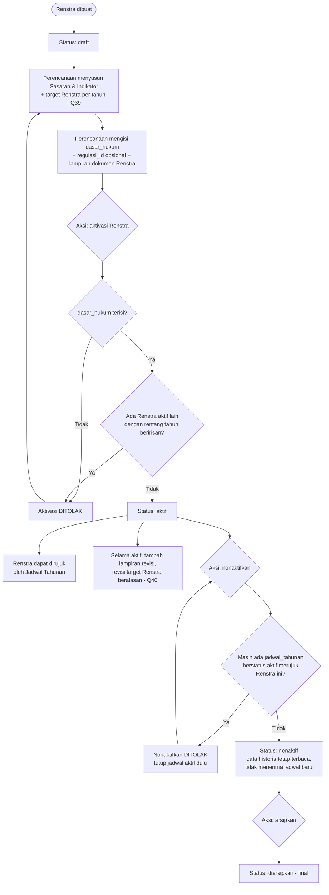

**Catatan kritis:** validasi pada node F dan H adalah gerbang kualitas terakhir sebelum data master berpotensi dibekukan ke `jadwal_snapshot` saat Jadwal Tahunan diaktifkan (§5). Guard pada node K2 mencegah Renstra menjadi nonaktif selagi masih ada jadwal operasional yang bergantung padanya — jadwal harus ditutup lebih dulu lewat alur §13. Kesalahan yang lolos di titik ini jauh lebih mahal untuk dikoreksi setelah snapshot terbentuk, apalagi setelah rencana aksi dan pengukuran menumpuk di atasnya. Validasi aktivasi Renstra **tidak** mensyaratkan `regulasi_id` maupun lampiran dokumen — keduanya bersifat pelengkap penelusuran, sedangkan `dasar_hukum` tetap satu-satunya syarat tekstual yang bergerbang keras di sini.

---

## 3. Alur Dokumen Dasar: Regulasi, Lampiran Renstra & Perjanjian Kinerja

Dokumen dasar adalah produk hukum (Kepmen/Permen/Perpres/keputusan lainnya) yang menjadi acuan penyusunan Renstra maupun penetapan indikator kinerja. Entitas `regulasi` menyimpan dasar aturan itu secara terstruktur dan dapat dirujuk berulang dari `renstra` (`renstra.regulasi_id`) maupun `indikator` (`indikator.regulasi_id`), tanpa perlu mengunggah dokumen yang sama berulang kali. Halaman "Dasar Aturan" (grup menu Master Data & Referensi, Q44) menjadi tempat CRUD `regulasi` beserta lampirannya; halaman Renstra dan halaman Perjanjian Kinerja masing-masing menampilkan lampiran dokumennya sendiri.

### 3.1 Entitas `regulasi` dan wewenang

Substansi dasar aturan (jenis produk hukum, nomor, tahun, tentang, tanggal, tautan sumber resmi) adalah wewenang **Perencanaan** dan **Superadmin** lewat permission granular `regulasi:create`/`regulasi:read`/`regulasi:update`/`regulasi:delete` (`update` dan `delete` bertanda `sensitif = true`). Pada preset baseline lama, **Admin**, **Pimpinan**, dan **Pegawai** memegang `regulasi:read` saja — dasar aturan tampil di halaman Renstra dan indikator agar konteksnya terbaca tanpa memberi wewenang substantif kepada Admin. **Hak bawaan PIC operasional (bukan role) atas `regulasi:read` masih OPEN pada Q31** dan tidak boleh disimpulkan hanya dari fakta bahwa model lama memperlakukan PIC operasional melalui user Pegawai + grant.

```
📋 Perencanaan / ⚙️ Superadmin (permission regulasi:create/read/update/delete)
  1. Membuka halaman "Dasar Aturan"
  2. Mencatat regulasi baru: jenis (kepmen/permen/perpres/keputusan_lainnya), nomor, tahun,
     tentang, tanggal (opsional), tautan_sumber (opsional — JDIH/laman kementerian), catatan
     → Kombinasi (jenis, nomor, tahun) harus unik — percobaan duplikat DITOLAK
  3. Melampirkan dokumen regulasi (mode file/tautan/teks, sama seperti bukti dukung tiga mode
     lain — lihat §10) sebagai bukti fisik/tautan resmi produk hukum tsb
  4. Menyimpan → regulasi berstatus aktif = true (default)

👤 Seluruh peran (permission regulasi:read)
  5. Membaca daftar regulasi dan lampirannya dari halaman "Dasar Aturan", halaman Renstra
     (bila renstra.regulasi_id terisi), maupun halaman Indikator (bila indikator.regulasi_id
     terisi)

📋 Perencanaan / ⚙️ Superadmin
  6. Mengubah/menonaktifkan regulasi (regulasi:update, sensitif — dasar_izin tercatat)
     → Menghapus regulasi yang masih dirujuk Renstra atau indikator aktif DITOLAK
       (regulasi:delete, sensitif) — lepaskan rujukan terlebih dahulu
  7. Lampiran regulasi tidak dapat dihapus selama regulasi masih dirujuk Renstra atau
     indikator aktif (lihat §10.6 untuk aturan imutabilitas per induk lampiran)
```

### 3.2 Rujukan regulasi dari Renstra dan Indikator

```
📋 Perencanaan
  1. Saat menyusun/mengedit Renstra: memilih regulasi_id (opsional) sebagai rujukan
     terstruktur ke dasar aturan, DI SAMPING mengisi dasar_hukum (ringkasan teks, tetap wajib
     sebelum aktivasi — §2)
  2. Saat menyusun/mengedit Indikator: memilih regulasi_id (opsional) sebagai dasar aturan per
     indikator (mis. produk hukum yang menetapkan IKU tersebut) — memungkinkan penelusuran
     dasar hukum per indikator tanpa mengunggah dokumen yang sama berulang

👤 Seluruh peran
  3. Halaman Renstra menampilkan: lampiran dokumen Renstra, rujukan regulasi (bila ada, lengkap
     dengan jenis/nomor/tahun/tentang), dan ringkasan dasar_hukum berdampingan
  4. Halaman Perjanjian Kinerja menampilkan: lampiran dokumen PK beserta nomor_pk dan
     tanggal_pk, serta isian baseline dan target PK per indikator aktif yang dikelompokkan per
     sasaran dengan target Renstra sebagai pembanding (Q39); bila PK direvisi, PK awal dan PK
     akhir sama-sama dapat diunduh (Q40) — lihat §3.3
```

### 3.3 Lampiran dokumen Perjanjian Kinerja (gerbang keempat aktivasi jadwal)

> **Q39, Q40, Q44, Q48, Q50 (13 Oktober 2026):** halaman Perjanjian Kinerja kini juga memuat isian baseline dan target PK per indikator; target PK menjadi acuan target periode Rencana Aksi dan pengukuran melalui snapshot (Q39). PK dapat direvisi sebagai versi baru yang membawa lampirannya sendiri (Q40; tahap 3, ISS-02.12 dengan prasyarat ISS-03.03). Penanda `tidak_dapat_dipenuhi` pada gerbang 4 akibat unggahan dimatikan tidak lagi terjadi karena saklar unggahan dihapus (Q44). Nomor PK opsional, target PK disimpan bernilai penuh, baseline tampil sebagai data pendukung, dan PK perubahan yang hanya mengubah anggaran cukup menjadi lampiran tambahan (Q50; ISS-02.11). Dokumen PK tidak dihasilkan SAKIP; PDF bertanda tangannya tetap menjadi lampiran PK (Q48). Status implementasi: belum.

```
📋 Perencanaan
  1. Mencatat renstra_pk tahun berjalan: nomor_pk, tanggal_pk (§2)
     → nomor_pk opsional; PK tetap dikenali dari Renstra dan tahun (unik per Renstra-tahun)
       serta tanggal PK (Q50 §50.1)
     → Tidak ada validasi bahwa tanggal PK harus setelah tanggal penetapan Renstra (Q50 §50.6)
     → Alasan perubahan PK opsional selama PK belum dipakai jadwal aktif; sesudahnya koreksi
       nomor/tanggal memakai jalur koreksi teraudit yang wajib beralasan (langkah 9; Q43 §43.3
       butir 3, §43.2 butir 3)
  1a. Mengisi baseline dan target PK tahun berjalan untuk setiap indikator aktif Renstra,
      dikelompokkan per sasaran — disimpan pada target_tahunan dengan domain nilai Q33 (Q39)
      dan permission target:update (Q39 §39.3 butir 3)
     → Target PK disimpan dengan nilai penuh yang dipakai pengukuran (mis. 94,05), bukan nilai
       tercetak yang dibulatkan pada dokumen PK (94); tampilan mengikuti desimal_tampilan
       (Q50 §50.2)
     → Baseline diisi dari realisasi tahun sebelumnya dan tampil sebagai data pendukung, bukan
       isi dokumen PK (Q50 §50.3)
     → Target Renstra tahun yang sama tampil di samping isian; indikator tanpa target Renstra
       (mis. IKU 4.1 pada sasaran S4 yang hanya ada di PK, Q50 §50.5) diberi keterangan
       "target Renstra belum ada" dan tetap dapat diberi target PK
     → Target PK di bawah target Renstra (naik_baik) atau di atasnya (turun_baik): PERINGATAN
       dan alasan WAJIB, disimpan bersama target PK dan tercatat di audit — penyimpanan tidak
       ditolak
     → Anjuran "minimal sama atau naik satu poin" tampil sebagai panduan, bukan aturan sistem
     → Di luar alasan deviasi tersebut, alasan perubahan target PK opsional (Q43)
     → PJ dan PIC melihat target PK sebagai baca-saja
  2. Melampirkan dokumen Perjanjian Kinerja pada renstra_pk tsb (mode file/tautan/teks, minimal
     satu lampiran) — halaman Perjanjian Kinerja menampilkan lampiran ini beserta nomor_pk/
     tanggal_pk
     → PDF PK bertanda tangan tetap diarsipkan sebagai lampiran PK dengan permission PK, dan
       per versi setelah revisi berversi tersedia; PK tidak dihasilkan SAKIP (Q48 §48.1 butir 4,
       §48.2 butir 1–2)
  2a. PK perubahan yang hanya mengubah anggaran (sebelum revisi berversi tersedia) diunggah
      sebagai lampiran tambahan pada renstra_pk tahun tsb dengan keterangan pada
      berkas.keterangan (mis. "PK perubahan anggaran", Q48 §48.2 butir 6) — target dan
      snapshot tidak berubah (Q50 §50.7 butir 1). PK perubahan yang mengubah target memakai
      revisi berversi (langkah 5–9); bila terbit sebelum ISS-02.12 selesai, penanganannya
      ditetapkan PM sebagai keputusan baru (Q50 §50.7 butir 2)

⚙️ Sistem (gerbang keempat aktivasi Jadwal Tahunan — lihat §5)
  3. Aktivasi jadwal:aktivasi kini mensyaratkan EMPAT gerbang, bukan tiga:
     Gerbang 1 — renstra_pk tahun tsb tercatat
     Gerbang 2 — seluruh indikator aktif punya target PK (target_tahunan) tahun tsb (Q39)
     Gerbang 3 — tahun jadwal dalam rentang Renstra
     Gerbang 4 (BARU) — renstra_pk tahun tsb memiliki MINIMAL SATU lampiran dokumen
     → Keempat gerbang harus lolos sebelum Jadwal Tahunan dapat AKTIF
  4. Mode lampiran PK bersifat bebas (file/tautan/teks) dan unggahan file selalu aktif (Q44),
     sehingga gerbang 4 TIDAK memacetkan alur — Perencanaan dapat memenuhi lewat tautan atau
     keterangan teks bila unggahan file tidak praktis
     → [Digantikan Q44] Semula: bila unggahan file DIMATIKAN pada setelan aplikasi
       (berkas.unggahan_aktif = false, §18; histori) SEMENTARA belum ada lampiran PK bermode
       tautan/teks, persyaratan ini ditandai tidak_dapat_dipenuhi — gerbang 4 dianggap
       terpenuhi secara administratif, tercatat audit_log, dan tampil di halaman kerja
       Perencanaan (§10.5). Saklar unggahan dihapus sehingga penanda ini tidak lagi terjadi;
       penanda yang sudah tercatat tetap menjadi histori

📋 Perencanaan — revisi PK berversi (Q40; tahap 3, ISS-02.12 dengan prasyarat ISS-03.03)
  5. Mencatat revisi PK (umumnya akhir tahun, setelah persetujuan Eselon I) sebagai VERSI PK
     BARU: nomor versi, nomor dan tanggal surat persetujuan Eselon I sebagai isian tersendiri,
     periode mulai berlaku, lampiran dokumen PK bertanda tangan, dan target per indikator —
     revisi disetujui Perencanaan di aplikasi dengan alasan wajib (Q43); versi sebelumnya tidak
     diubah
  6. Revisi berlaku mulai periode pertama yang belum ditutup; periode yang sudah dilaporkan
     tetap memakai target versi lama
     → Revisi yang mengubah target: persetujuannya menerbitkan versi jadwal_snapshot baru
       dengan periode_mulai_id = periode tsb dan rujukan_koreksi = surat Eselon I (Q35 §35.1)
     → Revisi yang hanya mengganti dokumen (mis. karena perubahan anggaran): tidak menerbitkan
       versi snapshot
  7. PK awal dan PK akhir sama-sama disimpan dan dapat diunduh sebagai lampiran laporan
     kinerja; capaian akhir tahun dinilai terhadap target PK akhir, yaitu versi yang berlaku
     pada periode nilai akhir
  8. Rencana Aksi tidak diubah otomatis: selisih target periode terakhir dengan target PK baru
     tampil sebagai deviasi yang wajib dijelaskan (ADR-0008); target periode yang belum
     terkunci disesuaikan lewat buka-kembali RA (§13)
  9. Koreksi salah ketik nomor atau tanggal PK tetap memakai jalur koreksi teraudit
     (ISS-02.09); perubahan target resmi memakai revisi berversi
```

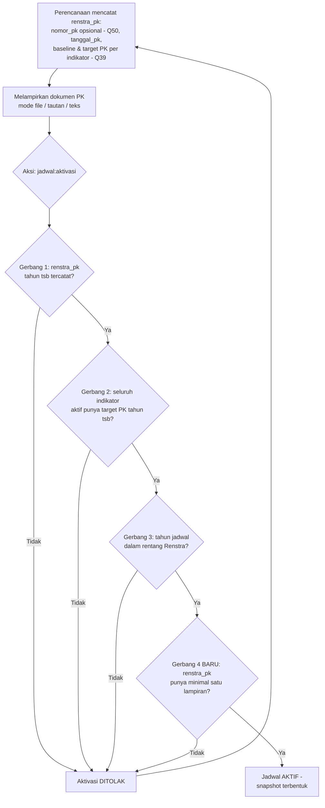

**Mengapa gerbang keempat ditambahkan:** dokumen Perjanjian Kinerja adalah bukti formal legalitas target tahunan yang dibekukan ke snapshot — menyamakan perlakuannya dengan gerbang bukti dukung lain (rencana aksi, pengukuran, kegiatan) memastikan Jadwal Tahunan hanya aktif ketika dasar formalnya terdokumentasi, tanpa mengorbankan fleksibilitas mode maupun memacetkan alur operasional — mode tautan/teks tersedia dan unggahan file selalu aktif (Q44); mekanisme anti-macet lama pada §10.5 digantikan Q44.

---

## 4. Struktur Periode & Jadwal (`jadwal_periode`, jendela rencana aksi)

> **Q41 (13 Oktober 2026):** Rencana Aksi tidak lagi terikat jendela penyusunan. `rencana_aksi_mulai`/`rencana_aksi_selesai` tidak lagi menjadi batas PIC dan dihapus dari form jadwal; PIC efektif dengan grant yang sah dapat menyusun, mengubah, dan mengajukan RA sejak jadwal aktif sampai `penutupan`, dengan kunci per triwulan (lihat aturan di bawah dan §7). Jadwal hanya mengikat pelaporan realisasi melalui jendela pengisian per periode. Q18 tetap berlaku untuk jendela pengisian pengukuran.

Jendela waktu pengisian dan reviu tidak lagi melekat pada `jadwal_tahunan` secara langsung, melainkan pada tabel pivot `jadwal_periode` yang menghubungkan satu Jadwal Tahunan dengan tiap Periode yang diharapkan pada tahun itu. Susunan ini memungkinkan setiap periode (mis. Triwulan I, II, III, IV) memiliki jendela pengisian dan reviu masing-masing, alih-alih satu jendela tunggal untuk seluruh tahun. `jadwal_tahunan` sendiri sempat juga membawa jendela tingkat tahun untuk penyusunan rencana aksi — digantikan Q41.

```
periode (master global)          jadwal_tahunan (payung tahun)
  - nama                            - renstra_id, tahun
  - urutan                          - penutupan (pembekuan akhir tahun)
  - aktif                           - status: draft / aktif / ditutup
  - is_nilai_akhir                  - renstra_pk_id, activated_at, closed_at
                                     - rencana_aksi_mulai, rencana_aksi_selesai (tidak dipakai
                                       sejak Q41; nullable)

              \                          /
               \                        /
                v                      v
                     jadwal_periode
                (jadwal_id, periode_id)
                - pengisian_mulai / pengisian_selesai
                - reviu_mulai / reviu_selesai
```

```
📋 Perencanaan
  1. Membuat Jadwal Tahunan (draft): pilih Renstra, tahun, tanggal penutupan
  2. Untuk tahun tsb, memilih periode-periode mana yang diharapkan (mis. Triwulan I–IV dari
     master periode aktif) dan mengisi jendela pengisian_mulai/selesai serta reviu_mulai/selesai
     untuk masing-masing periode → tersimpan sebagai baris jadwal_periode
  3. Sistem memvalidasi urutan tanggal logis per baris: pengisian_mulai ≤ pengisian_selesai ≤
     reviu_mulai ≤ reviu_selesai
  4. [Digantikan Q41] Jendela rencana_aksi_mulai / rencana_aksi_selesai tidak lagi diisi pada
     form jadwal — semula jendela tingkat tahun karena rencana aksi disusun sekali per
     indikator × tahun (§7); kini RA disusun sejak jadwal aktif sampai penutupan dengan kunci
     per triwulan bagi PIC
  5. Jadwal Tahunan siap diaktifkan (lanjut ke alur §5)
```

**Aturan penting:**
- Kolom `pengisian_mulai`, `pengisian_selesai`, `reviu_mulai`, `reviu_selesai` **tidak lagi ada** pada `jadwal_tahunan` — seluruhnya berpindah ke `jadwal_periode`, satu baris per periode yang diharapkan.
- Kolom `rencana_aksi_mulai`, `rencana_aksi_selesai` (date, nullable) di `jadwal_tahunan` **tidak lagi dipakai** sejak Q41 — tidak menjadi batas PIC, tidak tampil di form jadwal, dan dibiarkan nullable sampai dihapus pada migrasi lanjutan. Semula keduanya menjadi jendela tingkat tahun karena rencana aksi disusun sekali per (indikator × tahun).
- `jadwal_tahunan.penutupan` **tetap ada** dan berlaku sebagai pembekuan akhir di tingkat tahun, terpisah dari jendela per periode — sekaligus batas akhir penyusunan, perubahan, dan pengajuan Rencana Aksi (Q41); lihat §11 dan §13 untuk perannya dalam batas akses Perencanaan. Penutupan jadwal hanya menghentikan mutasi data kinerja; unggahan arsip PDF dokumen resmi tetap dapat dilakukan setelah jadwal ditutup karena tidak mengubah data (Q48 §48.2 butir 5, §25).
- **Kunci per triwulan pada Rencana Aksi (Q41)** menggantikan deadline mutlak jendela rencana aksi: periode P terkunci bagi PIC setelah `jadwal_periode.pengisian_selesai` periode P terlewati (tanggal bisnis Asia/Makassar). Setiap perubahan RA oleh PIC — simpan draf, pengajuan, dan versi setelah dikembalikan atau dibuka kembali — tidak boleh mengubah target maupun daftar kegiatan periode yang terkunci; pelanggaran ditolak sebagai validasi bisnis (422) dan diaudit. **Perencanaan dikecualikan** sampai `jadwal_tahunan.penutupan` (permission `rencana_aksi:create`/`update`/`ajukan` bersifat global tanpa scope unit). Periode lampau pada saat aktivasi jadwal sudah terkunci bagi PIC sejak aktivasi (§15). Kunci mengikuti nilai `pengisian_selesai` yang berlaku, termasuk hasil revisi resmi jendela pengisian (Q18, ISS-03.06): perpanjangan jendela pengisian periode P ikut menggeser kunci RA periode P bagi PIC (Q41 §41.2 butir 5). Dalam sesi koreksi setelah penutupan, PIC hanya dapat mengubah RA pada periode yang jendela pengisiannya dibuka kembali secara resmi (ISS-14.03, Q19); di luar itu koreksi RA dilakukan Perencanaan (Q41 §41.2 butir 6).
- Nilai periode dengan `is_nilai_akhir = true` (mis. Tahunan) diisi manual oleh yang berwenang — tidak ada perhitungan agregasi otomatis dari periode-periode di bawahnya.

---

## 5. Alur Aktivasi Jadwal & Pembentukan Snapshot

```
📋 Perencanaan
  1. Membuat Jadwal Tahunan baru untuk Renstra X, Tahun Y → Status: draft
  2. Menyusun jadwal_periode (§4)
  3. [Digantikan Q41] Jendela rencana_aksi_mulai/rencana_aksi_selesai tidak lagi diisi (§4)
  4. Menjalankan aksi aktivasi jadwal (jadwal:aktivasi)
     → Sistem menjalankan EMPAT gerbang validasi secara berurutan:
       Gerbang 1 — renstra_pk untuk (Renstra X, Tahun Y) sudah tercatat?
         Belum: Aktivasi DITOLAK, kembali lengkapi PK
       Gerbang 2 — seluruh indikator aktif milik Renstra X memiliki target PK (target_tahunan)
       Tahun Y (Q39)?
         Ada yang belum: Aktivasi DITOLAK, kembali lengkapi target PK di halaman PK
       Gerbang 3 — Tahun Y berada dalam rentang [tahun_mulai, tahun_akhir] Renstra X?
         Tidak: Aktivasi DITOLAK, kembali koreksi tahun jadwal atau rentang Renstra
       Gerbang 4 (BARU, §3.3) — renstra_pk untuk (Renstra X, Tahun Y) memiliki MINIMAL SATU
       lampiran dokumen (mode file/tautan/teks)?
         Belum: Aktivasi DITOLAK, kembali lampirkan dokumen PK
         Sudah: lanjut
         [Digantikan Q44] Cabang "ditandai tidak_dapat_dipenuhi karena unggahan file dimatikan
         pada setelan aplikasi" tidak lagi terjadi — saklar unggahan dihapus
     → Seluruh gerbang lolos: lanjut ke langkah 5

⚙️ Sistem (otomatis begitu aktivasi lolos validasi)
  5. Mengubah Jadwal Tahunan → Status: aktif, terhubung ke renstra_pk_id, activated_at tercatat
  6. Mengambil seluruh indikator aktif milik Renstra X (melalui Sasaran)
  7. Untuk tiap indikator, memeriksa apakah baris jadwal_snapshot untuk pasangan
     (jadwal_id, indikator_id) ini sudah ada
     → Sudah ada: dilewati (tidak ditimpa) — pembuatan snapshot bersifat idempoten
     → Belum ada: mengambil target PK (target_tahunan, Q39) tahun Y lalu menyalin nama,
       definisi, satuan, presisi, desimal_tampilan, unit_id, arah, tipe_perhitungan,
       dinilai_tahunan (Q47 §47.1 butir 2), baseline, dan target ke jadwal_snapshot baru
  8. Untuk indikator bertipe rasio_persen/penjumlahan (memiliki indikator_komponen aktif),
     menyalin seluruh definisi komponen (kode, label, peran, bobot, urutan) ke tabel anak
     jadwal_snapshot_komponen, satu baris per komponen aktif pada saat aktivasi
  9. Mencatat audit_log pembuatan snapshot dengan actor_id = Perencanaan yang menjalankan
     aktivasi (jejak menempel pada aksi manusianya, bukan pada proses sistem)

📋 Perencanaan
  10. Menerima konfirmasi: Jadwal AKTIF, snapshot (termasuk snapshot komponen) sudah terbentuk
      dan bisa diverifikasi lewat query
      (Fase Lanjutan, belum dibangun: jika pakai_persetujuan_pimpinan=true, akan ada jendela
      persetujuan_mulai–persetujuan_selesai tambahan setelah reviu, sebelum jadwal benar-benar
      aktif)
```

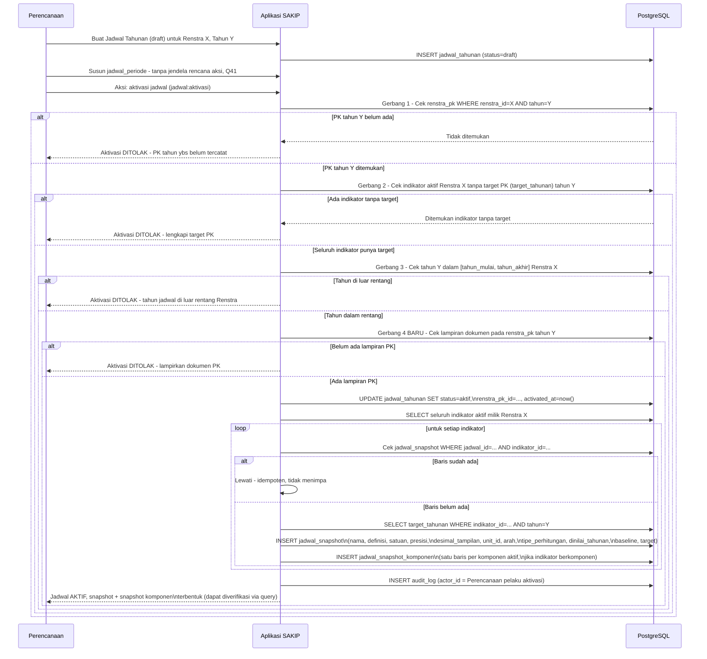

**Fase Lanjutan (belum dibangun):** jika `pakai_persetujuan_pimpinan = true` di masa depan, diagram ini akan bercabang tambahan untuk membuka jendela `persetujuan_mulai`–`persetujuan_selesai` setelah reviu. Detail cabang itu tidak digambarkan di sini karena berada di luar cakupan MVP.

**Gerbang keempat tidak memacetkan alur:** karena lampiran dokumen PK boleh dipenuhi lewat mode file/tautan/teks (§3.3, §10) dan unggahan file selalu aktif (Q44), gerbang 4 tidak pernah menjadi penghalang keras yang tidak dapat diatasi. Ketentuan semula — bila unggahan file dimatikan pada setelan aplikasi dan belum ada lampiran mode lain, sistem menandai persyaratan `tidak_dapat_dipenuhi` dan tetap meloloskan gerbang secara administratif (§10.5) — digantikan Q44 karena saklar unggahan dihapus; penanda yang sudah tercatat tetap menjadi histori.

**Sifat idempoten dan imutabilitas snapshot:** logika pembuatan snapshot pada langkah 7–8 dipanggil ulang, dengan perilaku yang sama, setiap kali `jadwal:buka_kembali` dijalankan (§13) — mis. saat indikator baru ditambahkan di tengah tahun. Baris snapshot yang **sudah terbit** bersifat beku dan tidak dapat diubah lagi, termasuk baris `jadwal_snapshot_komponen` anaknya, baik sudah maupun belum dirujuk (Q35 §35.1). Koreksi konteks selalu dibuat sebagai versi snapshot baru yang teraudit; versi lama tetap utuh. Persetujuan revisi PK yang mengubah target juga menerbitkan versi snapshot baru dengan `periode_mulai_id` periode pertama yang belum ditutup dan `rujukan_koreksi` surat Eselon I; revisi yang hanya mengganti dokumen tidak menerbitkan versi snapshot (Q40, §3.3). Tidak ada restatement data historis — perubahan definisi komponen di tengah tahun (§6) tidak pernah mengubah makna data historis yang sudah dibekukan.

---

## 6. Alur Komponen Indikator & Mesin Perhitungan

Perhitungan nilai indikator bersifat **data-driven**, bukan hardcode per indikator. Kolom baru `indikator.tipe_perhitungan` enum(`rasio_persen`, `penjumlahan`, `manual`) menentukan bagaimana nilai indikator diturunkan dari komponen-komponennya.

```
📋 Perencanaan (permission komponen:create/update)
  1. Menetapkan indikator.tipe_perhitungan saat membuat/mengubah indikator:
     a. rasio_persen — nilai = (Σ(komponen pembilang_i × bobot_i) ÷ (komponen penyebut × bobot))
        × 100. Menutup varian multi-suku seperti (a + b) / t × 100 maupun berbobot Σ(n_i × k_i) / t × 100
     b. penjumlahan — nilai = Σ(komponen penjumlah_i × bobot_i), mis. jumlah dosen naik jabatan
        fungsional (Lektor + Lektor Kepala + Guru Besar)
     c. manual — nilai diketik langsung, komponen tidak wajib (perilaku lama tetap berlaku)
  2. Untuk tipe rasio_persen/penjumlahan, mendefinisikan baris indikator_komponen: kode, label,
     peran (pembilang/penyebut/penjumlah), bobot, urutan, satuan
     → Validasi definisi: rasio_persen wajib punya ≥1 komponen pembilang aktif dan tepat 1
       komponen penyebut aktif; penjumlahan wajib punya ≥1 komponen penjumlah aktif — penyimpanan
       ditolak bila tidak terpenuhi
  3. Indikator siap dirujuk pengukuran; definisi komponen ikut dibekukan ke jadwal_snapshot_komponen
     saat jadwal diaktifkan (§5)

🎯 Penanggung Jawab (saat pengisian rencana aksi §7 atau pengukuran §11)
  4. Mengisi nilai tiap komponen aktif (pengukuran_komponen.nilai atau rencana_aksi_target.nilai)
  5. Sistem menghitung nilai turunan sesuai tipe_perhitungan:
     → Pembagian dengan penyebut 0: nilai TIDAK DAPAT DIHITUNG (disimpan null, ditampilkan
       sebagai "tidak dapat dihitung") — bukan 0, bukan galat sistem, dan berbeda dari realisasi
       "belum dapat diukur" yang dinyatakan pengisi bila nilainya belum tersedia (Q47 §47.4, §24)
     → Nilai dibulatkan sesuai indikator.presisi, ditampilkan sesuai indikator.desimal_tampilan
  6. Untuk tipe manual, pengukuran.nilai tetap diketik langsung (kolom sumber_nilai = manual);
     untuk tipe rasio_persen/penjumlahan, pengukuran.nilai menjadi READ-ONLY di UI, terisi
     otomatis dari mesin perhitungan (sumber_nilai = komponen)

📋 Perencanaan (permission komponen:update/delete)
  7. Sewaktu-waktu dapat menambah/mengubah/menonaktifkan definisi komponen (mis. saat Kepmen IKU
     berubah), tanpa penyesuaian kode — setiap perubahan tercatat audit_log (nilai_lama/nilai_baru)
```

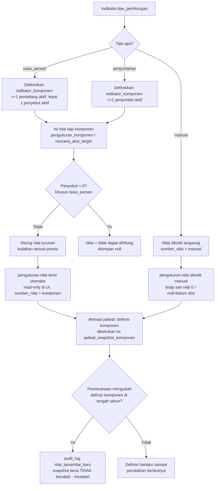

**Batas sadar cakupan ini:** mesin perhitungan mendukung **satu tingkat** perhitungan (rasio atau penjumlahan, dengan pembilang berjumlah banyak dan berbobot). Formula **bertingkat** (sub-skor → nilai komposit → digabung lagi) tidak dibangun; indikator semacam IKU "Predikat SAKIP dan Zona Integritas" memakai `tipe_perhitungan = manual` (nilai SAKIP dan nilai ZI diketik langsung, tanpa diturunkan ke sub-skor 30/30/15/25). Formula bertingkat adalah pengembangan lanjutan, bukan sesuatu yang bisa dikonfigurasi dari layar Fase Awal.

**Gerbang kelengkapan komponen:** pengajuan pengukuran ditolak bila ada komponen aktif yang nilainya masih `null` (lihat §11, §12) — di samping narasi pengukuran wajib (Q45), yang menggantikan aturan catatan wajib berbasis `arah` dan `wajib_catatan` (semula dibandingkan pada nilai turunan, §12). Gerbang ini dikecualikan bila realisasi berstatus `status_perhitungan = belum_dapat_diukur`; pada periode nilai akhir realisasi wajib terisi, kecuali tidak dapat dihitung (Q9; Q47 §47.4 butir 1 dan 4). Penanda dinilai tahunan tidak mengubah `tipe_perhitungan`, formula, maupun komponen (Q47 §47.1 butir 3).

---

## 7. Alur Penyusunan & Pengesahan Rencana Aksi

> **Q41, Q42, Q46 (13 Oktober 2026):** Rencana Aksi tidak lagi terikat jendela penyusunan — PIC dapat menyusun, mengubah, dan mengajukan RA sejak jadwal aktif sampai `penutupan`, dengan kunci per triwulan bagi PIC (Q41, §4). RA memuat target per periode **dan daftar kegiatan per periode**: kegiatan ditambahkan dari halaman RA beserta anggarannya, dan pengajuan mensyaratkan minimal satu kegiatan yang diklaim pada tahap RA serta persyaratan tahap `kegiatan_perencanaan` (mis. RAB) yang lengkap (Q42). RA 2026 yang dicatat Perencanaan sebagai data awal dikecualikan dari gerbang kegiatan minimal dan RAB (Q46, §15). Indikator dinilai tahunan boleh tanpa target pada periode sebelum periode nilai akhir (Q47 §47.2, §24), dan kegiatan dapat disalin ke periode lain yang belum terkunci (Q49 §49.2). Status implementasi: belum (US/ISS-05.07, 06.02, 06.08).

Rencana aksi adalah tahap yang disisipkan setelah penugasan Penanggung Jawab dan sebelum pelaksanaan kegiatan maupun pengisian pengukuran. Rencana aksi disusun **sekali per (indikator × tahun)**, bukan per periode — isinya rincian target per periode per komponen dan daftar kegiatan per periode (Q42).

```
🎯 Penanggung Jawab (PIC rencana aksi = PIC indikator yang berlaku, akses di-scope per unit)
  1. Membuka form Rencana Aksi untuk indikator × tahun miliknya, kapan pun sejak jadwal tahun
     tsb aktif sampai jadwal_tahunan.penutupan (Q41, §4) → Status: draft
  2. Mengisi rencana_aksi_target: nilai tiap KOMPONEN untuk tiap periode yang diharapkan
     (dari jadwal_periode) — target diinput pada level komponen (mis. n = jumlah responden puas,
     t = total layanan), bukan pada skor final
     → Periode terkunci (pengisian_selesai yang berlaku untuk periode itu sudah lewat, termasuk
       hasil perpanjangan resmi jendela pengisian): targetnya tidak dapat diubah PIC (Q41
       §41.2 butir 1 dan 5, §4)
     → Indikator dinilai tahunan menurut snapshot: target periode sebelum periode nilai akhir
       boleh dikosongkan = tidak ditargetkan, berbeda dari target 0; target periode nilai akhir
       tetap wajib; pada versi RA yang dibekukan, periode itu berstatus tidak_ditargetkan,
       bukan belum_diisi (Q47 §47.2, §24)
  2a. Menambah kegiatan per periode lewat "Tambah kegiatan" di halaman RA (Q42): aksi ini
      membuat kegiatan (unit × periode, §8) dengan nama hingga 500 karakter, tujuan opsional
      (Q49 §49.1), dan anggaran (rupiah, ≥ 0, wajib diisi) sekaligus klaimnya ke RA dengan
      sumber_klaim = rencana_aksi (§9)
     → Saat menambah, kegiatan dapat disalin ke satu atau lebih periode lain yang belum
       terkunci pada RA yang sama — tiap salinan menjadi kegiatan dan klaim tersendiri
       (Q49 §49.2, §8)
     → Tidak setiap periode wajib berisi kegiatan; daftar kegiatan periode terkunci tidak dapat
       diubah PIC (Q41)
     → Anggaran dijumlahkan otomatis per periode dan per RA; kegiatan yang juga diklaim IKU lain
       ditandai "kegiatan bersama" (Q42, §9)
  3. Sistem menampilkan perkiraan skor (nilai turunan hasil mesin perhitungan §6) berdasarkan
     nilai komponen yang sudah diisi — perkiraan skor tidak disimpan sebagai input
     → Target triwulan bersifat KUMULATIF: nilai periode berjalan mencakup periode sebelumnya
       (mis. target Triwulan II = capaian Januari–Juni)
     → Nilai suatu periode lebih kecil dari periode sebelumnya: sistem menampilkan PERINGATAN
       (tidak memblokir penyimpanan draft)
  4. Melengkapi bukti dukung wajib bertahap rencana_aksi (jenis_berkas.tahap = rencana_aksi)
     yang berlaku untuk indikator ini — memilih mode yang diizinkan (unggah file, isi tautan,
     tulis keterangan teks, atau kombinasi bila semua_mode_wajib = true)
     → Melengkapi pula persyaratan tahap kegiatan_perencanaan untuk setiap kegiatan yang
       diklaim pada tahap RA — persyaratan global ditambah persyaratan khusus indikator ini
       (Q42 §42.4 butir 4); RAB (Excel/PDF) wajib untuk kegiatan beranggaran lebih dari 0
       (persyaratan bertanda hanya_kegiatan_beranggaran, Q42 §42.3 butir 3); contoh berkas
       dari Perencanaan dapat diunduh pada persyaratannya (Q42, §10)

🎯 Penanggung Jawab
  5. Mengajukan Rencana Aksi → Status: diajukan
     → GERBANG (kelengkapan, bukan catatan): ada komponen aktif yang belum punya target pada
       salah satu periode yang diharapkan → pengajuan DITOLAK dengan pesan per periode —
       kecuali periode sebelum periode nilai akhir pada indikator dinilai tahunan (Q47 §47.2)
     → GERBANG: bukti dukung wajib tahap rencana_aksi belum lengkap (menurut mode yang dipilih
       dan aturan semua_mode_wajib) → pengajuan DITOLAK
     → GERBANG: belum ada minimal satu kegiatan yang diklaim pada tahap RA → pengajuan DITOLAK
       (Q42)
     → GERBANG: persyaratan wajib tahap kegiatan_perencanaan (mis. RAB untuk kegiatan
       beranggaran lebih dari 0) belum lengkap untuk salah satu kegiatan yang diklaim pada
       tahap RA → pengajuan DITOLAK (Q42)
     → GERBANG kunci per triwulan: perubahan target atau daftar kegiatan periode terkunci oleh
       PIC → DITOLAK sebagai validasi bisnis (422) dan diaudit (Q41)
     → PERINGATAN + ALASAN WAJIB: total target komponen periode terakhir tidak setara dengan
       target PK tahunan indikator ini — target PK hanya berubah lewat revisi PK berversi (Q40,
       §3.3); deviasi wajib terlihat dan tercatat, bukan disesuaikan diam-diam
     → [Digantikan Q41] Deadline jendela rencana_aksi_selesai yang MUTLAK bagi PIC tidak berlaku
       lagi — batas PIC kini kunci per triwulan (§4) dan jadwal_tahunan.penutupan
     → Gerbang kegiatan minimal dan RAB DIKECUALIKAN untuk RA 2026 data awal; gerbang baru
       Q42–Q45 dikecualikan untuk periode lampau, sedangkan kunci per triwulan bukan bagian
       pengecualian itu — periode lampau terkunci bagi PIC sejak aktivasi, dan Perencanaan
       yang mengisinya tidak terikat kunci (Q46 §46.1 butir 1, §15)

📋 Perencanaan (akses rencana_aksi:create/update/ajukan bersifat GLOBAL, tanpa scope unit;
                dikecualikan dari kunci per triwulan, dibatasi jadwal_tahunan.penutupan — Q41)
  6. Memverifikasi Rencana Aksi yang diajukan
     → Ditolak, perlu revisi: Status: dikembalikan + alasan wajib diisi, kembali ke Penanggung
       Jawab (langkah 1–4)
     → Disetujui teknis: Status: diverifikasi
  7. Mengesahkan Rencana Aksi yang diverifikasi → Status: disahkan — Perencanaan boleh
     mengesahkan RA yang diinputnya sendiri dengan penanda self-approval (F2, §20; Q41 §41.3
     butir 2)

📋 Perencanaan / ⚙️ Superadmin
  8. Untuk Rencana Aksi yang sudah disahkan, masih dapat dibuka-kembali
     (permission rencana_aksi:buka_kembali) menjadi dikembalikan, dengan alasan wajib, sebelum
     jadwal_tahunan.penutupan atau setelah penutupan di dalam sesi koreksi resmi yang mencakup
     rencana_aksi dan indikator tersebut ([Keputusan PM — PR #100](https://github.com/LLDIKTI-XVI-TEAM/SAKIP/pull/100#issuecomment-6161432383)) — lihat §13
     → Dipakai bila target periode yang belum terkunci perlu diubah, termasuk penyesuaian
       setelah revisi PK (Q40–Q41); tidak dipakai hanya untuk memindahkan kegiatan yang mundur
       ke periode lain (Q41, §8)

⚙️ Sistem
  9. Gerbang keras di tahap pengukuran (§11): pengajuan pengukuran untuk periode P pada
     indikator I DITOLAK selama rencana_aksi (I × tahun) belum berstatus disahkan
```

```mermaid
stateDiagram-v2
    [*] --> draft: rencana_aksi:create\n(PIC: scoped unit, sejak jadwal aktif s.d. penutupan,\nperiode terkunci tidak dapat diubah - Q41;\nPerencanaan: global, dibatasi penutupan)
    draft --> draft: rencana_aksi:update\n(isi rencana_aksi_target per periode per komponen;\ntambah/salin kegiatan beranggaran - Q42, Q49;\nlengkapi bukti dukung mode file/tautan/teks)
    draft --> diajukan: rencana_aksi:ajukan\n(gerbang: seluruh komponen aktif punya target\nper periode yang diharapkan, kecuali dinilai tahunan - Q47;\nminimal satu kegiatan + tahap kegiatan_perencanaan/RAB - Q42;\nbukti dukung wajib tahap rencana_aksi lengkap;\nperingatan+alasan bila total tak setara target PK)
    diajukan --> diverifikasi: rencana_aksi:verifikasi (Perencanaan)
    diajukan --> dikembalikan: rencana_aksi:kembalikan (Perencanaan, alasan wajib)
    diverifikasi --> dikembalikan: rencana_aksi:kembalikan (Perencanaan, alasan wajib)
    diverifikasi --> disahkan: rencana_aksi:sahkan (Perencanaan)
    dikembalikan --> diajukan: rencana_aksi:ajukan (revisi langsung, Q36.1 butir 2)
    disahkan --> dikembalikan: rencana_aksi:buka_kembali\n(Perencanaan/Superadmin, alasan wajib,\nsebelum penutupan atau dalam sesi koreksi resmi)
    disahkan --> [*]: gerbang pengukuran terbuka -\npengukuran indikator ini dapat diajukan (§11)

    note right of disahkan
        Begitu status = disahkan, gerbang keras
        pada pengajuan pengukuran (§11) terbuka
        untuk indikator x tahun ini. Sebelum
        disahkan, pengajuan pengukuran DITOLAK.
    end note
```

**Revisi dari `dikembalikan`:** rencana aksi yang dikembalikan disunting di tempat lalu diajukan ulang langsung ke `diajukan` sebagai versi pengajuan baru, tanpa kembali ke `draft` — sama dengan pengukuran.

**Rekonsiliasi dengan PK tahunan:** total target komponen periode terakhir seharusnya setara dengan target PK tahunan indikator. Bila tidak setara, sistem menampilkan peringatan dan mewajibkan alasan pada saat pengajuan — bukan memblokir — karena target PK hanya dapat diubah lewat revisi PK berversi (Q40 §40.1, §3.3), sementara target komponen per periode yang belum terkunci pada rencana aksi memang dapat direvisi lewat `rencana_aksi:buka_kembali` (alasan wajib, ter-audit; Q41 §41.4 butir 4). Untuk indikator dinilai tahunan, rekonsiliasi berlaku pada target periode nilai akhir, yang tetap wajib (Q47 §47.2 butir 1).

**Penugasan PIC rencana aksi:** PIC rencana aksi = PIC indikator yang ditunjuk Perencanaan lewat `penanggung_jawab` (§ Alur Penugasan) — tidak ada penugasan terpisah. Bila PIC indikator berganti di tengah tahun, `rencana_aksi.penanggung_jawab_id` mencatat PIC yang berlaku saat penyusunan (jejak historis), sementara hak pengisian tetap mengikuti `penanggung_jawab` yang berlaku saat itu.

---

## 8. Alur Kegiatan per Periode, Bukti Pelaksanaan & Geser Periode

> **Q41, Q42, Q44, Q45, Q49 (13 Oktober 2026):** kegiatan kini menjadi bagian Rencana Aksi: kegiatan ditambahkan dari halaman RA per periode sekaligus klaimnya (`sumber_klaim = rencana_aksi`), setiap kegiatan wajib mencatat satu angka anggaran (rupiah, ≥ 0), dan RAB wajib untuk kegiatan beranggaran lebih dari 0 (Q42). Persyaratan dokumen kegiatan dibagi dua tahap: tahap perencanaan kegiatan (`kegiatan_perencanaan`, mis. RAB) diperiksa saat RA diajukan, sedangkan tahap pelaksanaan (`kegiatan`) diperiksa saat kegiatan ditandai `terlaksana` (Q42 §42.4). `nama` hingga 500 karakter, `tujuan` opsional, dan kegiatan dapat disalin ke periode lain (Q49). Kegiatan yang mundur ditandai `ditunda`, lalu sistem membuat kegiatan lanjutan yang menyalin anggaran kegiatan asal dan diklaim pada tahap pengukuran tanpa membuka kembali RA (Q41 §41.4, Q42 §42.2 butir 6). Status kegiatan dapat diperbarui sepanjang periode, dan narasi per kegiatan menjadi opsional (Q45 §45.1). Penanda anti-macet akibat unggahan dimatikan tidak lagi terjadi (Q44). Status implementasi: belum (US/ISS-06.01–06.05, 06.08).

Kegiatan disusun per **periode** dan terikat tahun; kegiatan milik satu `unit` (unit pemilik indikator/unit pelaksana), dan **tidak** dimiliki oleh satu rencana aksi/indikator tunggal — hubungannya ke rencana aksi dibuat lewat klaim (§9). Sejak persyaratan bukti dukung diperluas ke tahap `kegiatan` (§10), transisi status kegiatan dari `rencana` menjadi `terlaksana` tunduk pada **gerbang kelengkapan bukti dukung** — sementara transisi ke status gagal (`tidak_terlaksana`/`ditunda`/`batal`) tetap hanya membutuhkan `justifikasi`, tanpa bukti pelaksanaan apa pun.

```
🎯 Penanggung Jawab (unit pelaksana) / 📋 Perencanaan (global)
  1. Membuat Kegiatan untuk suatu periode (periode RENCANA pelaksanaan): nama (hingga 500
     karakter), tujuan (opsional), sasaran peserta, keterangan peserta, lokasi, tanggal_rencana,
     anggaran → Status: rencana (Q49 §49.1)
     → Jalur utama: "Tambah kegiatan" di halaman Rencana Aksi per periode — membuat kegiatan
       sekaligus klaimnya ke RA dengan sumber_klaim = rencana_aksi (Q42 §42.1 butir 2, §7, §9);
       periode yang terkunci bagi PIC tidak dapat ditambah kegiatan (Q41 §41.2)
     → Kegiatan yang tidak masuk penyusunan RA — kegiatan lanjutan dari kegiatan yang ditunda
       (langkah 4) dan kegiatan TW IV pada RA 2026 data awal (Q46 §46.1 butir 3) — diklaim
       pada tahap pengukuran (sumber_klaim = pengukuran, §9)
     → anggaran WAJIB diisi saat kegiatan dibuat atau diubah: satu angka rupiah, nonnegatif;
       0 sah dan kegiatan beranggaran 0 tetap dapat diklaim. anggaran kosong hanya ada pada
       data sebelum Q42, tampil "belum diisi", dan tidak dihitung sebagai 0 (Q42 §42.2
       butir 1–2)
     → Pengecualian: kegiatan data awal 2026 dan kegiatan pada periode lampau boleh tanpa
       anggaran, tercatat "belum diisi" (Q46 §46.1 butir 3, §15)
  1a. Salin kegiatan (Q49 §49.2): saat menambah kegiatan dari halaman RA, PIC dapat
      menyalinnya ke satu atau lebih periode lain pada RA yang sama
     → Setiap salinan menjadi kegiatan tersendiri per unit × periode dengan klaim
       sumber_klaim = rencana_aksi sendiri; nama, tujuan, dan anggaran ikut disalin dan dapat
       diubah per kegiatan
     → Berkas, termasuk RAB, TIDAK ikut disalin; persyaratan tahap kegiatan_perencanaan
       diperiksa untuk setiap kegiatan
     → Salinan hanya dapat dibuat untuk periode yang belum terkunci (Q41 §41.2)
  1b. Melengkapi persyaratan tahap kegiatan_perencanaan per kegiatan (mis. RAB) sebelum RA
      diajukan — RAB (Excel atau PDF) wajib untuk kegiatan beranggaran lebih dari 0 dan tidak
      diwajibkan untuk anggaran 0, karena persyaratan RAB ditandai
      jenis_berkas.hanya_kegiatan_beranggaran; persyaratan lain pada tahap yang sama berlaku
      untuk setiap kegiatan; contoh berkas dari Perencanaan dapat diunduh pada persyaratannya;
      aplikasi tidak membuat template RAB (Q42 §42.3, §42.4 butir 1; §10)
  2. Menjalankan/melaksanakan kegiatan sesuai rencana — status dapat diperbarui sepanjang
     periode berjalan, mis. setiap bulan, tanpa entitas bulanan tersendiri (Q45 §45.1 butir 4)
  3. Setelah masa pelaksanaan, memperbarui kegiatan sesuai hasilnya:
     a. Terlaksana sesuai rencana:
        i.  Mengisi tanggal_realisasi dan realisasi_peserta; narasi per kegiatan
            (uraian_pelaksanaan, kendala, strategi_tindaklanjut) tetap tersedia dan OPSIONAL —
            narasi wajib diisi per pengukuran indikator × periode (Q45 §45.1 butir 1–2, §11)
        ii. Melengkapi bukti dukung wajib tahap pelaksanaan kegiatan (jenis_berkas.tahap =
            kegiatan yang berlaku untuk indikator/unit terkait — mis. undangan, daftar hadir,
            laporan pelaksanaan, dokumentasi, SP; Q42 §42.4 butir 2), memilih mode yang
            diizinkan: unggah file, isi tautan, tulis keterangan teks, atau kombinasi bila
            semua_mode_wajib = true
        iii. Mengajukan transisi Status → terlaksana
             → GERBANG: ada bukti dukung wajib bertahap kegiatan yang belum terpenuhi (menurut
               mode yang dipilih dan aturan semua_mode_wajib) → transisi DITOLAK, kembali ke (ii)
             → Seluruh bukti dukung wajib terpenuhi → Status: terlaksana
     b. Tidak terlaksana / ditunda / dibatalkan: Status → tidak_terlaksana / ditunda / batal,
        WAJIB mengisi justifikasi (Q43 §43.2 butir 5); untuk ditunda, beserta periode tujuan
        (Q41 §41.4 butir 1) — TIDAK memerlukan bukti dukung pelaksanaan apa pun, karena
        kegiatan yang gagal justru tidak memiliki dokumen pertanggungjawaban pelaksanaan —
        kegiatan TIDAK DIHAPUS
  4. Kegiatan yang tidak dilaksanakan sesuai rencana dan hendak dilaksanakan pada periode lain
     ditandai ditunda (langkah 3b); sistem membuat KEGIATAN LANJUTAN pada periode tujuan dengan
     kegiatan_asal_id menunjuk ke kegiatan asal (Q41 §41.4 butir 2)
     → Kegiatan lanjutan diklaim ke Rencana Aksi pada tahap pengukuran (sumber_klaim =
       pengukuran, §9); RA yang sudah disahkan TIDAK dibuka kembali hanya untuk memindahkan
       kegiatan, dan justifikasi menjadi catatan resmi yang dilihat Perencanaan saat
       verifikasi pengukuran (Q41 §41.4 butir 3)
     → [Diperbarui Q41] Semula PIC sendiri yang membuat baris kegiatan baru pada periode tujuan
     → Konsekuensi yang disadari: kegiatan yang sama tampil di dua periode (periode asal +
       periode tujuan) — keduanya sah, dibedakan status dan tautan kegiatan_asal_id
     → Kegiatan lanjutan menyalin anggaran kegiatan asal dan anggarannya dapat diubah;
       kegiatan asal yang ditunda dan sudah memiliki kegiatan lanjutan tidak dihitung dalam
       total, sehingga anggarannya hanya terhitung pada kegiatan lanjutan; total yang sudah
       dibekukan pada versi RA tidak berubah (Q42 §42.2 butir 6)
     → Periode tujuan hanya periode lain pada tahun yang sama; kegiatan yang mundur ke tahun
       berikutnya dicatat sebagai kegiatan baru pada Rencana Aksi tahun itu. Berkas kegiatan
       asal, termasuk RAB, tidak disalin; persyaratan tahap kegiatan_perencanaan tidak
       diperiksa ulang untuk kegiatan lanjutan yang diklaim pada tahap pengukuran (Q41 §41.4
       butir 5; US/ISS-06.04–06.05)

🎯 Penanggung Jawab / 📋 Perencanaan
  5. Kegiatan dapat diperbarui (status, realisasi, narasi, bukti dukung) selama jadwal_tahunan
     belum penutupan; setelah penutupan hanya lewat jadwal:buka_kembali
  6. Kegiatan berstatus batal/tidak_terlaksana TETAP BOLEH DIKLAIM (§9) — bukti mengapa
     komponen tidak bergerak sesuai rencana; statusnya ikut tampil di rekapitulasi

⚙️ Sistem (anti-macet — digantikan Q44)
  7. [Digantikan Q44] Semula: bila persyaratan bukti dukung tahap kegiatan yang wajib hanya
     mengizinkan mode file, sementara unggahan file sedang dinonaktifkan pada setelan aplikasi
     (§18), persyaratan itu ditandai tidak_dapat_dipenuhi — TIDAK memblokir transisi ke
     terlaksana, tercatat audit_log, dan tampil di rekapitulasi serta halaman kerja
     Perencanaan (lihat §10). Saklar unggahan dihapus sehingga unggahan file selalu aktif dan
     penanda ini tidak lagi dibuat; penanda yang sudah tercatat tetap tampil sebagai histori

⚙️ Sistem (anggaran — Q42 §42.2 dan §42.5)
  8. Anggaran dijumlahkan otomatis per periode, per RA, dan per IKU; kegiatan yang diklaim
     lebih dari satu IKU tampil penuh di setiap IKU dengan penanda "kegiatan bersama",
     sedangkan total per unit dan per tahun dihitung dari kegiatan unik (§9)
     → Kegiatan asal ditunda yang sudah memiliki kegiatan lanjutan tidak dihitung; total yang
       sudah dibekukan pada versi RA tidak berubah (Q42 §42.2 butir 6)
     → Realisasi belanja, pagu induk, dan rekonsiliasi anggaran tidak dikelola (Q42 §42.2
       butir 3)
  9. Anggaran per kegiatan dan berkas RAB mengikuti akses detail kegiatan — dibatasi unit
     berizin (Q12, Q54) karena nama kegiatan dapat memuat nama orang atau kasus (Q49 §49.3);
     Perencanaan dan Pimpinan dapat melihat seluruhnya; total anggaran per IKU di dashboard
     mengikuti akses dashboard
```

```mermaid
stateDiagram-v2
    [*] --> rencana: kegiatan:create\n(unit_id pemilik, periode rencana pelaksanaan;\numumnya dari halaman RA + klaim rencana_aksi - Q42;\nanggaran wajib, nama hingga 500, tujuan opsional - Q42, Q49)
    rencana --> terlaksana: update status\n(tanggal_realisasi, realisasi_peserta;\nnarasi per kegiatan opsional - Q45;\nGERBANG: bukti dukung wajib tahap kegiatan lengkap)
    rencana --> tidak_terlaksana: update status\n(justifikasi WAJIB, tanpa bukti dukung)
    rencana --> ditunda: update status\n(justifikasi + periode tujuan WAJIB,\ntanpa bukti dukung - Q41)
    rencana --> batal: update status\n(justifikasi WAJIB, tanpa bukti dukung)
    tidak_terlaksana --> [*]: kegiatan tetap ada,\ntetap dapat diklaim (§9)
    ditunda --> [*]: dilanjutkan pada\nperiode tujuan - Q41
    batal --> [*]: kegiatan tetap ada,\ntetap dapat diklaim (§9)
    terlaksana --> [*]: siap diklaim ke\nrencana aksi (§9)

    ditunda --> KegiatanBaru: sistem membuat kegiatan\nlanjutan pada periode tujuan - Q41
    state KegiatanBaru {
        [*] --> rencana2: kegiatan_asal_id ->\nkegiatan asal (ditunda)
        rencana2 --> [*]: diklaim tahap pengukuran\n(sumber_klaim = pengukuran)
    }

    note right of terlaksana
        Gerbang kelengkapan bukti dukung (§10)
        berlaku KHUSUS pada transisi menuju
        terlaksana. Transisi ke tidak_terlaksana/
        ditunda/batal tidak pernah digerbangi
        bukti dukung - hanya justifikasi.
    end note
```

**Narasi per kegiatan (diperbarui Q45):** kolom `uraian_pelaksanaan`, `kendala`, `strategi_tindaklanjut` tetap tersedia per kegiatan dan bersifat **opsional**. Narasi resmi kini diisi per pengukuran indikator × periode — `progres_kegiatan`, `kendala_masalah`, `strategi_tindak_lanjut`, serta `tindak_lanjut_rekomendasi` bila ada rekomendasi disetujui pada periode sebelumnya (Q45 §45.1, Q51; §11). Rekapitulasi menampilkan narasi pengukuran bersama daftar kegiatan yang diklaim (§9). Semula kolom "Progress Kegiatan / Kendala dan Masalah / Strategi tindaklanjut" pada rekapitulasi dihasilkan otomatis dari narasi per kegiatan — digantikan Q45 §45.1 butir 2.

**Validasi kepemilikan unit:** kegiatan dibuat oleh PIC unit pelaksananya (scope unit) atau Perencanaan (global); tidak ada pembuat kegiatan lintas unit di luar dua jalur ini.

**Mengapa gerbang hanya menyasar `terlaksana`:** kegiatan yang gagal (`tidak_terlaksana`/`ditunda`/`batal`) memang tidak memiliki dokumen pertanggungjawaban pelaksanaan untuk dilampirkan — mewajibkan bukti dukung pada transisi tersebut justru memaksa PIC membuat dokumen fiktif. Sebaliknya, `justifikasi` menjelaskan **mengapa** kegiatan gagal, sedangkan bukti dukung tahap kegiatan membuktikan **bahwa** kegiatan benar terlaksana — dua kebutuhan yang berbeda, digerbangi secara berbeda. Persyaratan tahap perencanaan kegiatan (`kegiatan_perencanaan`, mis. RAB) tidak digerbangi pada transisi status kegiatan, melainkan saat Rencana Aksi diajukan (Q42 §42.4 butir 1, §7).

---

## 9. Alur Klaim Kegiatan

> **Q41, Q42, Q49 (13 Oktober 2026):** klaim tahap RA kini terbentuk saat kegiatan ditambahkan dari halaman Rencana Aksi per periode (Q42 §42.1 butir 2), termasuk setiap salinan kegiatan (Q49 §49.2), dan pengajuan RA mensyaratkan minimal satu klaim tahap RA (Q42 §42.1 butir 3). Kegiatan lanjutan dari kegiatan yang ditunda diklaim pada tahap pengukuran (Q41 §41.4). Satu kegiatan tetap dapat diklaim lebih dari satu RA/IKU dalam unit yang sama — ditandai "kegiatan bersama" — dan klaim lintas unit tetap ditolak (Q42 §42.1 butir 4, §42.2 butir 4). Status implementasi: klaim tahap RA, tambah dan salin kegiatan dari halaman RA, serta gerbang minimal satu kegiatan diterapkan oleh US/ISS-06.02; klaim tahap pengukuran dan koreksi berbasis versi mengikuti ISS-06.06.

Klaim menyatakan **kegiatan mana yang mendukung rencana aksi/indikator dan berdampak pada komponen mana** — bukan mekanisme penghitungan otomatis.

```
🎯 Penanggung Jawab (unit yang sama dengan rencana aksi/kegiatan) / 📋 Perencanaan (global)
  1. Memilih kegiatan (miliknya sendiri atau kegiatan unit yang sama) untuk diklaim terhadap
     suatu Rencana Aksi
  2. Menentukan komponen yang terdampak (opsional — komponen_id nullable, kegiatan boleh
     diklaim sebagai pendukung rencana aksi tanpa menunjuk komponen tertentu) dan arah_dampak:
     menambah atau mengurangi
  3. Klaim dapat dibuat pada DUA titik siklus, dibedakan oleh sumber_klaim:
     a. Saat penyusunan Rencana Aksi (§7) → sumber_klaim = rencana_aksi — terbentuk otomatis
        ketika kegiatan ditambahkan atau disalin dari halaman RA per periode (Q42 §42.1 butir 2,
        Q49 §49.2), atau dengan memilih kegiatan unit yang sama yang sudah ada (langkah 1)
        → Periode yang terkunci bagi PIC: klaim tahap RA pada periode itu tidak dapat ditambah
          atau dihapus PIC; Perencanaan dikecualikan sampai penutupan (Q41 §41.2)
     b. Saat pengisian Pengukuran (§11) → sumber_klaim = pengukuran, pengukuran_id terisi —
        termasuk kegiatan lanjutan dari kegiatan yang ditunda (Q41 §41.4 butir 2)
  4. Sistem menolak klaim bila kegiatan.unit_id berbeda dengan unit rencana aksi/indikator
     (validasi lintas unit)
  5. Sistem menolak klaim duplikat pada kombinasi (rencana_aksi_id, kegiatan_id, komponen_id)

⚙️ Sistem
  6. KLAIM TIDAK MENGUBAH NILAI KOMPONEN SECARA OTOMATIS — nilai komponen tetap diisi manual
     oleh PIC di layar pengukuran (§11). Fungsi klaim murni:
     a. Dokumentasi dukungan & arah dampak kegiatan terhadap komponen
     b. Bahan rekapitulasi: daftar kegiatan yang diklaim tampil bersama narasi pengukuran
        indikator × periode (Q45 §45.1 butir 2; semula narasi kegiatan dirangkum otomatis)
     c. Pengingat di layar pengisian — daftar kegiatan yang sudah diklaim untuk periode itu
        ditampilkan sebagai pembanding saat PIC mengisi angka komponen, membantu PIC menghindari
        lupa atau salah hitung, TANPA menjumlahkan otomatis (mencegah penghitungan ganda, mis.
        satu PTS yang hadir di tiga kegiatan tetap dihitung satu kali pada komponen "jumlah PTS
        yang menerima fasilitasi")
     d. Dasar penjumlahan anggaran per periode, per RA, dan per IKU (Q42 §42.2 butir 4):
        kegiatan yang diklaim lebih dari satu RA/IKU tampil penuh di setiap IKU dengan penanda
        "kegiatan bersama"; total per unit dan per tahun dihitung dari kegiatan unik agar tidak
        terhitung ganda
     e. Gerbang pengajuan RA: minimal satu kegiatan diklaim pada tahap RA (Q42 §42.1 butir 3,
        §7)

🎯 Penanggung Jawab (pembuat klaim) / 📋 Perencanaan
  7. Dapat menghapus klaim selama rencana aksi induknya berstatus draf atau dikembalikan
     (klaim ikut dibekukan saat pengajuan; keputusan PM 16 Oktober 2026 pada PR #111) dan,
     bagi PIC, periode kegiatannya belum terkunci (Q41 §41.2); penghapusan tercatat audit_log
```

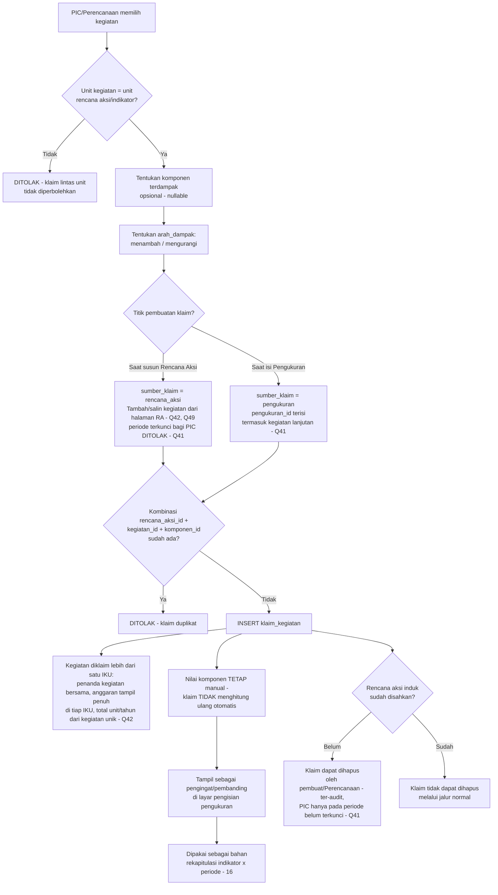

**Kegiatan berstatus batal/tidak_terlaksana tetap boleh diklaim** (§8) — kegiatan yang diklaim tapi gagal justru menjadi bukti mengapa komponen tidak bergerak sesuai rencana; statusnya ikut ditampilkan pada rekapitulasi (§17) sebagai bagian narasi kendala.

---

## 10. Alur Bukti Dukung: Persyaratan, Tiga Mode & Enam Induk Lampiran

> **Q42, Q43, Q44, Q48 (13 Oktober 2026):** persyaratan kegiatan dibagi dua tahap — tahap baru `kegiatan_perencanaan` (mis. RAB) diperiksa per kegiatan saat Rencana Aksi diajukan, dan tahap `kegiatan` (pelaksanaan) diperiksa saat kegiatan ditandai `terlaksana` (Q42 §42.4). Persyaratan tahap perencanaan kegiatan dapat ditandai `jenis_berkas.hanya_kegiatan_beranggaran` sehingga hanya diperiksa untuk kegiatan beranggaran lebih dari 0 — dipakai persyaratan RAB (Q42 §42.3 butir 3). Persyaratan dapat dilampiri **contoh berkas** melalui induk `berkas` baru `jenis_berkas`; contoh berkas bukan bukti dan tidak dibekukan ke versi pengajuan (Q42 §42.3 butir 2 dan 4). Kebijakan Storage, halaman Batas Unggahan Berkas, dan saklar unggahan dihapus: unggahan file selalu aktif, format dan ukuran per persyaratan ditetapkan Perencanaan, dan server menegakkan batas teknis dari konfigurasi aplikasi — default 10 MB (10240 KB) serta `pdf,docx,xlsx,jpg,jpeg,png` untuk lampiran tanpa persyaratan atau persyaratan yang mengosongkan format/ukuran, dan batas atas 100 MB (`ukuran_maks_kb` ≤ 102400) (Q44). Arsip PDF dokumen resmi memakai induk `berkas` baru `jadwal_tahunan` dan `jadwal_periode` (Q48, §25); lampiran per versi PK menyusul bersama revisi PK berversi (Q40, tahap 3). Induk baru tersebut tidak bergerbang persyaratan. Alasan perubahan persyaratan opsional, sedangkan penghapusan berkas tetap wajib alasan (Q43). Status implementasi: belum (US/ISS-06.08, 13.05, 13.06, 10.05).

Bukti dukung dikaitkan ke **enam induk** lewat kolom `berkas.berkasable_type`: tiga induk bergerbang persyaratan (`rencana_aksi`, `pengukuran`, `kegiatan` — dengan gerbang kelengkapan berbasis `jenis_berkas`) dan tiga induk dokumen dasar (`renstra`, `renstra_pk`, `regulasi` — lampiran bebas tanpa persyaratan `jenis_berkas`, kecuali gerbang keempat aktivasi jadwal khusus `renstra_pk`, §3.3/§5). Mode bukti (file/tautan/teks) dan seluruh aturan mode berlaku sama untuk keenam induk. Persyaratan bukti dukung bergerbang ditentukan Tim Perencanaan lewat tabel `jenis_berkas` (nama tabel dipertahankan meski kini mencakup lebih dari sekadar berkas fisik — UI memakai label "Bukti Dukung"), bukan hardcode. Substansi persyaratan (nama, tahap, mode yang diizinkan, wajib/opsional, `semua_mode_wajib`) beserta format dan ukuran maksimum per persyaratan adalah wewenang **Perencanaan** (`jenis_berkas:create/update/delete`; Q44 §44.1 butir 1). Semula kebijakan teknis unggahan tingkat aplikasi (saklar unggahan, ukuran/format default) menjadi wewenang Admin dan Superadmin (`pengaturan:update`, grup `berkas` — §18); digantikan Q44: saklar dihapus dan batas teknis ditegakkan server dari konfigurasi aplikasi (Q44 §44.2).

### 10.1 Tiga mode bukti dukung

Sistem mengenal tiga mode pemenuhan bukti dukung pada entitas `berkas`:

| Mode | Kolom terisi | Keterangan |
|---|---|---|
| `file` | `nama_asli`, `path`, `mime`, `ukuran_bytes` | Unggahan langsung ke disk VPS |
| `tautan` | `tautan` (varchar 2048, skema http/https) | URL ke dokumen yang disimpan di tempat lain |
| `teks` | `isi_teks` (text) | Keterangan tertulis langsung di sistem |

Satu persyaratan (`jenis_berkas`) dapat mengizinkan lebih dari satu mode sekaligus melalui kolom `izinkan_file`/`izinkan_tautan`/`izinkan_teks`; PIC memilih di antara mode yang diizinkan. Bila `semua_mode_wajib = true`, **seluruh** mode yang diizinkan harus terpenuhi; bila `false`, **minimal satu** mode terisi sudah dianggap memenuhi persyaratan. Satu persyaratan dapat dipenuhi oleh lebih dari satu baris `berkas` (mis. laporan sebagai file + dokumentasi sebagai tautan), terutama ketika `semua_mode_wajib = true`.

### 10.2 Alur penetapan persyaratan (Perencanaan)

```
📋 Perencanaan (permission jenis_berkas:create/update/delete)
  1. Mendefinisikan jenis_berkas: nama, tahap (rencana_aksi / pengukuran /
     kegiatan_perencanaan / kegiatan), indikator_id (nullable — null berarti berlaku untuk
     semua indikator)
     → kegiatan_perencanaan (BARU, Q42 §42.4 butir 1 dan 3): persyaratan perencanaan kegiatan
       (mis. RAB), diperiksa per kegiatan yang diklaim pada tahap RA saat Rencana Aksi diajukan
       — dapat ditandai hanya_kegiatan_beranggaran (boolean, default false) sehingga hanya
       diperiksa untuk kegiatan beranggaran lebih dari 0; persyaratan RAB memakai penanda ini,
       sedangkan persyaratan lain pada tahap yang sama berlaku untuk setiap kegiatan (Q42 §42.3
       butir 3)
     → kegiatan: persyaratan pelaksanaan kegiatan (mis. undangan, dokumentasi, SP), diperiksa
       saat kegiatan ditandai terlaksana; Q22 tetap berlaku (Q42 §42.4 butir 2)
  2. Mencentang mode yang diizinkan: izinkan_file, izinkan_tautan, izinkan_teks
     → Minimal satu mode harus dicentang — sistem menolak penyimpanan bila ketiganya kosong
  3. Menandai wajib/opsional (kolom wajib)
  4. Menentukan semua_mode_wajib:
     → true: seluruh mode yang dicentang pada langkah 2 harus terpenuhi PIC
     → false (default): minimal satu dari mode yang dicentang sudah cukup
  5. Bila izinkan_file = true, mengisi format_diizinkan dan ukuran_maks_kb (opsional — kosong
     berarti memakai default konfigurasi aplikasi: 10 MB dan pdf,docx,xlsx,jpg,jpeg,png;
     Q44 §44.2 butir 1)
     → ukuran_maks_kb di atas 102400 (100 MB) DITOLAK saat persyaratan disimpan (Q44 §44.2)
     → [Digantikan Q44] Semula default diambil dari setelan aplikasi grup berkas (§18)
  5a. Melampirkan contoh berkas pada persyaratan bila perlu (mis. contoh RAB generik) —
      disimpan sebagai berkas berinduk jenis_berkas dan dapat diunduh PIC; aplikasi tidak
      membuat template (Q42 §42.3 butir 2, §42.4 butir 3)
     → Contoh berkas BUKAN bukti: dapat ditambah, diganti, atau dihapus Perencanaan kapan saja
       (penghapusan wajib alasan, Q43 §43.2 butir 2) dan tidak dibekukan ke versi pengajuan
       (Q42 §42.3 butir 4)
  6. Menyimpan — alasan perubahan persyaratan opsional (Q43 §43.3 butir 3)
     → [Digantikan Q44] Semula muncul PERINGATAN saat penyimpanan bila wajib = true dan HANYA
       mode file yang diizinkan sementara unggahan file dinonaktifkan pada setelan aplikasi
       (berkas.unggahan_aktif = false, §18). Saklar unggahan dihapus sehingga peringatan ini
       tidak lagi muncul
```

### 10.3 Alur pemenuhan atas enam induk (tiga mode)

```
🎯 Penanggung Jawab (unit terkait) / 📋 Perencanaan / ⚙️ Superadmin (sesuai induk)
  1. Membuka daftar lampiran untuk induknya — enam nilai berkasable_type awal (a–f) ditambah
     tiga induk baru Q42/Q48 (g–i):
     a. berkasable_type = rencana_aksi — persyaratan tahap rencana_aksi (dilampirkan saat
        menyusun/mengajukan Rencana Aksi, §7), bergerbang jenis_berkas
     b. berkasable_type = pengukuran — persyaratan tahap pengukuran (dilampirkan saat mengisi/
        mengajukan Pengukuran, §11), bergerbang jenis_berkas
     c. berkasable_type = kegiatan — persyaratan tahap kegiatan_perencanaan (mis. RAB;
        dilampirkan saat menyusun RA dan diperiksa saat RA diajukan, §7, Q42) dan tahap
        kegiatan (pelaksanaan; dilampirkan saat mengubah status kegiatan menjadi terlaksana,
        §8), bergerbang jenis_berkas
     d. berkasable_type = renstra — lampiran dokumen Renstra (§3.2), TANPA jenis_berkas —
        pelengkap penelusuran, bukan persyaratan bergerbang
     e. berkasable_type = renstra_pk — lampiran dokumen Perjanjian Kinerja (§3.3), TANPA
        jenis_berkas untuk pemenuhannya, TETAPI minimal satu lampiran menjadi GERBANG KEEMPAT
        aktivasi Jadwal Tahunan (§5)
     f. berkasable_type = regulasi — lampiran dokumen dasar aturan (§3.1), TANPA jenis_berkas —
        pelengkap penelusuran, bukan persyaratan bergerbang
     g. berkasable_type = jenis_berkas (BARU, Q42) — contoh berkas pada persyaratan (mis.
        contoh RAB), dilampirkan Perencanaan (§10.2 langkah 5a) dan diunduh PIC; bukan bukti,
        tidak bergerbang, dan tidak dibekukan ke versi pengajuan (Q42 §42.3 butir 4)
     h. berkasable_type = jadwal_tahunan (BARU, Q48) — arsip PDF Rencana Aksi tahunan bertanda
        tangan, diunggah pemegang laporan:unggah (§25); tidak bergerbang, append-only
     i. berkasable_type = jadwal_periode (BARU, Q48) — arsip PDF Laporan Kinerja Triwulan
        bertanda tangan, diunggah pemegang laporan:unggah (§25); tidak bergerbang, append-only
     Keterangan berkas yang bukan pengganti (mis. "Rencana Aksi perubahan", "PK perubahan
     anggaran") disimpan pada kolom baru berkas.keterangan (nullable); alasan_koreksi tetap
     khusus untuk berkas pengganti (Q48 §48.2 butir 6)
     Bukti dukung TANPA jenis_berkas_id (lampiran bebas) tetap tersedia di seluruh enam induk
     awal (a–f) sebagai pelengkap; pada tiga induk pertama ia melengkapi persyaratan
     bergerbang, pada tiga induk dokumen dasar ia MEMANG SATU-SATUNYA bentuk lampiran (tidak
     ada jenis_berkas untuk ketiganya)
  2. Untuk induk bertahap (a–c), sistem menampilkan mode yang diizinkan per persyaratan
     (file/tautan/teks) sesuai jenis_berkas; untuk induk dokumen dasar (d–f), mode dipilih bebas
     tanpa daftar persyaratan yang mengikat
  3. Memilih dan mengisi salah satu atau kombinasi mode:
     a. mode = file: mengunggah berkas — divalidasi format_diizinkan & ukuran_maks_kb (fallback
        ke default konfigurasi aplikasi bila jenis_berkas tidak mengisinya sendiri) dan batas
        atas 100 MB (Q44 §44.2); unggahan file selalu aktif — saklar berkas.unggahan_aktif
        dihapus (Q44 §44.1 butir 2)
     b. mode = tautan: mengisi URL (divalidasi skema http/https)
     c. mode = teks: menulis keterangan
     → Mode yang dipilih HARUS termasuk mode yang diizinkan pada jenis_berkas terkait —
       permintaan dengan mode di luar daftar DITOLAK sistem
  4. Daftar bukti yang sudah dikirim tampil beserta mode masing-masing pada halaman kerja
     induknya

⚙️ Sistem (gerbang kelengkapan — lihat §10.4 untuk rincian per tahap)
  5. Pada pengajuan rencana_aksi/pengukuran atau perubahan status kegiatan menjadi terlaksana,
     memeriksa: untuk tiap jenis_berkas aktif bertanda wajib pada tahap terkait, apakah sudah
     terpenuhi menurut mode yang diizinkan dan aturan semua_mode_wajib
     → Pengajuan rencana_aksi juga memeriksa tahap kegiatan_perencanaan untuk setiap kegiatan
       yang diklaim pada tahap RA; persyaratan bertanda hanya_kegiatan_beranggaran (mis. RAB)
       hanya diperiksa untuk kegiatan beranggaran lebih dari 0 (Q42 §42.3 butir 1 dan 3,
       §42.4 butir 1)
     → Persyaratan yang diperiksa saat RA indikator X diajukan = persyaratan global ditambah
       persyaratan khusus indikator X; untuk kegiatan bersama, persyaratan khusus indikator
       lain diperiksa saat RA indikator tersebut diajukan (Q42 §42.4 butir 4)
     → Tidak terpenuhi: transisi/pengajuan DITOLAK (pengecualian tidak_dapat_dipenuhi akibat
       unggahan dimatikan, §10.5, tidak lagi berlaku — Q44)
     → Terpenuhi: lanjut

🎯 Penanggung Jawab (unit pemilik bukti) / 📋 Perencanaan (bukti mana pun)
  6. Dapat menghapus bukti milik unitnya (PIC) atau bukti mana pun (Perencanaan) SELAMA
     induknya masih dapat disunting (untuk rencana_aksi/pengukuran: hanya saat draft/dikembalikan,
     sejak diajukan koreksi lewat pengembalian beralasan, Q36; untuk kegiatan: belum
     terlaksana); setiap penghapusan tercatat audit_log dengan alasan wajib (Q43 §43.2 butir 2)
  7. Imutabilitas mengikuti status induk masing-masing (rincian per induk — §10.6a):
     rencana_aksi/pengukuran: sejak diajukan (koreksi lewat pengembalian), imutabel setelah
     disahkan (Q36); kegiatan: setelah terlaksana; renstra: setelah
     Renstra aktif; renstra_pk: setelah Jadwal Tahunan tahun itu aktif; regulasi: selama masih
     dirujuk Renstra/indikator aktif. Sebelum batas itu, PIC/Perencanaan (dan pengunggah) dapat
     menghapus; setiap penghapusan tercatat audit_log. Setelah jadwal_tahunan.penutupan, koreksi
     lampiran rencana_aksi/pengukuran/kegiatan hanya lewat jadwal:buka_kembali. Arsip
     jadwal_tahunan/jadwal_periode tidak pernah dihapus (append-only) dan tetap dapat
     ditambah setelah jadwal ditutup (Q48 §48.2 butir 3 dan 5)
```

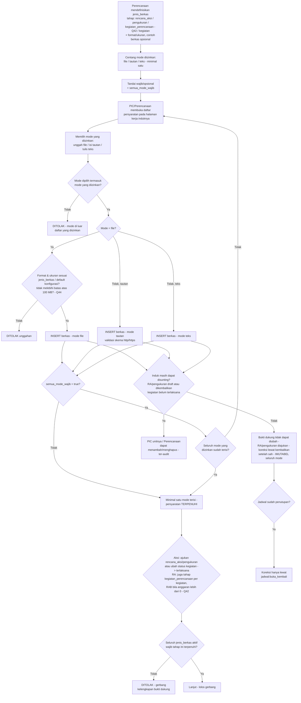

### 10.4 Gerbang kelengkapan per induk

Dari enam induk, **empat** memiliki gerbang kelengkapan; **dua** (`renstra`, `regulasi`) murni lampiran pelengkap tanpa gerbang:

- **Rencana aksi & pengukuran** (§7, §11): transisi `draft → diajukan` ditolak bila ada persyaratan `wajib` pada tahap tersebut yang belum terpenuhi — "terpenuhi" kini dibaca sesuai mode (file terunggah, tautan terisi, atau teks terisi) dan aturan `semua_mode_wajib`. Pengajuan Rencana Aksi juga ditolak bila persyaratan wajib tahap `kegiatan_perencanaan` belum terpenuhi untuk salah satu kegiatan yang diklaim pada tahap RA — persyaratan bertanda `hanya_kegiatan_beranggaran` (mis. RAB) hanya untuk kegiatan beranggaran lebih dari 0 (Q42 §42.3–§42.4). Yang diperiksa saat RA indikator X diajukan adalah persyaratan global ditambah persyaratan khusus indikator X; untuk kegiatan bersama, persyaratan khusus indikator lain diperiksa saat RA indikator tersebut diajukan (Q42 §42.4 butir 4).
- **Kegiatan** (§8): transisi status `rencana → terlaksana` DITOLAK bila ada persyaratan `wajib` bertahap `kegiatan` (tahap pelaksanaan, Q42 §42.4 butir 2) yang belum terpenuhi. Transisi ke `tidak_terlaksana`/`ditunda`/`batal` **tidak pernah** digerbangi bukti dukung — syaratnya tetap `justifikasi`, karena kegiatan yang gagal tidak memiliki dokumen pertanggungjawaban pelaksanaan.
- **renstra_pk** (§3.3, §5, BARU): aktivasi `jadwal:aktivasi` (gerbang keempat) DITOLAK bila `renstra_pk` tahun tsb belum memiliki minimal satu lampiran — gerbang ini TIDAK memakai `jenis_berkas` (tanpa daftar persyaratan bernama), cukup "ada minimal satu baris `berkas`" pada induk tsb, mode apa pun.
- **renstra** dan **regulasi**: TIDAK memiliki gerbang kelengkapan — lampiran pada kedua induk ini murni pelengkap penelusuran (§3.1, §3.2), tidak pernah memblokir transisi status apa pun.
- Keempat gerbang di atas (rencana_aksi, pengukuran, kegiatan, renstra_pk) mengikuti aturan `semua_mode_wajib` yang sama: pada tiga induk bertahap, `true` mensyaratkan seluruh mode yang diizinkan terpenuhi dan `false` cukup satu; pada `renstra_pk`, cukup satu lampiran mode apa pun. Aturan anti-macet `tidak_dapat_dipenuhi` (§10.5) digantikan Q44.
- Induk baru `jenis_berkas` (contoh berkas), `jadwal_tahunan`, dan `jadwal_periode` (arsip dokumen resmi) tidak memiliki gerbang kelengkapan (Q42, Q48).
- Gerbang rencana_aksi, pengukuran, dan kegiatan DIKECUALIKAN untuk periode lampau (§15), termasuk persyaratan tahap `kegiatan_perencanaan` dan RAB; RA 2026 data awal juga dikecualikan dari gerbang RAB (Q46 §46.1 butir 1 dan 3). Gerbang `renstra_pk` (gerbang keempat aktivasi jadwal) TIDAK dikecualikan untuk periode lampau — periode lampau tetap memerlukan PK tahun berjalan beserta lampirannya, karena PK adalah dasar legal yang mendahului aktivasi jadwal, bukan bagian dari alur pengisian rutin yang dikecualikan.

### 10.5 Aturan anti-macet: penanda `tidak_dapat_dipenuhi`

> **Digantikan Q44 (13 Oktober 2026):** saklar unggahan dihapus sehingga unggahan file selalu aktif; penanda `tidak_dapat_dipenuhi` akibat unggahan dimatikan tidak lagi dibuat pada gerbang mana pun, termasuk gerbang keempat aktivasi jadwal (Q44 §44.1 butir 2). Penanda yang sudah tercatat tetap tampil sebagai histori pada rekapitulasi dan audit. Teks dan diagram di bawah dipertahankan sebagai riwayat.

Semula (histori, digantikan Q44): ketersediaan mode **tidak boleh memacetkan alur kerja**, pada keempat gerbang (rencana_aksi, pengukuran, kegiatan, renstra_pk) sekaligus. Bila unggahan file dinonaktifkan pada setelan aplikasi (`berkas.unggahan_aktif = false`, §18) sementara suatu persyaratan `wajib` hanya mengizinkan mode `file` (`izinkan_tautan` dan `izinkan_teks` sama-sama `false`) — atau, khusus `renstra_pk`, belum ada lampiran mode `tautan`/`teks` sama sekali — sistem:

1. Menandai persyaratan/gerbang tersebut sebagai **`tidak_dapat_dipenuhi`** untuk induk yang bersangkutan.
2. **Tidak memblokir** gerbang kelengkapan (§10.4) maupun gerbang keempat aktivasi jadwal (§5) — pemenuhan yang ditandai demikian dianggap terpenuhi secara administratif agar PIC/Perencanaan tidak terjebak menunggu keputusan teknis di luar kendalinya.
3. Mencatat penandaan ini di `audit_log`.
4. Menampilkan penanda tersebut pada rekapitulasi (§17) dan pada halaman kerja Perencanaan, sehingga terlihat dan dapat diperbaiki — Perencanaan dapat menambahkan mode `tautan`/`teks` pada persyaratan/lampiran itu, atau Admin/Superadmin dapat mengaktifkan kembali unggahan (§18).

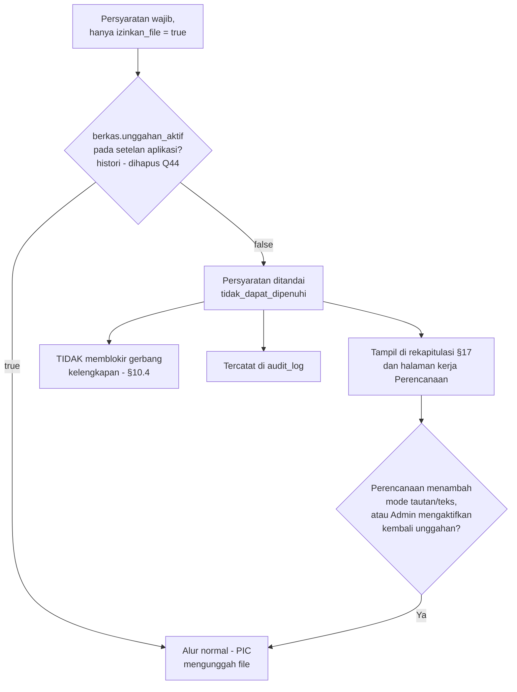

### 10.6 Imutabilitas per induk & audit

**10.6a — Imutabilitas mengikuti status induk, berbeda-beda per induk (enam induk awal ditambah induk baru Q42/Q48):**

| Induk (`berkasable_type`) | Lampiran tidak dapat dihapus setelah | Sebelum batas itu, dapat dihapus oleh |
|---|---|---|
| `rencana_aksi` | induk berstatus `diajukan` (koreksi lewat pengembalian beralasan); imutabel setelah `disahkan` (Q36) | PIC unit terkait, Perencanaan |
| `pengukuran` | induk berstatus `diajukan` (koreksi lewat pengembalian beralasan); imutabel setelah `disahkan` (Q36) | PIC unit terkait, Perencanaan |
| `kegiatan` | induk berstatus `terlaksana`; berkas yang memenuhi persyaratan tahap `kegiatan_perencanaan` (mis. RAB) tidak dapat dihapus sejak RA yang mengklaim kegiatan itu diajukan — koreksi lewat pengembalian RA atau berkas pengganti (Q25), pola Q36 (Q42 §42.4 butir 5) | PIC unit terkait, Perencanaan |
| `renstra` | Renstra berstatus `aktif` | Perencanaan |
| `renstra_pk` | Jadwal Tahunan tahun tsb berstatus `aktif` | Perencanaan |
| `regulasi` | masih dirujuk Renstra atau indikator aktif (bukan status waktu, melainkan status rujukan) | Perencanaan/Superadmin |
| `jenis_berkas` (contoh berkas, Q42) | tidak ada batas — contoh berkas bukan bukti, dapat ditambah, diganti, atau dihapus kapan saja dan tidak dibekukan ke versi pengajuan (Q42 §42.3 butir 4) | Perencanaan (`jenis_berkas:update`) |
| `jadwal_tahunan`, `jadwal_periode` (arsip dokumen resmi, Q48) | sejak diunggah — tidak pernah dihapus (append-only); salah unggah dikoreksi dengan berkas pengganti (`menggantikan_id`, `alasan_koreksi`) (Q48 §48.2 butir 3) | — |

Setiap penghapusan tercatat `audit_log` (soft delete lewat `dihapus_pada`/`dihapus_oleh`) dengan alasan wajib (Q43 §43.2 butir 2). Setelah batas imutabilitas tercapai: bukti dukung TIDAK DAPAT dihapus maupun diganti isinya pada mode apa pun. Untuk `rencana_aksi`/`pengukuran`/`kegiatan`, koreksi pasca-`jadwal_tahunan.penutupan` hanya lewat `jadwal:buka_kembali`; untuk `renstra`/`renstra_pk`/`regulasi`, tidak ada jalur koreksi otomatis serupa — perubahan dokumen dasar setelah induknya beku memerlukan revisi in place pada induknya sendiri (§14) yang tercatat beralasan, bukan penghapusan lampiran lama.

**10.6b — Audit:**

- Penetapan/ubah persyaratan (`jenis_berkas`) — termasuk perubahan mode yang diizinkan, `wajib`, `semua_mode_wajib`, tahap, format/ukuran, dan `hanya_kegiatan_beranggaran` — dicatat dengan `nilai_lama`/`nilai_baru` dan `alasan` bila diisi; alasan perubahan persyaratan opsional (Q43 §43.3 butir 3), sedangkan penghapusan contoh berkas wajib alasan (Q42 §42.3 butir 4).
- Pengiriman bukti mencatat `mode` dan sumbernya: untuk `file` — nama asli, ukuran, mime; untuk `tautan` — nilai tautan tersimpan utuh pada baris `berkas` dan dicatat sebagai perubahan biasa; untuk `teks` — panjang teks, bukan salinannya. Berlaku sama pada keenam induk.
- Pembuatan/ubah/hapus `regulasi` (nilai_lama/nilai_baru + alasan), perubahan `renstra.regulasi_id`/`indikator.regulasi_id`, unggah/hapus lampiran dokumen dasar (mode + sumber), dan penandaan `tidak_dapat_dipenuhi` pada gerbang keempat aktivasi jadwal (histori sebelum Q44) — seluruhnya tercatat `audit_log`.
- Unggahan arsip dokumen resmi (Rencana Aksi tahunan, Laporan Kinerja Triwulan) tercatat `audit_log` dan tidak mengubah data, status, maupun snapshot (Q48 §48.2 butir 4).
- Penyimpanan file fisik tetap di disk VPS (`storage/app/berkas/...`), diakses lewat route ber-permission (streamed download) — **bukan** URL publik, konsisten dengan model akses berbasis permission yang berlaku di seluruh aplikasi, untuk seluruh induk (Q44 §44.1 butir 4). Mode `tautan` dan `teks` tidak memakai storage aplikasi sama sekali.

---

## 11. Alur Pengisian Pengukuran per Periode

> **Q44, Q45, Q46, Q47, Q51 (13 Oktober 2026):** pengajuan pengukuran kini juga mensyaratkan narasi pengukuran (`progres_kegiatan`, `kendala_masalah`, `strategi_tindak_lanjut`) dan, bila ada Rekomendasi Pimpinan yang **disetujui** pada periode sebelumnya, `tindak_lanjut_rekomendasi` (Q45 §45.1, §45.2 butir 3; Q51 §51.1 butir 2); `catatan` menjadi keterangan tambahan opsional. Realisasi yang belum tersedia dapat diajukan sebagai "belum dapat diukur" (`status_perhitungan = belum_dapat_diukur`, `nilai` kosong) dengan gerbang komponen dikecualikan (Q47 §47.4, §24). Pengecualian `tidak_dapat_dipenuhi` akibat unggahan dimatikan tidak berlaku lagi (Q44). Gerbang baru dikecualikan untuk periode lampau (Q46 §46.1). Status implementasi: belum (US/ISS-07.01, 07.03; tahap 2).

Jendela pengisian dan reviu berlaku per periode (§4), bukan satu jendela untuk seluruh tahun. Batasan waktu ini berlaku berbeda bagi Penanggung Jawab (PIC) dibandingkan Perencanaan, dan pengajuan pengukuran tunduk pada gerbang tambahan: rencana aksi disahkan, komponen lengkap, bukti dukung lengkap, narasi wajib, dan tindak lanjut rekomendasi (Q45).

```
🎯 Penanggung Jawab (PIC, akses pengukuran:create/update di-scope per unit)
   [Q31] Scope unit tetap merupakan bagian penting jalur operasional. Penambahan PIC operasional (bukan role) tidak boleh diartikan sebagai izin global ke seluruh unit/indikator; sumber permission bawaan PIC operasional (bukan role) masih OPEN.
  1. Membuka daftar indikator dalam scope unit-nya untuk periode berjalan
  2. Selama tanggal hari ini berada dalam [pengisian_mulai, pengisian_selesai] periode tsb
     (dari jadwal_periode): dapat membuat/mengubah pengukuran, mengisi nilai tiap komponen aktif
     (§6) atau menyatakan realisasi belum dapat diukur (Q47, §24), mengisi narasi pengukuran
     (Q45), menambah klaim kegiatan susulan (§9), dan melengkapi bukti dukung wajib tahap
     pengukuran (§10)
  3. Mengajukan pengukuran → GERBANG (ditolak bila salah satu tidak terpenuhi):
     a. rencana_aksi (indikator × tahun) belum berstatus disahkan (tetap berlaku, Q41 §41.3
        butir 1)
     b. ada komponen aktif pada indikator ini yang nilainya masih null — dikecualikan bila
        realisasi berstatus belum dapat diukur; pada periode nilai akhir realisasi wajib
        terisi, kecuali tidak dapat dihitung (Q9; Q47 §47.4 butir 1 dan 4)
     c. bukti dukung wajib bertahap pengukuran untuk indikator ini belum lengkap (pengecualian
        tidak_dapat_dipenuhi, §10.5, digantikan Q44)
     d. narasi pengukuran belum lengkap: progres_kegiatan, kendala_masalah,
        strategi_tindak_lanjut (Q45 §45.1 butir 1)
     e. ada Rekomendasi Pimpinan yang disetujui pada periode sebelumnya — termasuk periode
        terakhir tahun sebelumnya bila indikatornya masih diukur (Q51 §51.1 butir 4) — tetapi
        tindak_lanjut_rekomendasi belum diisi (Q45 §45.2 butir 3, Q51 §51.1 butir 2; dibangun
        bersama ISS-09.01, tahap 2) — draf rekomendasi tidak memicu gerbang ini
     → Gerbang di atas DIKECUALIKAN untuk periode lampau (§15), termasuk narasi wajib dan
       tindak lanjut rekomendasi (Q46 §46.1 butir 1) — periode lampau dipakai justru untuk
       memasukkan data historis yang mungkin tidak melalui proses rencana aksi/bukti dukung
       formal pada masanya
  4. Begitu tanggal hari ini melewati pengisian_selesai periode tsb:
     → PIC TIDAK DAPAT LAGI membuat, mengubah, atau mengajukan pengukuran untuk periode itu
     → Deadline ini bersifat mutlak — tidak ada jendela toleransi tambahan bagi PIC
     → Satu-satunya jalur lanjutan adalah Perencanaan mengisikan sendiri (langkah 5) atau
       jadwal:buka_kembali (§13) bila koreksi diperlukan setelah penutupan

📋 Perencanaan (akses pengukuran:create/update bersifat GLOBAL, tanpa scope unit)
  5. Dikecualikan dari batas jendela periode — dapat membuat/mengubah/mengajukan pengukuran
     untuk indikator unit mana pun, kapan pun, selama Jadwal Tahunan belum mencapai penutupan
     → TETAP TUNDUK pada gerbang kelengkapan langkah 3 (rencana aksi disahkan, komponen
       lengkap, bukti dukung lengkap, narasi wajib, tindak lanjut rekomendasi) — pengecualian
       Perencanaan hanya berlaku pada batas WAKTU, bukan pada gerbang KELENGKAPAN DATA
  6. Sering dipakai untuk: mengisikan data atas nama unit yang lewat tenggat, backfill (§15),
     atau koreksi tanpa harus membuka-kembali jadwal terlebih dahulu — bila Perencanaan yang
     mengisi juga hendak memverifikasi/mengesahkan pengukuran ini sendiri, berlaku aturan
     pemisahan tugas F2 (§20): diizinkan, ditandai self_approval di audit_log

⚙️ Sistem (perhitungan status tampilan)
  7. Status "Belum mengisi"/"Tidak mengisi" dihitung per kombinasi indikator × periode yang
     diharapkan (dari jadwal_periode) — bukan per tahun secara keseluruhan
  8. Indikator berstatus arsip TIDAK dihitung sebagai kewajiban pengisian pada periode manapun
  9. Untuk periode dengan is_nilai_akhir=true, nilai diisi manual — tidak dihitung otomatis
     dari agregasi periode-periode di bawahnya
  10. Periode tanpa target (target RA periode kosong — pada indikator dinilai tahunan, atau
      periode lampau data awal 2026): capaian persen dan status capaian tidak dihitung; layar
      pengukuran menampilkan realisasi, target PK, dan selisih terhadap target PK; pada
      periode bertarget, selisih tampil sebagai informasi tambahan (Q47 §47.3, §24)
```

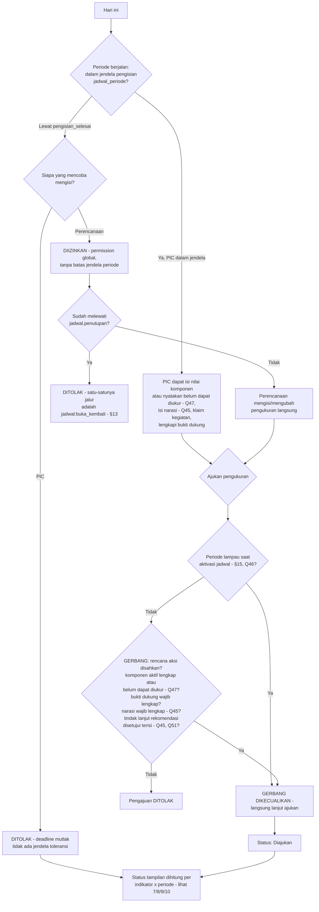

**Konsekuensi permission (lihat §19):** permission hasil role selalu global. Perencanaan dapat memiliki allow global sesuai preset. Jalur PIC operasional memperoleh hak kerja unit melalui `user_permission_granted` pada 7 permission scoped final. Tidak ada role `pic`. Resolver tetap membedakan allow global vs grant scoped, sedangkan deadline, assignment, F1/F2, status, dan gerbang kelengkapan tetap business guard terpisah.

---

## 12. Alur Status Data Pengukuran (5 Status + Jalur Kembali)

```
🎯 Penanggung Jawab / 📋 Perencanaan
  1. Membuat pengukuran baru untuk indikator → Status: Draft
     PIC: hanya untuk indikator dalam scope unit miliknya (grant user_permission_granted), dalam
     jendela pengisian periode aktif
     Perencanaan: untuk indikator unit mana pun (permission global lewat role_permissions), tanpa
     batas jendela periode (hanya dibatasi jadwal.penutupan)
  2. Mengedit nilai komponen, narasi pengukuran (Q45), dan catatan opsional — atau menyatakan
     realisasi belum dapat diukur (status_perhitungan = belum_dapat_diukur, Q47) — selama masih
     Draft (bisa berkali-kali); untuk indikator bertipe rasio_persen/penjumlahan, nilai
     indikator terhitung otomatis sebagai turunan (§6)
  3. Mengajukan pengukuran → Status: Diajukan
     GERBANG (§11): rencana_aksi disahkan, komponen aktif lengkap (dikecualikan bila realisasi
     belum dapat diukur, Q47), bukti dukung wajib tahap pengukuran lengkap, narasi pengukuran
     lengkap, dan tindak lanjut atas rekomendasi disetujui periode sebelumnya (Q45, Q51) —
     dikecualikan untuk periode lampau (§15, Q46)
     catatan opsional sebagai keterangan tambahan (Q45 §45.1 butir 3)
     [Digantikan Q45] Semula catatan wajib diisi jika:
       a. Nilai pada periode ini MEMBURUK menurut arah indikator (naik_baik: nilai turun;
          turun_baik: nilai naik) dibanding pengukuran berstatus Disahkan terakhir secara
          kronologis untuk indikator yang sama — nilai STAGNAN tidak memicu kewajiban ini;
          pengukuran pertama tanpa pembanding Disahkan tidak wajib catatan, atau
       b. indikator.wajib_catatan = true (saklar kini disembunyikan dari form indikator,
          kolomnya dipertahankan — Q45)

📋 Perencanaan
  4. Memverifikasi pengukuran yang Diajukan
     → PERINGATAN bila realisasi atau narasi sama persis dengan periode sebelumnya — tidak
       memblokir verifikasi (ketentuan pelengkap pengantar Q47–Q51, ISS-08.01)
     → Realisasi belum dapat diukur: Perencanaan menilai penjelasan pada narasi; bila tidak
       dapat diterima, pengukuran dikembalikan (Q47 §47.4 butir 2)
     → Setuju: Status: Diverifikasi
     → Perlu revisi: Status: Dikembalikan + alasan wajib diisi
     GERBANG PEMISAHAN TUGAS (§20, aturan F1): ditolak bila aktor yang memverifikasi adalah PIC
     yang sama dengan pengukuran_versi.diajukan_by lewat jalur scope unit — tidak berlaku bagi
     Perencanaan yang mengisi atas nama unit (F2)
  5. Untuk pengukuran yang sudah Diverifikasi, masih bisa dikembalikan bila belakangan ditemukan
     masalah → Status: Dikembalikan + alasan wajib diisi
  6. Mengesahkan pengukuran yang Diverifikasi → Status: Disahkan (Fase Awal: langsung final,
     tanpa approval Pimpinan)
     GERBANG PEMISAHAN TUGAS (§20, aturan F1) berlaku sama pada pengesahan

🎯 Penanggung Jawab / 📋 Perencanaan
  7. Jika status Dikembalikan, merevisi nilai/narasi/catatan → Status kembali ke Draft, lanjut
     lagi dari langkah 2 (tunduk batas jendela periode yang sama bagi PIC, dan gerbang §11 pada
     pengajuan ulang)

📋 Perencanaan / ⚙️ Superadmin
  8. Untuk pengukuran yang sudah Disahkan, masih dapat dibuka-kembali (pengukuran:buka_kembali)
     menjadi Dikembalikan, dengan alasan wajib, selama Jadwal Tahunan belum penutupan — lihat §13

(Fase Lanjutan, belum dibangun: pengukuran yang sudah Disahkan bisa memerlukan tahap tambahan
pengukuran:setujui oleh Pimpinan sebelum benar-benar dianggap final, jika
pakai_persetujuan_pimpinan=true)
```

```mermaid
stateDiagram-v2
    [*] --> Draft: pengukuran:create\n(PIC: grant scoped unit + jendela periode;\nPerencanaan: role global, tanpa batas jendela)
    Draft --> Draft: pengukuran:update\n(edit nilai komponen, narasi wajib - Q45,\ncatatan opsional; atau nyatakan belum dapat diukur - Q47;\nnilai indikator turunan otomatis jika berkomponen)
    Draft --> Diajukan: ajukan (GERBANG: rencana aksi disahkan,\nkomponen lengkap kecuali belum dapat diukur - Q47,\nbukti dukung lengkap, narasi wajib,\ntindak lanjut rekomendasi disetujui - Q45, Q51;\ndikecualikan utk periode lampau - Q46)
    Diajukan --> Diverifikasi: pengukuran:verifikasi (Perencanaan,\ntunduk gerbang pemisahan tugas F1/F2 §20;\nperingatan bila realisasi/narasi sama persis\ndengan periode sebelumnya - tidak memblokir)
    Diajukan --> Dikembalikan: pengukuran:kembalikan (Perencanaan, alasan wajib)
    Diverifikasi --> Dikembalikan: pengukuran:kembalikan (Perencanaan, alasan wajib)
    Diverifikasi --> Disahkan: pengukuran:sahkan (Perencanaan)\nFASE AWAL: langsung, tanpa approval Pimpinan\ntunduk gerbang pemisahan tugas F1/F2 §20
    Dikembalikan --> Draft: penanggung jawab/Perencanaan merevisi
    Disahkan --> Dikembalikan: pengukuran:buka_kembali\n(Perencanaan/Superadmin, alasan wajib,\nhanya sebelum jadwal.penutupan)
    Disahkan --> [*]: status final Fase Awal\n(sampai jadwal.penutupan) -\nsiap direkomendasikan Pimpinan (§17)\ndan ditetapkan status capaiannya (§16)

    note right of Disahkan
        FASE LANJUTAN (belum dibangun):
        Disahkan dapat memerlukan tahap
        tambahan pengukuran:setujui oleh
        Pimpinan sebelum dianggap final,
        jika pakai_persetujuan_pimpinan=true
    end note

    note right of Dikembalikan
        Ada DUA jalur menuju Dikembalikan:
        1. Pra-pengesahan (dari Diajukan/Diverifikasi)
           via pengukuran:kembalikan
        2. Pasca-pengesahan (dari Disahkan)
           via pengukuran:buka_kembali - §13
    end note
```

**Aturan penting yang tidak tergambar eksplisit di diagram state di atas:**
- Setiap transisi menaikkan kolom `versi` pada baris `pengukuran` (optimistic locking) — permintaan dengan `versi` usang ditolak.
- Baris dengan `nilai`/`catatan` terisi tidak pernah dihapus permanen di transisi manapun.
- Transisi `pengukuran:create`/`update` oleh PIC hanya diizinkan jika terdapat grant `user_permission_granted` dengan `unit_id` yang cocok dengan `indikator.unit_id` target, **dan** tanggal hari ini masih dalam jendela pengisian periode terkait (§11). Transisi oleh Perencanaan tidak tunduk pengecekan `unit_id` (permission global lewat peran) maupun jendela periode, hanya dibatasi `jadwal.penutupan` dan gerbang kelengkapan.
- `pengukuran:create` untuk indikator berstatus `arsip` ditolak sistem, siapa pun pemohonnya.
- Untuk indikator bertipe `rasio_persen`/`penjumlahan`, kolom `pengukuran.nilai` adalah nilai turunan (`sumber_nilai = komponen`); PIC mengedit `pengukuran_komponen`, bukan `pengukuran.nilai` langsung.
- Realisasi "belum dapat diukur" dicatat sebagai nilai tersendiri `status_perhitungan = belum_dapat_diukur` dengan `nilai` kosong — di samping `belum_diisi`, `terhitung`, dan `tidak_dapat_dihitung` — bukan disimpulkan dari `nilai` kosong; berbeda dari realisasi `0` dan dari "tidak dapat dihitung" (Q9) (Q47 §47.4 butir 1 dan 3, §24).
- Transisi `diajukan/diverifikasi → disahkan` (dan verifikasi) tunduk pada aturan pemisahan tugas F1/F2 (§20), yang dievaluasi **setelah** aktor dinyatakan memiliki permission yang relevan (§19).

---

## 13. Alur Buka-Kembali

Koreksi data rencana aksi/pengukuran/jadwal disediakan lewat tiga permission berbeda, masing-masing untuk situasi yang berbeda:

| Lapis | Permission | Transisi | Alasan | Batasan waktu | Pelaku |
|---|---|---|---|---|---|
| 1 — Rencana Aksi | `rencana_aksi:buka_kembali` | `disahkan → dikembalikan` | Wajib | Hanya **sebelum** `jadwal_tahunan.penutupan` | Perencanaan / Superadmin |
| 2 — Pengukuran | `pengukuran:buka_kembali` | `Disahkan → Dikembalikan` | Wajib | Hanya **sebelum** `jadwal.penutupan` | Perencanaan / Superadmin |
| 3 — Jadwal | `jadwal:buka_kembali` | `ditutup → aktif` | Wajib | Hanya **setelah** `jadwal.penutupan` (atau kapan saja jadwal berstatus `ditutup`) | Perencanaan / Superadmin |

```
📋 Perencanaan / ⚙️ Superadmin
  Lapis 1 — Rencana Aksi, sebelum penutupan jadwal:
  1. Menemukan Rencana Aksi berstatus disahkan yang perlu dikoreksi (mis. target komponen
     periode yang belum terkunci perlu direvisi, termasuk penyesuaian setelah revisi PK —
     Q40 §40.1 butir 7, Q41 §41.4 butir 4)
     → BUKAN untuk memindahkan kegiatan yang mundur ke periode lain: kegiatan ditandai ditunda
       dan kegiatan lanjutannya diklaim pada tahap pengukuran (Q41 §41.4 butir 3, §8)
  2. Menjalankan aksi rencana_aksi:buka_kembali, wajib mengisi alasan
     → Jadwal sudah penutupan: aksi DITOLAK — jalur ini sudah tertutup, lanjut ke Lapis 3
     → Jadwal belum penutupan: Status rencana aksi kembali ke dikembalikan
  3. Penanggung jawab/Perencanaan merevisi rencana_aksi_target (kembali ke alur §7)
     → Revisi oleh PIC TIDAK boleh mengubah target maupun daftar kegiatan periode yang sudah
       terkunci (pengisian_selesai lewat) — DITOLAK 422 dan diaudit; Perencanaan dikecualikan
       sampai penutupan (Q41 §41.2)
     → Pada RA 2026 data awal, Perencanaan dapat memakai jalur ini untuk menambah kegiatan
       TW IV, selain lewat klaim tahap pengukuran (Q46 §46.1 butir 3)
     → Rencana aksi yang kembali ke dikembalikan/draft TIDAK otomatis mencabut gerbang
       pengukuran yang sudah terlanjur diajukan sebelumnya pada periode lain; gerbang hanya
       dievaluasi ulang pada pengajuan BARU

  Lapis 2 — Pengukuran, sebelum penutupan jadwal:
  4. Menemukan pengukuran berstatus Disahkan yang perlu dikoreksi
  5. Menjalankan aksi pengukuran:buka_kembali, wajib mengisi alasan
     → Jadwal sudah penutupan: aksi DITOLAK — jalur ini sudah tertutup, lanjut ke Lapis 3
     → Jadwal belum penutupan: Status pengukuran kembali ke Dikembalikan
  6. Penanggung jawab/Perencanaan merevisi nilai/narasi/catatan (kembali ke alur §12
     langkah 7)

  Lapis 3 — Jadwal, setelah penutupan jadwal (mekanisme standar, bukan sekadar darurat):
  7. Menjalankan aksi jadwal:buka_kembali pada Jadwal Tahunan berstatus ditutup, wajib
     mengisi alasan → Status jadwal kembali ke aktif
  8. Dipakai untuk beberapa skenario:
     a. Koreksi rencana aksi/pengukuran pasca-penutupan — begitu jadwal aktif kembali, Lapis 1
        dan Lapis 2 tersedia lagi untuk baris yang relevan
        → Dalam sesi koreksi ini PIC hanya dapat mengubah RA pada periode yang jendela
          pengisiannya dibuka kembali secara resmi (Q19, ISS-14.03); di luar itu koreksi RA
          dilakukan Perencanaan (Q41 §41.2 butir 6)
     b. Memasukkan indikator baru di tengah tahun (mis. akibat revisi Kepmen IKU, §14) —
        begitu jadwal aktif kembali, trigger snapshot idempoten (§5 langkah 7–8) berjalan ulang
        dan membuat baris jadwal_snapshot (+ jadwal_snapshot_komponen) baru khusus untuk
        indikator yang belum punya pasangan snapshot pada jadwal ini, tanpa menyentuh baris
        snapshot lama
  9. Setelah koreksi/penambahan selesai, menjalankan jadwal:tutup kembali → Status: ditutup

Seluruh transisi pada ketiga lapis tercatat di audit_log; alasan tetap wajib (Q43 §43.2
butir 1). Penutupan jadwal hanya menghentikan mutasi data kinerja: unggahan arsip PDF
dokumen resmi tetap dapat dilakukan saat jadwal berstatus ditutup tanpa jadwal:buka_kembali,
karena tidak mengubah data, status, maupun snapshot (Q48 §48.2 butir 4–5, §25).
```

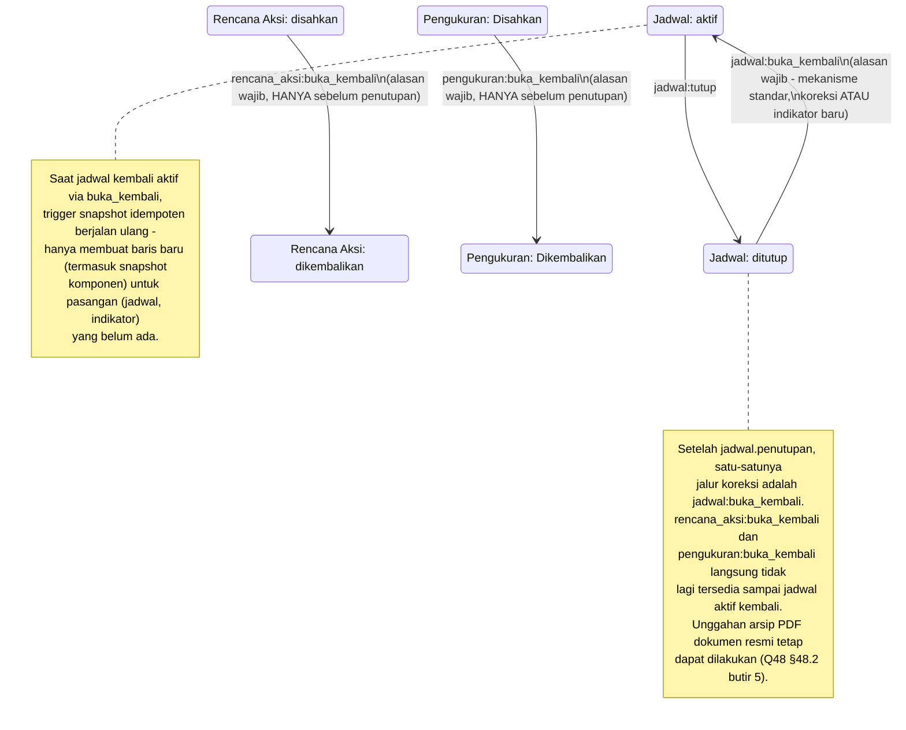

**Perbedaan mendasar dengan cakupan Fase Awal lain:** `jadwal:buka_kembali` bukan sekadar jalur darurat, melainkan **mekanisme standar** untuk beberapa kebutuhan operasional yang sama pentingnya: koreksi data setelah penutupan (baik rencana aksi maupun pengukuran), dan penambahan indikator baru di tengah tahun berjalan (§14). Ketiga permission buka-kembali (`rencana_aksi:buka_kembali`, `pengukuran:buka_kembali`, `jadwal:buka_kembali`) memakai pola alasan-wajib dan pencatatan audit yang konsisten, sehingga jejaknya seragam meski tahap dan entitasnya berbeda.

---

## 14. Alur Perubahan Kepmen IKU & Revisi Renstra

> **Q39, Q40, Q50 (13 Oktober 2026):** target Renstra diisi di Sasaran & Indikator dan target PK di halaman PK (Q39). Lampiran revisi Renstra boleh ditambahkan setelah Renstra aktif, dan perubahan target Renstra saat Renstra aktif wajib beralasan serta tampil sebagai riwayat revisi target Renstra (Q40 §40.2; US/ISS-02.10, tahap 1). Perubahan target resmi PK memakai revisi PK berversi (Q40 §40.1, §3.3; US/ISS-02.12, tahap 3); PK perubahan yang hanya mengubah anggaran cukup menjadi lampiran tambahan PK (Q50 §50.7). Versi penuh Renstra tidak dibangun (Q40 §40.2 butir 4). Status implementasi: belum.

Terbitnya Kepmen IKU baru dapat mengubah, menghapus, atau menambah indikator yang wajib diukur. Alur berikut menegaskan bagaimana perubahan itu direfleksikan ke sistem tanpa kehilangan riwayat data yang sudah ada.

```
📋 Perencanaan
  1. Kepmen IKU baru terbit, menggantikan/merevisi Kepmen sebelumnya

  Kasus A — Revisi atribut Renstra (nama, dasar_hukum, rentang tahun, dsb):
  2a. Mengedit baris Renstra yang SAMA secara langsung (in place) — BUKAN membuat Renstra baru
  3a. Sistem mencatat audit_log dengan nilai_lama/nilai_baru dari field yang berubah, dan
      alasan wajib memuat nomor & tanggal Kepmen yang melandasi revisi

  Kasus B — Indikator dihapus dari Kepmen baru:
  2b. Mengarsipkan indikator terkait (status: aktif → arsip) — TIDAK menghapus baris
  3b. Data pengukuran lama pada indikator ini tetap utuh, tetap muncul di laporan historis
      dengan penanda status arsip; rencana aksi dan kegiatan historisnya juga tetap terbaca
  4b. pengukuran:create dan rencana_aksi:create untuk indikator ini ditolak sistem sejak saat
      itu (lihat §5, §7, §12)

  Kasus C — Indikator baru ditambahkan oleh Kepmen baru:
  2c. Membuat indikator baru di bawah Sasaran yang sesuai (unit pemilik, arah penilaian,
      tipe_perhitungan, dan indikator_komponen bila diperlukan)
  3c. Mengisi target Renstra indikator baru bila ada (Sasaran & Indikator), serta baseline dan
      target PK tahun berjalan di halaman PK (Q39) — tanpa target Renstra, target PK tetap
      dapat diisi dengan keterangan "target Renstra belum ada" (Q39 §39.2 butir 4)
  4c. Merevisi Perjanjian Kinerja tahun berjalan agar mencakup target indikator baru — memakai
      revisi PK berversi (Q40 §40.1, §3.3; tahap 3); bila revisi yang mengubah target terbit
      sebelum ISS-02.12 selesai, penanganannya ditetapkan PM sebagai keputusan baru (Q50 §50.7
      butir 2)
  5c. Menjalankan jadwal:buka_kembali (§13) pada Jadwal Tahunan tahun berjalan — ini
      MEKANISME STANDAR untuk memasukkan indikator baru di tengah tahun, termasuk untuk
      mengisi periode-periode yang tersisa pada tahun berjalan
  6c. Trigger snapshot idempoten membuat baris jadwal_snapshot (+ jadwal_snapshot_komponen)
      baru khusus indikator ini; indikator kini dapat diukur untuk periode-periode berikutnya
      pada jadwal yang sama, setelah rencana aksinya disusun dan disahkan (§7)

  Kasus D — Lampiran revisi Renstra (Q40 §40.2 butir 2 dan 5; ISS-02.10):
  2d. Menambahkan lampiran revisi pada Renstra yang sudah aktif; lampiran yang sudah ada tetap
      tidak dapat dihapus
     → Lampiran baru hanya diterima Renstra berstatus draft atau aktif; Renstra nonaktif atau
       diarsipkan DITOLAK menerima lampiran baru

  Kasus E — Revisi target Renstra saat Renstra aktif (Q40 §40.2 butir 3; ISS-02.10):
  2e. Mengubah target Renstra indikator di Sasaran & Indikator dengan alasan WAJIB (dasar
      revisi; Q43 §43.2 butir 3) — permission target:update (Q39 §39.3 butir 3)
  3e. Sistem mencatat audit_log nilai_lama/nilai_baru; catatan tsb tampil sebagai riwayat
      revisi target Renstra — mis. bila target terlampaui sebelum akhir periode Renstra,
      target tahun-tahun berikutnya dinaikkan dengan cara ini
     → Target Renstra hanya pembanding target PK; perubahan ini tidak mengubah target PK,
       snapshot, maupun capaian (Q39 §39.1, §39.4)

  Kasus F — Penggantian Renstra karena kebijakan kementerian (Q40 §40.2 butir 4):
  2f. Membuat Renstra baru; Renstra lama dinonaktifkan sesuai aturan yang berlaku (§2) — versi
      penuh Renstra (sasaran dan indikator ikut berversi) tidak dibangun
```

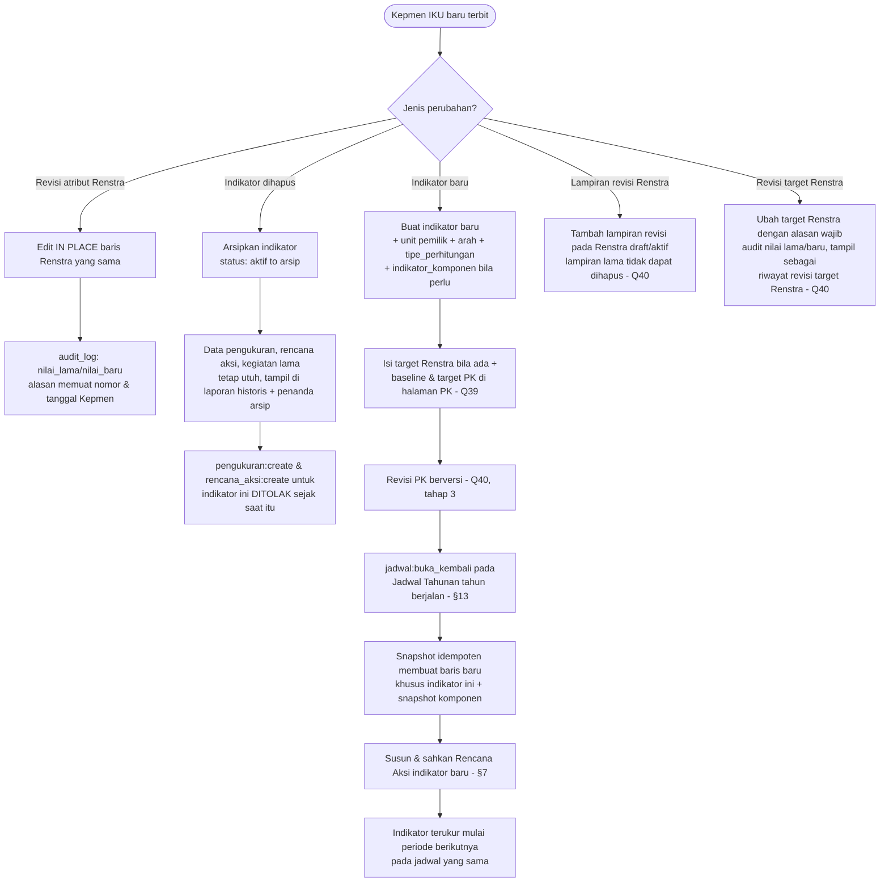

**Konsekuensi desain yang disadari:** indikator baru yang dibuat setelah jadwal aktif **tanpa** melewati `jadwal:buka_kembali` tidak otomatis terukur pada tahun berjalan — baru terukur mulai jadwal tahun berikutnya diaktifkan. `jadwal:buka_kembali` (Kasus C langkah 5c) adalah satu-satunya jalur agar indikator baru dapat diukur pada sisa tahun berjalan yang sama, dan rencana aksinya tetap wajib disusun-disahkan sebelum pengukuran pertamanya dapat diajukan.

---

## 15. Alur Periode Lampau 2026 dan Data Awal

> **Q46, Q47, Q50 (13 Oktober 2026):** dengan pola pelaporan pada minggu pertama bulan setelah triwulan, **TW III 2026** ikut menjadi periode lampau yang diisi Perencanaan, dan **TW IV 2026** menjadi triwulan pertama workflow normal PIC operasional dengan pelaporan awal Januari 2027 (Q46 §46.1 butir 2). Gerbang baru Q42–Q45 dikecualikan untuk periode lampau, sedangkan kunci per triwulan (Q41) bukan bagian pengecualian itu (Q46 §46.1 butir 1, dikoreksi 13 Oktober 2026). Data awal 2026 diisi Perencanaan dari dokumen resmi 2026, dengan target TW I–III dicatat kosong (Q46 §46.1 butir 6, Q47 §47.2 butir 4). Semula TW I–II periode lampau dan TW III–IV normal (Q32.7) — diperbarui Q46. Status implementasi: belum (US/ISS-03.05, 07.05, 15.01).

Penggunaan pertama SAKIP memakai Jadwal Tahunan 2026, bukan mekanisme backfill generik.

```text
Aktivasi Jadwal 2026
        ↓
Evaluasi jadwal_periode.pengisian_selesai
        ↓
┌───────────────────────────┬───────────────────────────┐
│ sudah lewat saat aktivasi │ belum lewat              │
│ = periode lampau         │ = periode normal         │
├───────────────────────────┼───────────────────────────┤
│ TW I–III 2026            │ TW IV 2026               │
│ diisi Perencanaan        │ workflow PIC operasional │
└───────────────────────────┴───────────────────────────┘
```

Untuk periode lampau:

1. tidak dibuat flag `is_backfill`; status periode lampau dihitung dari jendela pengisian terhadap waktu aktivasi (Q46 §46.1 butir 2);
2. tidak dibuat jadwal 2025;
3. PK tahun 2026 tetap menjadi gerbang wajib;
4. gerbang RA disahkan, kelengkapan komponen, dan berkas wajib dikecualikan pada jalur pengisian periode lampau, demikian pula gerbang baru Q42–Q45: RA minimal satu kegiatan, RAB, persyaratan tahap perencanaan kegiatan, narasi wajib, dan tindak lanjut rekomendasi (Q46 §46.1 butir 1); setiap issue yang menambah gerbang Q42–Q45 menyertakan pengecualian periode lampau beserta test-nya, dan issue kunci per triwulan (Q41) menyertakan test bahwa periode lampau terkunci bagi PIC (Q46 §46.1 butir 4);
5. pengisian dilakukan Perencanaan dan seluruh mutasi tetap teraudit;
6. kunci per triwulan BUKAN bagian pengecualian: periode lampau sudah terkunci bagi PIC pada Rencana Aksi sejak aktivasi jadwal, sedangkan Perencanaan yang mengisinya memang tidak terikat kunci (Q41 §41.2 butir 3–4; Q46 §46.1 butir 1 — dikoreksi 13 Oktober 2026, semula kunci per triwulan ikut disebut dikecualikan);
7. target Rencana Aksi periode lampau boleh kosong = tidak ditargetkan (Q46 §46.1 butir 6, Q47 §47.2 butir 4);
8. kegiatan data awal 2026 dan kegiatan pada periode lampau boleh tanpa anggaran — tercatat "belum diisi" (Q46 §46.1 butir 3, Q42 §42.2 butir 2).

Rencana Aksi 2026 yang telah disusun Perencanaan harus dicatat dengan status **disahkan** sebelum pengajuan TW IV (diperbarui Q46; semula sebelum pengajuan TW III). RA 2026 data awal dikecualikan dari gerbang kegiatan minimal dan RAB; kegiatan TW IV ditambahkan lewat klaim tahap pengukuran atau buka-kembali RA oleh Perencanaan; kegiatannya boleh tanpa anggaran karena Rencana Aksi resmi hanya memuat anggaran per Rincian Output (Q46 §46.1 butir 3). Workflow PIC operasional untuk RA baru berlaku normal mulai siklus berikutnya (2027).

**Data awal 2026 (Q46 §46.1 butir 6; ISS-15.01, di akhir tahap 1):** Perencanaan mengisi data awal dari dokumen resmi 2026 — Renstra 2025–2029, Perjanjian Kinerja 2026, Rencana Aksi 2026, serta Laporan Kinerja Triwulan I dan II 2026 (pengantar Q47–Q51).

```text
📋 Perencanaan (data awal 2026, sebelum operasional TW IV)
  1. Sasaran dan indikator berkode mengikuti PK: S1–S4, IKU 1.1–4.1; nomor IKU Renstra dicatat
     pada definisi operasional (Q50 §50.4)
  2. Sasaran S4 dan IKU 4.1 dicatat di bawah Renstra 2025–2029 tanpa target Renstra
     (Q50 §50.5)
  3. PK 2026 tanpa nomor (Q50 §50.1) dengan target PK bernilai penuh (mis. 94,05; 80,95;
     92,86), bukan nilai tercetak yang dibulatkan (Q50 §50.2)
  4. IKU 1.3 ditandai dinilai tahunan; indikator lain tidak, termasuk IKU 4.1 (Q47 §47.1
     butir 4)
  5. Rencana Aksi 2026 berstatus disahkan: target TW I–III dicatat KOSONG untuk semua
     indikator (Q47 §47.2 butir 4), target TW IV, dan kegiatan per indikator per triwulan —
     kegiatan data awal boleh tanpa anggaran, tercatat "belum diisi" (Q46 §46.1 butir 3)
  6. Realisasi, narasi, dan rekomendasi TW I–II dari Laporan Kinerja Triwulan I dan II; TW III
     diisi Perencanaan sebagai periode lampau (Q46 §46.1 butir 2)
     → Rekomendasi TW I–II dari laporan triwulan yang sudah ditandatangani Pimpinan dicatat
       Perencanaan langsung berstatus disetujui, dengan penanda persetujuan cadangan dan
       rujukan laporan sumbernya pada rekomendasi_pimpinan.rujukan_sumber (Q51 §51.1 butir 5)
  → Data yang belum dikonfirmasi mengikuti asumsi kerja data awal 2026 pada Keputusan
    Penyelarasan; asumsi kerja tidak dipakai di produksi sebelum dikonfirmasi Perencanaan
```

Koreksi data setelah penutupan tidak disebut backfill; gunakan flow buka-kembali/koreksi teraudit yang memang disediakan.

## 16. Alur Penetapan Status Capaian

> **Q47, Q50 (13 Oktober 2026):** pada periode tanpa target, capaian persen dan status capaian tidak dihitung; tampilan memakai "Tanpa target periode" serta realisasi, target PK, dan selisih terhadap target PK (Q47 §47.3). Realisasi "belum dapat diukur" tampil dengan label tersebut dan tidak dihitung sebagai capaian 0 (Q47 §47.4 butir 3). Penetapan status capaian manual tidak tersedia untuk pengukuran pada periode tanpa target maupun pengukuran berstatus belum dapat diukur (Q47 §47.3 butir 4). Status capaian dan selisih memakai target PK yang disimpan bernilai penuh (Q50 §50.2 butir 2). Status implementasi: belum (§24).

```
📋 Perencanaan / ⚙️ Superadmin
  1. Membuka daftar pengukuran berstatus Disahkan yang belum punya status_capaian aktif —
     tidak termasuk pengukuran pada periode tanpa target atau berstatus belum dapat diukur,
     yang tidak dapat diberi status capaian manual (Q47 §47.3 butir 4)
  2. Memilih status: Tercapai atau Belum Tercapai untuk tiap pengukuran
  3. Sistem menyimpan baris status_capaian baru dengan sumber=manual, ditetapkan_oleh=user
     yang login
  4. Status capaian itu langsung aktif untuk pengukuran tsb dan tampil di dashboard
  5. Kalau suatu saat perlu direvisi, pilih status baru
     → sistem menyimpan baris status_capaian baru sebagai status aktif, baris lama tetap
       tersimpan sebagai riwayat (soft replace, bukan update/hapus)
  6. Kalau tidak ada revisi, proses selesai — status capaian tetap tampil di dashboard

(Fase Lanjutan, belum dibangun: jalur ini digambar sebagai referensi desain, di mana sistem
eksternal/job terjadwal menghitung status_capaian otomatis dengan sumber=data_sumber,
ditetapkan_oleh=NULL — belum ada job yang menjalankan jalur ini di Fase Awal)
```

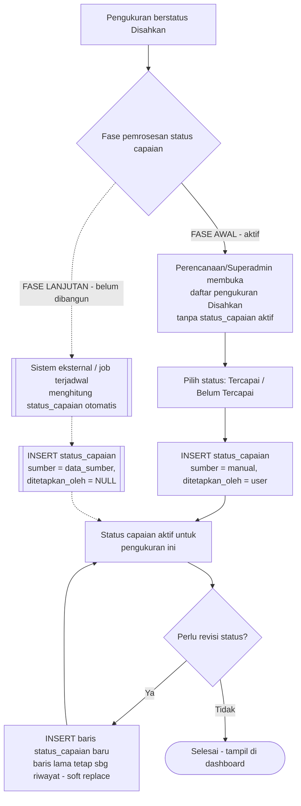

Garis putus-putus menandai jalur `data_sumber` sebagai referensi desain masa depan, bukan sesuatu yang aktif pada Fase Awal — tidak ada job/integrasi yang mengeksekusi cabang tersebut saat ini. Status capaian tetap ditetapkan manual dan terpisah dari transisi status alur `Disahkan` — keduanya adalah dua momen berbeda, dan juga terpisah dari Rekomendasi Pimpinan (§17), yang merupakan momen ketiga yang berbeda lagi.

---

## 17. Alur Rekomendasi Pimpinan

> **Q45 dan Q51 (13 Oktober 2026):** Rekomendasi Pimpinan kini diisi **Pimpinan**: Perencanaan menyusun **draf** per indikator × periode, lalu Pimpinan **menyetujui** draf — boleh mengubah isinya lebih dulu — atau menulis rekomendasi langsung (Q51 §51.1 butir 1). Hanya rekomendasi **disetujui** yang berlaku (Q51 §51.1 butir 2). Permission tetap `rekomendasi:tetapkan` pada preset Pimpinan dan Perencanaan; persetujuan oleh Perencanaan adalah jalur cadangan bila Pimpinan berhalangan, diberi penanda dan tercatat di audit (Q45 §45.2 butir 1, Q51 §51.2). Alur lama — Perencanaan menetapkan rekomendasi dan Pimpinan read-only — digantikan Q45 §45.2 dan Q51. Dikerjakan pada US/ISS-09.01, tahap 2 (Q51 §51.3). Status implementasi: draf, persetujuan, dan tampilan rekomendasi disetujui pada pengukuran periode berikutnya tersedia (ISS-09.01); gerbang tindak lanjut pada pengajuan (ISS-07.03) tersedia dan diuji pada `04c8a16`, dengan serialisasi persetujuan/pengajuan pada `850ae98` (Q55); Laporan Kinerja Triwulan (ISS-10.05) belum.

Rekomendasi Pimpinan melekat pada **indikator × periode**, terpisah dari status alur `pengukuran` — dapat diisi setelah rapat evaluasi triwulan tanpa menunggu pengukuran periode itu berstatus disahkan, dan tetap opsional per indikator per periode (Q51 §51.1 butir 3).

```
📋 Perencanaan (permission rekomendasi:tetapkan)
  1. Setelah rapat evaluasi triwulan/berkala, membuka form Rekomendasi Pimpinan untuk suatu
     indikator × periode × tahun
     → TIDAK perlu menunggu pengukuran periode itu berstatus disahkan — rekomendasi dapat
       disusun berdasarkan hasil rapat, sebelum atau sesudah pengesahan
  2. Menyusun DRAF isi rekomendasi (teks) → INSERT baris rekomendasi_pimpinan dengan
     status = draf, ditetapkan_oleh = penyusun yang login (Q51 §51.1 butir 1)
     → Draf belum berlaku dan tidak tampil bagi PIC (Q51 §51.1 butir 2)
     → Paling banyak satu draf terbuka per indikator × periode × tahun; menyimpan lagi mengubah
       draf yang sama dengan token versi, dan konflik versi ditolak tanpa mengubah data (Q55)

✍️ Pimpinan (permission rekomendasi:tetapkan — preset Pimpinan, Q45 §45.2 butir 1)
  3. Membuka draf, dapat mengubah isinya, lalu MENYETUJUI → status = disetujui; disetujui_oleh,
     disetujui_oleh_role, dan disetujui_pada terisi (Q51 §51.1 butir 1)
  4. Atau menulis rekomendasi langsung tanpa draf Perencanaan, lalu menyimpannya sebagai draf
     atau langsung menyetujuinya — simpan draf dan setujui dibedakan oleh status, bukan oleh
     permission (Q51 §51.1 butir 1, §51.2 butir 1)

📋 Perencanaan (jalur cadangan)
  5. Bila Pimpinan berhalangan, Perencanaan dapat menyetujui draf — persetujuan diberi penanda
     cadangan dari salinan peran penyetuju (disetujui_oleh_role) dan tercatat di audit_log;
     penanda yang sama berlaku untuk persetujuan oleh peran lain selain Pimpinan, termasuk
     Superadmin (Q51 §51.2 butir 2)
     → Penyetuju cadangan juga dapat menulis rekomendasi yang langsung disetujui dengan
       penanda yang sama; draf tidak diwajibkan lebih dulu (Q55 §55.1 butir 4)
  5a. Data awal 2026: rekomendasi TW I–II dari laporan triwulan yang sudah ditandatangani
      Pimpinan dicatat Perencanaan langsung berstatus disetujui, dengan penanda persetujuan
      cadangan dan rujukan laporan sumbernya pada kolom rancangan
      rekomendasi_pimpinan.rujukan_sumber (Q51 §51.1 butir 5, §15)

⚙️ Sistem
  6. Rekomendasi yang berlaku = baris terbaru berstatus disetujui per (indikator_id, tahun,
     periode_id); baris lama tetap sebagai riwayat (soft replace, tidak dihapus) — sama
     seperti status_capaian (§16)
  7. Perubahan atas rekomendasi yang sudah disetujui membentuk BARIS BARU dan melalui
     persetujuan yang sama (langkah 2–5); sampai baris baru disetujui, rekomendasi lama tetap
     berlaku (Q51 §51.2 butir 3)
     → Permintaan dari tampilan yang rekomendasi berlakunya sudah diganti pengguna lain ditolak
       sebagai konflik versi tanpa mengubah data (Q55 §55.1 butir 3)
  8. Rekomendasi disetujui tampil pada layar pengukuran periode berikutnya, rekapitulasi
     indikator × periode, dashboard/laporan, dan Laporan Kinerja Triwulan (§25), berdampingan
     dengan target, capaian, komponen, dan narasi (Q51 §51.1 butir 2)
  9. Rekomendasi disetujui pada periode N memicu kewajiban tindak_lanjut_rekomendasi pada
     pengajuan pengukuran periode N+1 (Q45 §45.2 butir 3, §11) — draf tidak memicu kewajiban
     ini; pengecualian periode lampau tetap berlaku (Q46 §46.1)
     → Kewajiban berlaku lintas tahun: rekomendasi pada periode terakhir suatu tahun
       ditindaklanjuti pada periode pertama jadwal tahun berikutnya bila indikatornya masih
       diukur (Q51 §51.1 butir 4)
     → Versi pengajuan membekukan rekomendasi yang tampil bersama tindak lanjutnya; persetujuan
       atau revisi sesudahnya tidak mengubah tampilan versi itu (Q55 §55.1 butir 5)
     → Pengajuan dari tampilan yang rekomendasinya sudah diganti ditolak sebagai konflik tanpa
       membentuk versi (Q55 §55.1 butir 6)
```

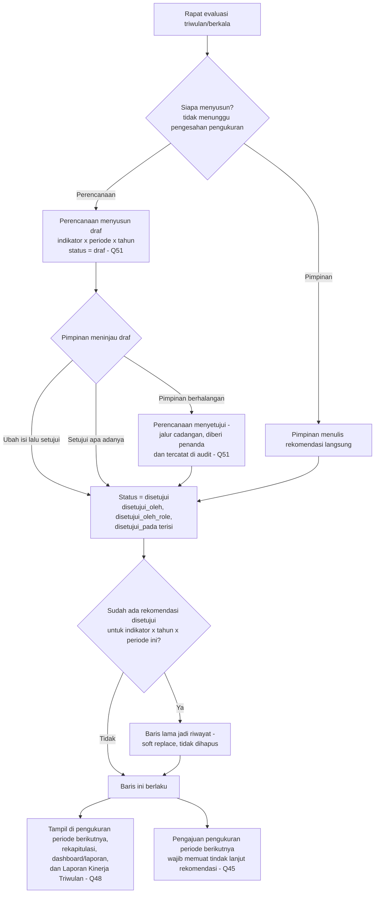

**Pengisi rekomendasi (diperbarui Q45 dan Q51):** Perencanaan menyusun draf, sedangkan Pimpinan menyetujui atau menulis langsung; persetujuan oleh Perencanaan hanya cadangan bertanda. Semula — pada baseline Fase Awal — pengisinya Perencanaan dan Pimpinan read-only karena alur approval Pimpinan ditunda ke Fase Lanjutan; ketentuan itu digantikan Q45 §45.2 butir 1 dan Q51. Approval pengukuran oleh Pimpinan (`pengukuran:setujui`) tetap Fase Lanjutan. Penanda persetujuan cadangan berlaku untuk persetujuan oleh peran selain Pimpinan, termasuk Superadmin (Q51 §51.2 butir 2).

---

## 18. Alur Setelan Aplikasi

> **Q43, Q44 (13 Oktober 2026):** Kebijakan Storage (`/pengaturan/storage`) — grup `berkas` pada §18.1 — dan halaman Batas Unggahan Berkas (§18.2) dihapus; saklar unggahan dihapus sehingga unggahan file selalu aktif, dan panel penggunaan penyimpanan dihapus (Q44 §44.1). Format dan ukuran per persyaratan ditetapkan Perencanaan di Persyaratan Berkas (§10.2), sedangkan batas teknis ditegakkan server dari konfigurasi aplikasi dan diubah lewat konfigurasi deployment yang dicatat pada catatan rilis (Q44 §44.2). Kunci grup `berkas` yang sudah tersimpan tidak lagi dibaca maupun dikelola UI dan tetap sebagai histori. Alasan perubahan setelan opsional (Q43 §43.3 butir 3). Status implementasi: belum (US/ISS-13.06, 13.05; tahap 1).

Modul terbatas yang memungkinkan Superadmin maupun Admin mengubah nilai teks dan preferensi presentasional aplikasi tanpa perlu deploy ulang kode; kebijakan teknis operasional unggahan tidak lagi dikelola modul ini (Q44).

### 18.1 Setelan umum (identitas, preferensi; grup `berkas` dihapus Q44)

```
⚙️ Superadmin / Admin
  1. Membuka halaman Setelan Aplikasi, terkelompok per grup: identitas instansi (nama,
     alamat, telepon, surel, laman, logo), identitas aplikasi (nama aplikasi, label unit), dan
     preferensi tampilan/laporan (zona waktu, format tanggal, format angka, header/footer
     ekspor)
     → [Dihapus Q44] Grup berkas — kebijakan bukti dukung tingkat aplikasi — tidak lagi tampil
       maupun dibaca; kuncinya tetap tersimpan sebagai histori:
       - berkas.unggahan_aktif (boolean) — saklar unggahan file aplikasi-wide, dihapus Q44;
         unggahan selalu aktif (Q44 §44.1 butir 2)
       - berkas.ukuran_maks_kb (integer) dan berkas.format_diizinkan (teks) — semula default
         bila jenis_berkas mengosongkannya; digantikan default konfigurasi aplikasi (Q44 §44.2)
       - berkas.tautan_selalu_diizinkan (boolean) — semula penanda bahwa mode tautan dan teks
         selalu tersedia sebagai jalur alternatif tanpa storage; dihapus dari UI (Q44)
  2. Mengubah satu atau beberapa nilai kunci pengaturan
  3. Menyimpan perubahan
     → Sistem memvalidasi kunci yang dikirim berada dalam whitelist kunci terdefinisi —
       kunci di luar whitelist ditolak
     → Kunci valid: baris pengaturan terkait diperbarui (nilai, updated_by, updated_at)

⚙️ Sistem
  4. Mencatat audit_log untuk tiap kunci yang berubah (nilai_lama/nilai_baru); alasan
     perubahan setelan opsional (Q43 §43.3 butir 3)
  5. Menginvalidasi cache accessor pengaturan terkait, sehingga pembacaan berikutnya
     mengambil nilai terbaru
  6. [Digantikan Q44] Semula: bila berkas.unggahan_aktif diubah menjadi false (histori),
     seluruh endpoint unggah file pada KEEMPAT gerbang (rencana_aksi/pengukuran/kegiatan/
     renstra_pk) dan pada lampiran bebas induk renstra/regulasi menolak unggahan sejak saat
     itu; persyaratan/gerbang wajib yang hanya mengizinkan mode file ditandai
     tidak_dapat_dipenuhi (§10.5). Saklar dihapus sehingga cabang ini tidak lagi terjadi

📋 Perencanaan (permission jenis_berkas:create/update/delete, TANPA pengaturan:update)
  7. [Dihapus Q44 §44.1 butir 3] Semula: panel READ-ONLY "Penggunaan Penyimpanan Bukti
     Dukung" pada halaman Setelan Aplikasi (jumlah bukti mode file beserta total
     ukuran_bytes, dan jumlah bukti mode tautan/teks lintas induk). Panel dihapus; tampilan
     daftar berkas terunggah masuk backlog tahap 3 (Q46 §46.3)

👤 Pengguna lain
  8. Membaca nilai pengaturan terjadi otomatis saat render halaman (mis. label unit di form
     Indikator, header laporan ekspor) — TANPA memerlukan permission khusus untuk membaca;
     batas ukuran/format unggahan di form bukti dukung kini dibaca dari persyaratan atau
     default konfigurasi aplikasi, bukan dari pengaturan (Q44 §44.2)
```

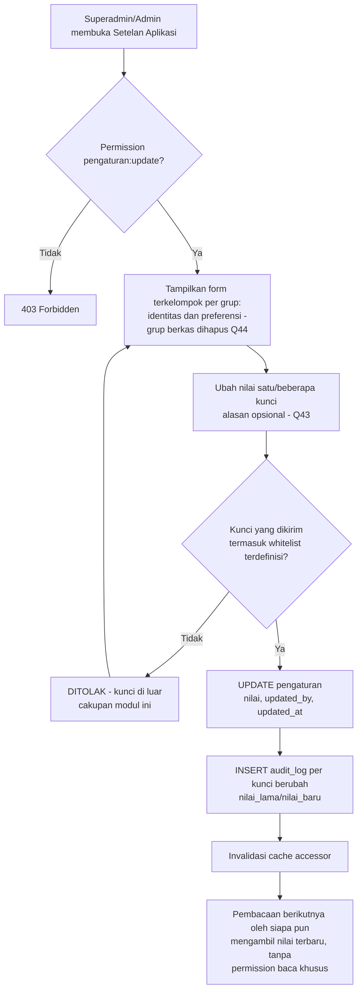

### 18.2 Halaman "Batas unggahan berkas" (per persyaratan) — dihapus Q44

> **Dihapus Q44 (13 Oktober 2026):** halaman ini dihapus dan route lamanya tidak lagi melayani halaman tersebut; format dan ukuran per persyaratan kini diubah Perencanaan lewat form Persyaratan Berkas (§10.2), dengan `ukuran_maks_kb` paling besar 102400 KB (Q44 §44.1 butir 1, §44.2; US/ISS-13.06). Teks dan diagram di bawah dipertahankan sebagai riwayat.

Semula (histori, dihapus Q44): berbeda dari grup `berkas` di §18.1 (kebijakan default/saklar tingkat aplikasi), halaman ini adalah layar **khusus** di Setelan Aplikasi yang mendaftar SELURUH `jenis_berkas` (aktif maupun nonaktif, lintas tahap rencana_aksi/pengukuran/kegiatan) dan memungkinkan Admin/Superadmin mengubah **dua kolom saja** per baris persyaratan: `format_diizinkan` dan `ukuran_maks_kb`. Halaman ini TIDAK menerima perubahan atas kolom substantif persyaratan.

```
⚙️ Admin / Superadmin (permission pengaturan:update)
  1. Membuka halaman "Batas unggahan berkas" pada Setelan Aplikasi (histori, dihapus Q44)
  2. Sistem menampilkan daftar SELURUH jenis_berkas (aktif maupun nonaktif) sebagai baris,
     dengan HANYA dua kolom yang dapat diedit inline: format_diizinkan, ukuran_maks_kb
     → Kolom substantif (nama, tahap, wajib, izinkan_file, izinkan_tautan, izinkan_teks,
       semua_mode_wajib, indikator_id) DITAMPILKAN sebagai referensi tetapi TIDAK DAPAT diubah
       dari halaman ini — payload yang menyertakan kolom di luar dua kolom tsb DITOLAK sistem
       sama sekali, terlepas nilai yang dikirim
  3. Mengubah ukuran_maks_kb dan/atau format_diizinkan pada satu atau beberapa baris
  4. Menyimpan perubahan
     → Validasi: ukuran_maks_kb minimal 100 (KB) bila diisi — nilai di bawah itu DITOLAK
     → Validasi: format_diizinkan WAJIB terisi bila izinkan_file = true pada persyaratan
       tersebut — mengosongkannya pada persyaratan yang mengizinkan mode file DITOLAK
     → Perubahan bersifat GRANDFATHERED: bukti yang sudah terlanjur diunggah dengan
       format/ukuran lama TIDAK menjadi tidak sah karena perubahan batas ini
     → Bila perubahan MENYEMPITKAN daftar format sementara sudah ada bukti berformat yang
       tidak lagi termasuk daftar baru: sistem menampilkan PERINGATAN (bukan menolak
       penyimpanan) — bukti lama tetap sah, hanya unggahan baru yang tunduk format baru

⚙️ Sistem
  5. Mencatat audit_log PER PERSYARATAN yang berubah: persyaratan mana (jenis_berkas_id),
     kolom apa (format_diizinkan/ukuran_maks_kb), nilai lama → nilai baru, oleh siapa
  6. Menginvalidasi cache accessor terkait sehingga validasi unggahan berikutnya memakai
     nilai baru

📋 Perencanaan (permission jenis_berkas:create/update/delete, TANPA pengaturan:update)
  7. Tetap satu-satunya pemegang wewenang atas kolom substantif persyaratan — perubahan
     substansi (nama, tahap, wajib, mode yang diizinkan, semua_mode_wajib, indikator_id)
     tetap lewat CRUD jenis_berkas (§10.2), TIDAK lewat halaman ini
```

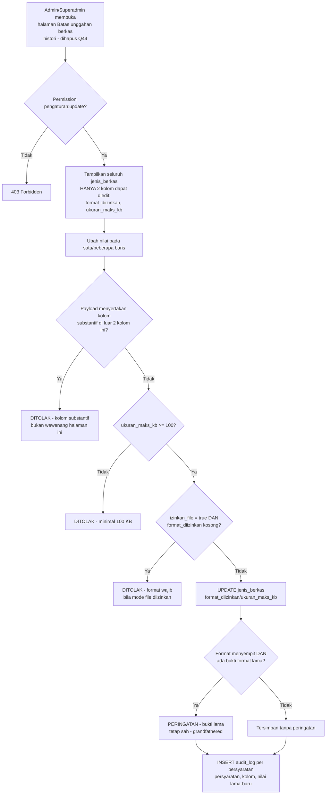

**Pembagian kewenangan (diperbarui Q44):** **substansi persyaratan bukti dukung** (nama, tahap, wajib/opsional, mode yang diizinkan, `semua_mode_wajib`, per indikator) **beserta format dan ukuran per persyaratan** adalah wewenang **Perencanaan** (`jenis_berkas:create/update/delete`, §10.2; Q44 §44.1 butir 1). Batas teknis unggahan (default dan batas atas) ditegakkan server dari konfigurasi aplikasi dan diubah lewat konfigurasi deployment, bukan dari UI (Q44 §44.2). Semula kebijakan teknis unggahan — saklar/format/ukuran default tingkat aplikasi (§18.1, grup `berkas`) maupun format/ukuran per persyaratan (§18.2, halaman "Batas unggahan berkas") — menjadi wewenang pemegang `pengaturan:update` (Admin dan Superadmin); pembagian itu digantikan Q44.

**Batas tegas cakupan modul ini (diperbarui Q44):** yang boleh dinamis melalui Setelan Aplikasi **hanya teks dan preferensi presentasional** — dipegang **Admin maupun Superadmin** lewat `pengaturan:update`. Kebijakan teknis operasional bukti dukung (saklar unggahan, ukuran/format default tingkat aplikasi, ukuran/format per persyaratan, penanda ketersediaan tautan) tidak lagi dikelola modul ini sejak Q44: substansi serta format/ukuran per persyaratan menjadi wewenang Perencanaan lewat `jenis_berkas:create/update/delete` (§10), sedangkan batas teknis berasal dari konfigurasi aplikasi. Modul ini secara sengaja **tidak** menyediakan jalur untuk mengubah nilai enum/status, nama permission, atau aturan bisnis apa pun — seluruh hal tersebut tetap didefinisikan di kode, bukan di tabel `pengaturan`.

**Catatan cakupan:** branding halaman login Keycloak berada di luar cakupan aplikasi ini — diatur di level realm Keycloak, bukan lewat modul Setelan Aplikasi.

---

## 19. Alur Evaluasi Permission Saat Request

Resolver authorization selalu bekerja server-side.

```text
Request
  ↓
permission dikenal & aktif?
  ├─ tidak → 403 fail closed
  ↓ ya
user terautentikasi & status aktif?
  ├─ tidak → tolak / halaman akun tidak aktif
  ↓ ya
allow role global + grant cocok
  ↓
ada deny yang cocok?
  ├─ ya → 403 (deny wins)
  ↓ tidak
permission unit-scoped?
  ├─ ya → cek 7 permission scoped final + unit grant/allow global sah
  ↓
cek business guard
(status, PJ bila relevan, jendela, F1/F2, penutupan, dsb.)
  ↓
ALLOW
```

Role final hanya lima. PIC bukan role database. User tanpa role memiliki nol permission.

Hanya tujuh permission unit-scoped: `pengukuran:create/update`, `rencana_aksi:create/update/ajukan`, `kegiatan:create/update`. Permission read bersifat global sesuai preset.

Grant Unit dikelola melalui `delegasi:update`; Assign Role dan Deny melalui `akses:update`.

## 20. Alur Pemisahan Tugas (Segregation of Duties)

Pemisahan tugas pada verifikasi dan pengesahan pengukuran adalah **aturan bisnis keras**, bukan bagian dari resolusi izin (§19) dan bukan baris deny — supaya tidak dapat "dinonaktifkan" lewat pemberian grant apa pun. Aturan ini dievaluasi **setelah** aktor dinyatakan memiliki permission `pengukuran:verifikasi`/`pengukuran:sahkan` yang berlaku (§19); ia tidak menggantikan resolusi izin, hanya menambah syarat di atasnya.

**Penyelarasan Q32:** F1/F2 tidak memeriksa nama role PIC karena role tersebut tidak ada. Jalur PIC berarti provenance pengajuan melalui grant unit/scoped workflow; provenance historis tetap dibekukan.

```
🎯 Penanggung Jawab (PIC, mengisi lewat grant scope unit — jalur PIC)
   [Q32] F1 memakai provenance/jalur pengajuan scoped. Perubahan role setelah pengajuan tidak menghapus larangan self-review historis.
  1. Mengajukan pengukuran (draft → diajukan) untuk indikator dalam scope unitnya —
     pengukuran.created_by tercatat sebagai PIC ini

⚙️ Sistem (aturan bisnis keras F1 — tidak dapat dikonfigurasi lewat izin)
  2. Pada transisi diajukan → diverifikasi dan diverifikasi → disahkan: membandingkan aktor
     yang menjalankan aksi dengan pengukuran_versi.diajukan_by
     → Aktor SAMA dengan pengukuran_versi.diajukan_by, DAN pengisian dilakukan lewat jalur grant
       scope unit (jalur PIC): TOLAK — terlepas dari permission pengukuran:verifikasi/
       pengukuran:sahkan yang dimiliki aktor tersebut
     → Aktor BERBEDA dari pengukuran_versi.diajukan_by: lanjut sebagai aksi yang diizinkan (tunduk
       evaluasi izin normal §19)

📋 Perencanaan (mengisi ATAS NAMA unit, permission global lewat peran, tanpa scope unit)
  3. Mengisi pengukuran untuk indikator unit yang PIC-nya melewati tenggat, atau untuk
     backfill (§15) — pengukuran.created_by tercatat sebagai Perencanaan yang mengisi
  4. ATURAN F2: aturan keras F1 TIDAK berlaku pada jalur ini. Perencanaan yang sama DIIZINKAN
     memverifikasi dan mengesahkan pengukuran yang diisinya sendiri
  5. Aksi verifikasi/pengesahan pada pengukuran hasil jalur Perencanaan-mengisi-sendiri
     ditandai self_approval pada audit_log, dan tampil sebagai penanda eksplisit di
     dashboard/laporan Perencanaan — transparansi menggantikan larangan pada jalur ini

⚙️ Sistem
  6. F1 dan F2 TIDAK menggantikan resolusi izin (§19): pada kedua jalur, aktor tetap harus
     memiliki permission pengukuran:verifikasi/pengukuran:sahkan yang berlaku (lewat peran
     atau grant, dan tidak sedang di-deny) sebelum pemeriksaan F1/F2 dijalankan
```

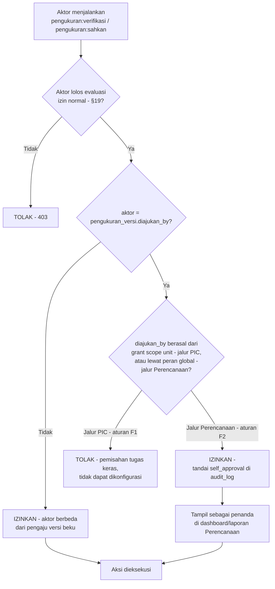

**Alasan pengecualian F2:** bila jalur Perencanaan-mengisi-sendiri turut diblokir sekeras F1, LLDIKTI Wilayah XVI wajib menugaskan minimal dua akun Perencanaan agar pengisian yang terlambat masih dapat disahkan — kondisi yang belum tentu terpenuhi pada Fase Awal. Sebagai gantinya, jalur ini tetap dibuka dengan syarat transparansi: setiap pengesahan diri sendiri oleh Perencanaan wajib tercatat dan terlihat (`self_approval`), bukan disembunyikan.

**Cakupan aturan ini (Q15):** F1/F2 berlaku untuk transisi status `pengukuran` dan `rencana_aksi` (verifikasi dan pengesahan). Keduanya memakai identitas dan jalur pengaju yang dibekukan pada versi pengajuan (`diajukan_by`, `jalur_pengajuan` — Data Model §2.34 untuk rencana aksi), bukan pembuat draft maupun role terkini; self-approval jalur Perencanaan ditandai `self_approval` pada audit.

---

## 21. Alur Pengelolaan Akses, Unit, dan Setelan (Admin/Superadmin/Perencanaan)

### 21.1 Onboarding SSO

```text
Login Keycloak valid
→ create/update users
→ status aktif
→ tanpa role
→ halaman "Menunggu penetapan peran"
→ Admin assign satu dari 5 role
```

Tanpa role = nol permission. Sejak Q38 tidak ada langkah aktivasi; login ulang tidak mengubah status, dan `nonaktif` berarti akun dinonaktifkan.

### 21.2 Assign Peran

- pilihan: Superadmin, Admin, Perencanaan, Pimpinan, Pegawai;
- gate: `pengguna:read` + `akses:update`;
- alasan wajib (Q43 §43.2 butir 4);
- tidak mengubah grant, deny, atau assignment PJ;
- menonaktifkan dan mengaktifkan kembali akun lain dilakukan dari halaman yang sama dengan alasan wajib dan audit; peran dan grant disimpan sehingga pengaktifan kembali memulihkan akses yang sama; akun sendiri dan superadmin aktif terakhir tidak dapat dinonaktifkan; bila pengguna masih menjadi PJ aktif, UI menampilkan peringatan tanpa memblokir (Q38 §38.2).
- penetapan peran tidak dapat menurunkan peran superadmin aktif terakhir, termasuk peran akun sendiri; superadmin `nonaktif` tidak dihitung (Q53).

### 21.3 Grant Unit

- gate: `delegasi:update`;
- pemegang baseline: Perencanaan, Admin, Superadmin;
- hanya 7 permission unit-scoped;
- user/unit harus aktif;
- alasan pemberian grant opsional — kolom tetap `NOT NULL` dan server mengisi alasan baku bila dikosongkan; pencabutan grant tetap wajib alasan (Q43 §43.3 butir 1, §43.2 butir 4; semula alasan wajib pada keduanya);
- create/revoke tidak mengubah role atau PJ.

### 21.4 Explicit Deny

- gate: `akses:update`;
- deny global/per-unit sesuai kontrak;
- deny menang atas allow;
- create/revoke teraudit dengan alasan wajib (Q43 §43.2 butir 4).

### 21.5 Peran & Izin

Halaman **read-only** digerbangi `pengguna:read`. Tidak ada form add/revoke `role_permissions`. Preset role hanya berubah melalui code/seeder/release dengan audit delta.

### 21.6 Logout

- **Keluar** → POST + CSRF → logout Laravel lokal → pesan sesi SSO masih aktif.
- **Keluar dari semua aplikasi (SSO)** → POST terpisah → logout lokal + Keycloak end-session.

## 22. Tabel Peran vs Aksi (Ringkas — Fase Awal)

| Aksi/Kelompok | Superadmin | Admin | Perencanaan | Pimpinan | Pegawai |
|---|:---:|:---:|:---:|:---:|:---:|
| Lihat dashboard | ✓ | ✓ | ✓ | ✓ | ✓ |
| Baca Regulasi / Jenis Berkas / Komponen | ✓ | ✓ | ✓ | ✓ sesuai preset | ✓ |
| Kelola user/unit teknis | ✓ | ✓ sesuai permission | sesuai permission | — | — |
| Assign Peran | ✓ | ✓ bila punya `akses:update` | sesuai permission | — | — |
| Kelola Grant Unit (alasan pemberian opsional, Q43) | ✓ | ✓ | ✓ | — | — |
| Explicit Deny | ✓ | ✓ bila punya `akses:update` | sesuai permission | — | — |
| Ubah preset role via UI | **Tidak ada UI** | **Tidak ada UI** | **Tidak ada UI** | **Tidak ada UI** | **Tidak ada UI** |
| Kerja RA/Kegiatan/Pengukuran per unit | exception/global bila diizinkan | hanya jika grant eksplisit yang sah | global sesuai preset | read-only | **hanya lewat Grant Unit** |
| Setelan Aplikasi: identitas dan preferensi (tanpa setelan unggahan, Q44) | ✓ | ✓ | — | — | — |
| Persyaratan Berkas: substansi, format/ukuran per persyaratan, contoh berkas (Q42, Q44) | ✓ | — | ✓ | — | — |
| Target Renstra dan target PK (`target:update`, Q39) | ✓ | — | ✓ | — | — |
| Penanda indikator dinilai tahunan (`indikator:update`, Q47) | ✓ | — | ✓ | — | — |
| Penetapan/pergantian PJ (tanpa isian alasan, Q43) | ✓ | — | ✓ | — | — |
| Rekomendasi Pimpinan: susun draf (`rekomendasi:tetapkan`, Q51) | break-glass sesuai katalog | — | ✓ | ✓ | — |
| Rekomendasi Pimpinan: setujui atau tulis langsung (Q45, Q51) | break-glass sesuai katalog, bertanda cadangan | — | cadangan bertanda | ✓ | — |
| Buat/unduh Rencana Aksi tahunan dan Laporan Kinerja Triwulan (`laporan:ekspor`, Q48) | ✓ | — | ✓ | ✓ | — |
| Unggah PDF bertanda tangan (`laporan:unggah`, Q48) | ✓ | — | ✓ | — | — |

**Q38–Q51 (13 Oktober 2026):** baris "Setelan Aplikasi" sampai "Unggah PDF bertanda tangan" ditambahkan. Admin tidak lagi mengelola setelan unggahan karena Kebijakan Storage dan halaman Batas Unggahan Berkas dihapus (Q44). Pimpinan kini menyetujui atau menulis Rekomendasi Pimpinan, sedangkan Perencanaan menyusun draf dan menyetujui hanya sebagai cadangan bertanda (Q45, Q51); persetujuan oleh Superadmin juga diberi penanda cadangan (Q51 §51.2 butir 2). `laporan:unggah` adalah permission baru dengan preset Perencanaan dan Superadmin; tidak bertanda sensitif karena unggahan bersifat append-only dan tidak mengubah data, tetapi tetap tercatat di audit (Q48 §48.2 butir 2 dan 4). Status implementasi baris baru: belum.

**PIC operasional tidak menjadi kolom role.** PIC adalah user yang berada dalam konteks penugasan/pekerjaan dan memiliki grant unit + business guard yang diperlukan.

### 22.1 Penanggung Jawab vs Hak Isi

**Kontrak final Q32:**

- PJ dapat menunjuk user aktif dengan role apa pun.
- Assignment PJ tidak memberi permission.
- Jika PJ belum punya hak isi, tampilkan warning dan masukkan ke daftar “PJ aktif tanpa hak isi”.
- Perubahan role tidak mengakhiri assignment PJ.
- Monitoring memakai tujuh izin scoped pada unit indikator (`pengukuran:create/update`, `rencana_aksi:create/update/ajukan`, `kegiatan:create/update`), menampilkan izin tersedia/kurang memakai ACL saat ini. Assignment tidak memberi izin, explicit deny menang, akun nonaktif fail-closed; diagnosis bukan pengganti resolver saat aksi.

**Kontrak dasar histori/resolusi — Plan §4.3–4.4 / Issue #54:** pergantian menambah histori; resolver memilih tanggal mulai terbesar yang <= tanggal acuan, lalu `urutan` penugasan terbesar pada tanggal yang sama. Isian alasan pada penetapan dan pergantian PJ dihapus dari form, sedangkan kolom basis datanya sudah nullable (Q43 §43.3 butir 4; semula pergantian wajib alasan).

**Aturan PJ — Diratifikasi Q34; butir 1 (pergantian di tanggal yang sama) diimplementasikan pada [#70](https://github.com/LLDIKTI-XVI-TEAM/SAKIP/issues/70):**

- **PJ-01/PJ-02:** mutasi bertanggal lampau/mendatang diperbolehkan tanpa mengubah data historis yang sudah dibekukan; pergantian PJ pada tanggal yang sama diperbolehkan dengan tepat satu PJ efektif menurut tanggal efektif lalu urutan penugasan (`urutan`).
- **PJ-03/PJ-04:** no-op ditolak, mantan PJ boleh kembali setelah pergantian nyata, dan assignment mendatang existing dipertahankan.
- **PJ-05:** mutasi pada indikator arsip, Renstra diarsipkan, atau unit nonaktif ditolak dan diaudit; histori tetap terbaca sesuai akses.

Rujukan keputusan: **Q34 §34.1** pada [Keputusan Penyelarasan](SAKIP%20-%20Keputusan%20Penyelarasan.md). Evidence dan dampak per aturan berada pada [matriks provenance ISS-04.01](SAKIP%20-%20User%20Issues.md#status-review-dan-traceability-iss-0401--8-oktober-2026).

## 23. Catatan Penyelarasan Q32 — Klarifikasi Final

Q31 dipertahankan pada dokumen Keputusan Penyelarasan sebagai histori, tetapi kontrak aktif Workflow adalah Q32:

1. role final lima; tidak ada PIC operasional (bukan role);
2. PIC = konteks operasional, bukan role database;
3. PJ = assignment historis dan tidak memberi izin;
4. Grant Unit = hanya 7 permission scoped, gate `delegasi:update`;
5. Role & Permission UI = read-only;
6. onboarding JIT = aktif + tanpa role (Q38);
7. logout lokal default, logout SSO terpisah;
8. TW I–III 2026 = periode lampau oleh Perencanaan; TW IV normal (diperbarui Q46; semula TW I–II lampau dan TW III–IV normal);
9. tidak ada `is_backfill`;
10. IKU 3 = dua input SAKIP + ZI-WBK; IKU 8 = `n/t × 100%` dengan t total publikasi seluruh PTS — keduanya nomor Renstra: pada PK, Rencana Aksi, dan laporan triwulan berkode IKU 1.3 (dinilai tahunan, Q47 §47.1) dan IKU 3.3 (Q50 §50.4).

Semua diagram/flow lama yang menyebut “role PIC” harus ditafsirkan sebagai **PIC operasional** dan tidak boleh menghasilkan row `roles.kode = pic`.

Keputusan Q38–Q51 diselaraskan melalui catatan pada bagian terkait; alur baru Q47 dan Q48 dimuat pada §24 dan §25, sedangkan alur draf dan persetujuan Rekomendasi Pimpinan (Q51) dimuat pada §17.

---

## 24. Alur Indikator Dinilai Tahunan, Periode tanpa Target, dan Realisasi Belum Dapat Diukur

> **Q47 (13 Oktober 2026):** indikator yang nilainya baru tersedia pada periode nilai akhir dapat ditandai **dinilai tahunan**; target Rencana Aksi pada periode sebelum periode nilai akhir boleh kosong (tidak ditargetkan) hanya untuk indikator tersebut; pada periode tanpa target, capaian persen dan status capaian tidak dihitung dan tampilan memakai selisih terhadap target PK; realisasi yang belum tersedia dicatat sebagai "belum dapat diukur". Dikerjakan pada US/ISS-05.07 (penanda dan target periode kosong, tahap 1), US/ISS-07.01 dan 07.03 (realisasi belum dapat diukur, tahap 2), US/ISS-10.01 dan 10.02 (tampilan, tahap 2), serta ISS-15.01 (data awal). Status implementasi: belum.

```
📋 Perencanaan (permission indikator:update)
  1. Menandai indikator sebagai "Dinilai tahunan" di halaman Sasaran & Indikator bila nilainya
     baru tersedia pada periode nilai akhir (periode.is_nilai_akhir) — indikator.dinilai_tahunan
     (boolean, default false); perubahan tercatat audit_log (Q47 §47.1 butir 1)
     → Penanda tidak mengubah tipe_perhitungan, formula, maupun komponen (Q47 §47.1 butir 3)
     → Data awal 2026: hanya IKU 1.3 yang ditandai; IKU 4.1 tidak, karena nilainya tersedia
       tiap triwulan (Q47 §47.1 butir 4)

⚙️ Sistem (aktivasi jadwal, §5)
  2. Penanda dibekukan ke jadwal_snapshot.dinilai_tahunan bersama atribut indikator lain;
     perubahan penanda setelah jadwal aktif mengikuti koreksi snapshot berversi (Q35; Q47 §47.1
     butir 2)

🎯 PIC operasional / 📋 Perencanaan (penyusunan Rencana Aksi, §7)
  3. Indikator dinilai tahunan menurut snapshot: target periode sebelum periode nilai akhir
     BOLEH KOSONG = tidak ditargetkan, berbeda dari target 0 yang tetap sah bila memang
     ditargetkan nol (Q47 §47.2 butir 1 dan 3)
     → Target periode nilai akhir tetap WAJIB dan direkonsiliasi dengan target PK (ADR-0008)
     → Pada versi Rencana Aksi yang dibekukan, periode tanpa target dicatat berstatus
       tidak_ditargetkan, bukan belum_diisi, sehingga laporan dapat membedakannya dari target
       yang belum diisi (Q47 §47.2 butir 5)
  4. Indikator lain: target kumulatif wajib di setiap periode, termasuk indikator berbasis
     jumlah PTS yang diukur tiap triwulan — pengajuan RA dengan target periode kosong DITOLAK
     dengan pesan per periode (Q47 §47.2 butir 2)
  5. Data awal 2026: target TW I–III yang tertulis 0 pada Rencana Aksi 2026 dicatat KOSONG
     untuk semua indikator karena periode itu periode lampau (Q47 §47.2 butir 4, §15)

🎯 PIC operasional / 📋 Perencanaan (pengisian pengukuran, §11–§12)
  6. Bila nilai belum tersedia pada periode tsb, mengajukan pengukuran dengan realisasi
     "Belum dapat diukur": status_perhitungan = belum_dapat_diukur dengan nilai kosong —
     dicatat eksplisit, bukan disimpulkan dari nilai kosong (Q47 §47.4 butir 1)
     → Gerbang kelengkapan komponen dikecualikan
     → Narasi pengukuran (Q45 §45.1) tetap WAJIB dan menjelaskan mengapa nilai belum tersedia
       (Q47 §47.4 butir 2)
     → Pada periode nilai akhir realisasi WAJIB terisi, kecuali tidak dapat dihitung karena
       penyebut nol (Q9; Q47 §47.4 butir 4)

📋 Perencanaan (verifikasi, §12)
  7. Menilai penjelasan "belum dapat diukur"; bila tidak dapat diterima, mengembalikan
     pengukuran dengan alasan wajib (Q47 §47.4 butir 2, Q43 §43.2 butir 1)

⚙️ Sistem (tampilan pengukuran, dashboard, rekap, dan keluaran dokumen resmi §25)
  8. Periode tanpa target: capaian persen dan status capaian (§16) TIDAK dihitung; tampil
     realisasi, target PK, dan selisih terhadap target PK = realisasi − target PK dalam satuan
     indikator, tandanya dibaca menurut arah indikator (Q47 §47.3 butir 1)
     → Dashboard menampilkan "Tanpa target periode", bukan "Belum tercapai" (Q47 §47.3
       butir 3)
     → Status capaian manual tidak dapat ditetapkan untuk pengukuran ini (Q47 §47.3 butir 4)
  9. Periode bertarget: selisih terhadap target PK tampil sebagai informasi tambahan; status
     capaian resmi tetap ditetapkan sesuai §16 (Q47 §47.3 butir 2)
  10. Realisasi belum dapat diukur: tampil "Belum dapat diukur" — bukan capaian 0 dan bukan
      "tidak dapat dihitung" (Q9) (Q47 §47.4 butir 3)
     → Bila periode tanpa target sekaligus belum dapat diukur (mis. IKU 1.3 TW I–II 2026),
       yang tampil "Belum dapat diukur" (Q47 §47.3 butir 3)
     → Status capaian manual tidak dapat ditetapkan untuk pengukuran ini (Q47 §47.3 butir 4)
     → Selisih dan status capaian memakai target PK yang disimpan bernilai penuh; tampilan
       mengikuti desimal_tampilan (Q50 §50.2)
```

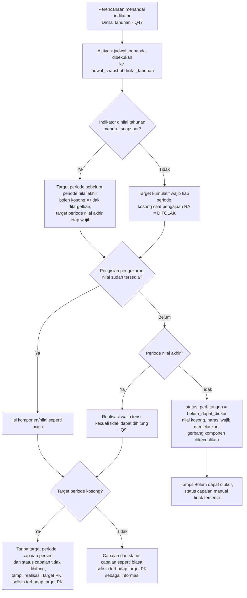

---

## 25. Alur Keluaran Dokumen Resmi: Rencana Aksi Tahunan dan Laporan Kinerja Triwulan

> **Q48 (13 Oktober 2026):** SAKIP menghasilkan dua dokumen gabungan untuk satu lembaga dalam format Excel — **Rencana Aksi tahunan** per jadwal tahunan dan **Laporan Kinerja Triwulan** per periode — lalu PDF yang ditandatangani elektronik di luar aplikasi diunggah kembali sebagai arsip resmi. Dokumen PK tidak dihasilkan SAKIP; PDF PK bertanda tangan tetap menjadi lampiran PK (§3.3). Dikerjakan pada US/ISS-10.05, tahap 2 (Q46 §46.3); bila pembuatan berkas memerlukan pustaka baru, keputusannya dicatat sebagai ADR (Q48 §48.3). Status implementasi: belum.

```
📋 Perencanaan / ✍️ Pimpinan / ⚙️ Superadmin (permission laporan:ekspor)
  1. Membuat Rencana Aksi tahunan untuk satu jadwal tahunan (Excel): sasaran, indikator,
     satuan, target PK, target per periode seluruh indikator, dan daftar kegiatan per indikator
     per periode dari Rencana Aksi versi disahkan (Q48 §48.1 butir 1)
  2. Membuat Laporan Kinerja Triwulan untuk satu periode jadwal (Excel), per indikator: target
     PK, target periode, realisasi, capaian atau selisih terhadap target PK (Q47 §47.3),
     analisis dari narasi pengukuran (Q45 §45.1), dan Rekomendasi Pimpinan yang disetujui
     (Q51); status kegiatan per indikator dimuat sebagai lampiran tambahan (Q48 §48.1 butir 1)
     → Isi diambil dari data yang disahkan; indikator yang RA atau pengukurannya belum disahkan
       tetap tercantum dengan keterangan "belum disahkan" tanpa angka resmi (Q48 §48.1 butir 2)
     → Periode tanpa target dan realisasi belum dapat diukur memakai keterangan yang sama
       dengan dashboard: "Tanpa target periode", "Belum dapat diukur"; bila keduanya berlaku,
       "Belum dapat diukur" (Q47 §47.3 butir 3, §24)
     → Format mengikuti contoh keluaran yang disahkan Perencanaan (Q29); keluaran PDF dari
       aplikasi tetap fase lanjutan (Q48 §48.1 butir 5)
  3. Mengunduh berkas Excel; permintaan tanpa laporan:ekspor DITOLAK 403 — Rencana Aksi
     tahunan memuat nama kegiatan lintas unit sehingga hanya dibuat dan diunduh pemegang
     laporan:ekspor (Q48 §48.1 butir 6, Q49 §49.3)

👤 Di luar aplikasi
  4. Tabel Rincian Output pada Rencana Aksi dan realisasi anggaran per Rincian Output pada
     laporan disusun di luar SAKIP — SAKIP tidak mengelola struktur anggaran DIPA (Q48 §48.1
     butir 3)
  5. Dokumen ditandatangani elektronik di luar aplikasi

📋 Perencanaan / ⚙️ Superadmin (permission laporan:unggah — baru; preset Perencanaan dan
                                 Superadmin; tidak bertanda sensitif, Q48 §48.2 butir 2)
  6. Mengunggah PDF bertanda tangan sebagai arsip resmi; keterangan berkas (mis. "Rencana Aksi
     perubahan") disimpan pada berkas.keterangan (Q48 §48.2 butir 1–2 dan 6):
     a. Rencana Aksi tahunan → berkas berinduk jadwal_tahunan; boleh lebih dari satu berkas,
        mis. Rencana Aksi awal dan perubahan
     b. Laporan Kinerja Triwulan → berkas berinduk jadwal_periode
     c. PK → tetap lewat lampiran PK dengan permission PK (§3.3), dan per versi setelah revisi
        berversi tersedia (Q40)
     → Unggahan tetap dapat dilakukan setelah jadwal tahunan ditutup; penutupan jadwal hanya
       menghentikan mutasi data kinerja (Q48 §48.2 butir 5)
     → Arsip hanya menerima berkas PDF, dengan batas ukuran mengikuti batas teknis Q44 §44.2
       (Q48 §48.2 butir 7)
  7. Salah unggah: berkas TIDAK dihapus; dikoreksi dengan mengunggah berkas pengganti
     (menggantikan_id) beserta alasan_koreksi — append-only, pola Q25 (Q48 §48.2 butir 3
     dan 6)

⚙️ Sistem
  8. Unggahan arsip TIDAK mengubah data, status, maupun snapshot, dan tetap tercatat
     audit_log walau laporan:unggah tidak bertanda sensitif (Q48 §48.2 butir 2 dan 4)
  9. Unduhan arsip mengikuti laporan:ekspor; penyimpanan tetap privat dan unduhan melalui
     route berizin (Q48 §48.2 butir 2, Q44 §44.1 butir 4)
```

```mermaid
flowchart TD
    A[Pemegang laporan:ekspor memilih\njadwal tahunan atau periode jadwal] --> B{Jenis keluaran?}
    B -- Rencana Aksi tahunan --> C[Excel: sasaran, indikator, satuan, target PK,\ntarget per periode, kegiatan per indikator\nper periode dari RA versi disahkan]
    B -- Laporan Kinerja Triwulan --> D[Excel per indikator: target PK, target periode,\nrealisasi, capaian atau selisih terhadap target PK,\nanalisis dari narasi, rekomendasi disetujui,\nlampiran status kegiatan]
    C --> E{Data RA/pengukuran\nindikator sudah disahkan?}
    D --> E
    E -- Belum --> F[Indikator tetap tercantum dengan\nketerangan belum disahkan, tanpa angka resmi]
    E -- Sudah --> G[Angka resmi dicantumkan -\nTanpa target periode / Belum dapat diukur\nsesuai dashboard - Q47]
    F --> H[Unduh Excel]
    G --> H
    H --> I[Di luar aplikasi: Rincian Output disusun\nterpisah, dokumen ditandatangani elektronik]
    I --> J[Perencanaan mengunggah PDF bertanda tangan\nlaporan:unggah - induk jadwal_tahunan / jadwal_periode]
    J --> K{Salah unggah?}
    K -- Ya --> L[Unggah berkas pengganti + alasan_koreksi,\nberkas lama tidak dihapus - append-only]
    K -- Tidak --> M[Arsip tersimpan - data, status, snapshot\ntidak berubah, tercatat audit]
    L --> M
    M --> N[Unggahan tetap dapat dilakukan\nwalau jadwal sudah ditutup - Q48]
```

